| 元数据 | 内容 |
|---|---|
| 标题 | MetaScatter: Enabling High-Order Underwater Backscatter via Piezoelectric Metasurface |
| 作者 | Juan He, Jie Xiong, Wenhao Liu, Xuan Wang, Xiaoyan Wang, Na Chen, Chen Liu, Chunlong Fei, Chao Feng, Xiaojiang Chen |
| 单位 | 西北大学；南洋理工大学；西安电子科技大学；陕西省无源物联网与神经计算重点实验室；陕西省无电池物联网国际联合研究中心 |
| 会议 | ACM MobiCom ’26，2026 年 10 月 26–30 日，美国得克萨斯州奥斯汀 |
| DOI | https://doi.org/10.1145/3795866.3796677 |
| 论文类型 | 系统/方法论文（ACM 会议论文），正文 15 页 |
| 来源 | Zotero 本地 PDF（selectable-text） |

## 章节索引

| 章节 | 内容 |
|---|---|
| 摘要 ABSTRACT | 高阶反向散射、压电超表面与主要实验结果 |
| 1 引言 INTRODUCTION | 水下通信瓶颈、现有路线与本文贡献 |
| 2 水下反向散射背景 BACKGROUND ON UNDERWATER BACKSCATTER | 发射器、水听器与压电标签的基本链路 |
| 3 超表面设计 METASURFACE DESIGN | 设计目标、压电 meta-atom、被动壳层与装配工艺 |
| 4 高阶反向散射通信 HIGH-ORDER BACKSCATTER COMMUNICATION | 波束成形、相位/幅度编码、QAM 码本与多通道 DFE |
| 5 原型实现 PROTOTYPE IMPLEMENTATION | 超表面、控制板、阅读器与实验设置 |
| 6 评估 EVALUATION | 距离、吞吐率、码本优化、通道数、尺寸、干扰与功耗 |
| 7 相关工作 RELATED WORK | 声学反向散射、声学超表面与 RF 超表面调制 |
| 8 讨论 DISCUSSION | 更高阶调制与移动性 |
| 9 结论 CONCLUSION | 系统贡献与部署意义 |
| 10 致谢 ACKNOWLEDGMENTS | 基金与审稿致谢 |
| 附录 APPENDIX | meta-atom 几何参数 |
| 阅读提示 / Critical Reading Notes | 证据链、边界、局限与延伸阅读 |

## 公式索引

- [E001 · Eq. (1)](#E001) — 声学反射系数
- [E002 · Eq. (2)](#E002) — 基础压电 meta-atom 的等效声阻抗
- [E003 · Eq. (3)](#E003) — 带被动壳层的总声阻抗
- [E004 · Eq. (4)](#E004) — 壳层集总参数
- [E005 · Eq. (5)](#E005) — 超表面叠加反射信号
- [E006 · Eq. (6)](#E006) — 入射波相位延迟
- [E007 · Eq. (7)](#E007) — 反射波相位延迟
- [E008 · Eq. (8)](#E008) — 波束成形补偿相位
- [E009 · Eq. (9)](#E009) — 连续相位到 1-bit 相位的量化
- [E010 · Eq. (10)](#E010) — 幅度拟合目标函数
- [E011 · Eq. (11)](#E011) — 多码本主瓣误差最小化
- [E012 · Eq. (12)](#E012) — 主瓣功率变化约束
- [E013 · Eq. (13)](#E013) — QAM 星座码本选择
- [E014 · Eq. (14)](#E014) — RLS 自适应多通道 DFE

## 术语表（Terminology Ledger）

| 原文术语 | 中文 | 说明 |
|---|---|---|
| MetaScatter | MetaScatter | 作者提出的压电超表面水下反向散射系统，保留原名 |
| underwater acoustic backscatter | 水下声学反向散射 | 标签通过改变反射状态把信息写入入射声波 |
| piezoelectric metasurface | 压电超表面 | 由可编程压电 meta-atom 组成的声学反射阵列 |
| meta-atom | meta-atom（超原子） | 超表面的最小可编程单元；正文保留英文以避免与材料“原子”混淆 |
| codebook | 码本 | 每个 meta-atom 相位状态的组合 |
| 1-bit phase control | 1-bit 相位控制 | 每个单元只有 0 与 π 两个相位状态 |
| beamforming | 波束成形 | 通过相位对齐把反射能量集中到目标方向 |
| electromechanical coupling | 机电耦合 | 压电材料中电场与机械振动之间的双向转换 |
| acoustic impedance | 声阻抗 | 决定界面反射强弱；水约为 1.5 Mrayl |
| reflection coefficient | 反射系数 | 反射波与入射波的复振幅比 |
| passive resonator shell | 被动谐振壳层 | 提高与水的阻抗反差、改善反射效率的封装结构 |
| high-order modulation | 高阶调制 | 每个符号携带多于 1 bit 的调制方式 |
| QAM | 正交幅度调制 | 同时利用幅度与相位承载信息 |
| switch rate | 开关速率 | 超表面码本切换频率，直接影响符号率 |
| round-trip range | 往返通信距离 | 发射器到标签再到接收器的链路距离 |
| BER | 误码率 | 越低越好；论文以 10⁻² 作为可用链路阈值 |
| SNR | 信噪比 | 越高越有利于高阶调制 |
| DFE | 判决反馈均衡器 | 抑制多径与码头间串扰 |
| RLS | 递归最小二乘 | 用于自适应更新均衡器抽头 |
| FoV | 视场角 | 超表面可维持有效回反射的角度范围 |

---

## 摘要 ABSTRACT

**Original:** Underwater communication has long been constrained by the fundamental requirement for low power consumption, driven by applications such as environmental monitoring that demand long-term operation. While backscatter technology is promising in terms of power consumption, existing systems rely on simplistic reflection states (e.g., binary modulation), resulting in low data rates and the communication range is also limited.

**中文:** 水下通信长期受制于低功耗这一基本要求，尤其是环境监测等需要长期运行的应用。反向散射技术在功耗方面很有前景，但现有系统依赖过于简单的反射状态（例如二值调制），导致数据率低，通信距离也受到限制。

**Original:** In this paper, we present MetaScatter, the first piezoelectric metasurface that overcomes these limitations by simultaneously enabling high-order backscatter modulation and beamforming. Unlike conventional mechanical metasurface designs, MetaScatter leverages programmable piezoelectric meta-atoms to control the phase of reflected acoustic signals in real time at milliwatt-level power.

**中文:** 本文提出 MetaScatter——首个能够同时实现高阶反向散射调制与波束成形的压电超表面系统，从而突破上述限制。与依赖机械结构的传统超表面不同，MetaScatter 利用可编程压电 meta-atom，在毫瓦级功耗下实时控制反射声波的相位。

**Original:** By decoupling beamforming and modulation via novel metasurface codebook designs, we achieve long-range communication and high-order modulation with significantly reduced complexity. Experimental results in real-world underwater environments show that MetaScatter supports reliable high-order modulation, including 16-QAM, achieving over 500% higher throughput than the state-of-the-art underwater backscatter system [24].

**中文:** 通过新颖的超表面码本设计解耦波束成形与调制，MetaScatter 以显著降低的复杂度同时实现远距离通信和高阶调制。真实水下环境实验表明，系统能够可靠支持 16-QAM 等高阶调制，吞吐率相比当时最先进的水下反向散射系统 [24] 提高 500% 以上。

**Original:** CCS Concepts: • Hardware → Wireless devices; • Networks → Programming interfaces. Keywords: Underwater Communication, High-order Backscatter, Piezoelectric Metasurface.

**中文:** CCS 分类：• 硬件 → 无线设备；• 网络 → 编程接口。关键词：水下通信、高阶反向散射、压电超表面。

## 1 引言 INTRODUCTION

**Original:** Underwater communication plays a crucial role in a variety of applications, including subsea infrastructure inspection and monitoring [30, 36], as well as environmental and ecological assessment [37]. These applications demand long-term monitoring, making energy-efficient communication systems essential for sustaining underwater operations over months or even years without frequent maintenance.

**中文:** 水下通信在海底基础设施巡检与监测 [30, 36]、环境与生态评估 [37] 等应用中至关重要。这些场景要求长期监测，因此通信系统必须足够节能，才能让水下设备持续运行数月甚至数年而无需频繁维护。

**Original:** To achieve this objective, researchers have explored techniques such as duty cycling [6], adaptive power control [26], and reduced communication rates [26] to extend battery life. Nevertheless, these approaches still struggle with relatively high energy consumption. This is because they rely on active signal transmissions, which requires oscillators and amplifiers to generate and amplify signals. These components consume substantial power, shortening the operational lifespan of battery-powered underwater devices.

**中文:** 为实现这一目标，研究者尝试了占空比控制 [6]、自适应功率控制 [26] 和降低通信速率 [26] 等方法来延长电池寿命。然而，这些方法仍难以摆脱较高能耗，因为它们依赖主动信号发射，需要振荡器产生信号、功率放大器放大信号；这些器件消耗大量功率，会缩短电池供电水下设备的工作寿命。

**Original:** To overcome this issue, researchers are turning to backscatter communication technology. Unlike active transmission, backscatter devices communicate by reflecting ambient signals in the environment and thus, enabling ultra-low power operation. In underwater environments, radio waves attenuate rapidly within meters, and light scatters easily, rendering both unsuitable for long-range communication. In contrast, sound waves propagate efficiently through water, making them the preferred medium for long-range underwater communication.

**中文:** 为解决该问题，研究者转向反向散射通信。与主动发射不同，反向散射设备通过反射环境中的既有信号来通信，因此能够以超低功耗运行。在水下环境中，无线电波在数米内便快速衰减，光又容易被散射，二者都不适合远距离通信；相反，声波能在水中高效传播，是远距离水下通信的首选介质。

**Original:** Consequently, acoustic backscatter emerges as a promising approach for enabling energy-efficient, long-range underwater communication. While promising, current acoustic backscatter systems face a key limitation: they can only transmit simple, low-rate messages due to their reliance on basic binary modulation schemes. This limits their ability to support applications that require high throughput, such as transmitting images of endangered coral reefs or videos of underwater infrastructure.

**中文:** 因此，声学反向散射成为实现低功耗、远距离水下通信的一条有前景的路线。但现有声学反向散射系统存在关键限制：它们依赖基础二值调制，只能发送简单、低速的消息，难以支撑濒危珊瑚礁图像或水下基础设施视频等高吞吐率应用。

### 图 1 基于超表面的高阶反向散射通信

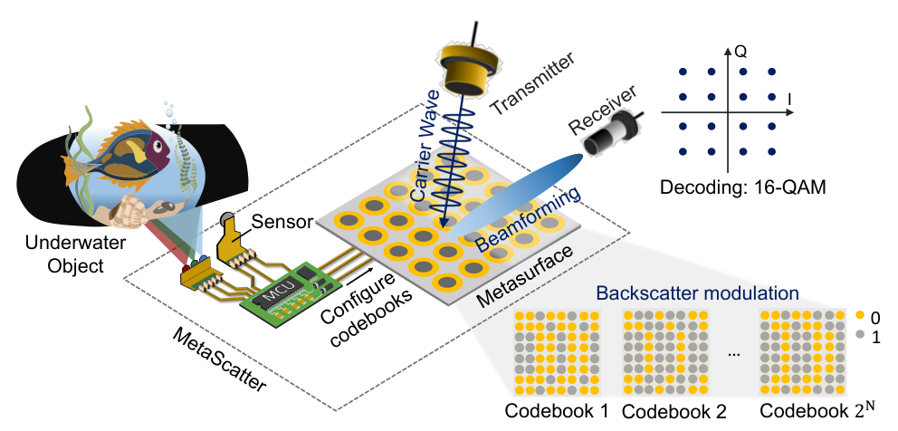

**Original caption:** Figure 1: High-order backscatter communication based on metasurface. A metasurface-based node can enable communication of multiple bits per symbol with high SNR by configuring its codebooks.

**中文图注:** 图 1：基于超表面的高阶反向散射通信。超表面节点通过配置码本，可在较高信噪比下实现每符号多比特通信。

**Reading note:** 需要同时看三件事：水下目标或传感器产生的比特流、超表面在不同码本之间切换所形成的高阶符号，以及接收端恢复出的 I/Q 星座。图中的关键不是“反射更强”，而是“码本让反射同时具备定向增益和多个可区分状态”。

**Original:** To enhance throughput in backscatter communication, researchers have explored three primary approaches: increasing the switch (backscatter) rate [41], adopting Orthogonal Frequency-Division Multiplexing (OFDM)-based schemes [13], and employing high-order modulation such as quadrature amplitude modulation (QAM) [38, 47]. However, the first approach increases energy consumption as it requires oscillators to operate at higher frequencies. The second method requires wide bandwidths, which are incompatible with the narrowband acoustic transducers typically used in underwater systems.

**中文:** 为提高反向散射吞吐率，已有研究主要探索三类方法：提高开关（反向散射）速率 [41]、采用基于正交频分复用（OFDM）的方案 [13]，以及使用正交幅度调制（QAM）等高阶调制 [38, 47]。但第一种方法要求振荡器工作在更高频率，会增加能耗；第二种方法需要宽带，而水下系统常用的声学换能器通常是窄带的，两者并不兼容。

**Original:** Furthermore, for long-distance communication, the underwater acoustic channel is usually in the low-frequency range and has limited bandwidth. These constraints render the first two approaches impractical for real-world underwater deployment. In contrast, high-order backscatter communication [3, 38] increases data rates by encoding more bits per symbol through more reflection states, without requiring additional bandwidth or compromising energy efficiency.

**中文:** 此外，远距离水下声学信道通常位于低频段，可用带宽有限。这些约束使前两种路线难以用于真实水下部署。相比之下，高阶反向散射通信 [3, 38] 通过更多反射状态让每个符号携带更多比特，在不增加带宽、也不牺牲能效的情况下提高数据率。

**Original:** This makes it a promising candidate for underwater backscatter communication. However, implementing higher-order acoustic modulation (e.g., 16-QAM) is non-trivial and faces two key challenges. On one hand, acoustic systems lack tunable capacitors [34] or delay lines [11, 20]—components commonly used in RF systems that can fine-tune reflection states. As a result, current state-of-the-art underwater systems rely on discrete switch arrays, limiting them to just four reflection states (QPSK/4-QAM), achieving only 2 bits per symbol [3].

**中文:** 因此，高阶反向散射很适合水下通信，但实现 16-QAM 等声学高阶调制并不容易，面临两个关键挑战。其一，声学系统缺少射频系统中常用于细调反射状态的可调电容 [34] 或延迟线 [11, 20]。现有先进水下系统只能依赖离散开关阵列，最多产生四种反射状态（QPSK/4-QAM），每符号仅 2 bit [3]。

**Original:** On the other hand, simply increasing the number of reflection states reduces the spacing between symbols, which in turn lowers the signal-to-noise ratio (SNR). This issue is exacerbated by underwater conditions—such as severe multipath interference and large signal attenuation—that degrade SNR even more, ultimately limiting the practical communication range for higher-order modulation schemes.

**中文:** 其二，简单增加反射状态会缩小符号间距，从而降低信噪比（SNR）。水下环境中的严重多径干扰与显著信号衰减会进一步压低 SNR，最终限制高阶调制可达到的实际通信距离。

**Original:** In this paper, we present MetaScatter, a low-power metasurface-based underwater backscatter system that achieves higher-order modulation (e.g., 16-QAM) and accordingly high data rate without compromising the communication range. As shown in Figure 1, MetaScatter utilizes a metasurface combined with a microcontroller as a backscatter tag, where each meta-atom can modulate the phase of the incident signal.

**中文:** 本文提出 MetaScatter——一种低功耗、基于超表面的水下反向散射系统，在不牺牲通信距离的前提下实现 16-QAM 等高阶调制和相应的高数据率。如图 1 所示，MetaScatter 用超表面加微控制器构成反向散射标签，其中每个 meta-atom 都能调制入射信号的相位。

**Original:** Due to the large number of meta-atoms in a metasurface, a metasurface can generate a wide variety of phase combinations (i.e., codebooks) corresponding to different reflection states, facilitating high-order modulation. Furthermore, the metasurface enables directional beamforming to enhance the reflected signal’s SNR and extends the communication range. While promising, realizing such a backscatter system in real life is non-trivial.

**中文:** 由于超表面包含大量 meta-atom，它可以产生丰富的相位组合（即码本），对应多种反射状态，从而支持高阶调制。同时，超表面还能进行定向波束成形，提高反射信号 SNR 并扩大通信距离。虽然思路有吸引力，但把这样的系统真正实现出来并不简单。

**Original:** First, to enable energy-efficient backscatter communication, we need to design a configurable metasurface capable of dynamically adjusting codebooks in real-time (i.e., within microseconds) to modulate the reflected signal, while operating at ultra-low power—ideally in the milliwatt range. Existing acoustic metasurfaces that rely on mechanical actuators [31, 54, 56] are unsuitable for this purpose, as they consume power at the watt level and suffer from latencies on the order of seconds.

**中文:** 首先，低功耗反向散射要求可配置超表面能在微秒尺度实时切换码本，同时自身尽量工作在毫瓦级。依赖机械执行器的现有声学超表面 [31, 54, 56] 不适合该任务：它们功耗可达瓦级，响应延迟约为秒级。

**Original:** To address this, we electrically modulate the impedance—and consequently the signal phase—using piezoelectric material, rather than altering the signal’s propagation path through mechanical structure changes. This is based on a key insight: the reflection coefficient of piezoelectric materials can be adjusted by tuning their electrical impedance through transient electromechanical coupling [3]. This enables signal control to be achieved using low-power electrical switching rather than mechanical adjustments.

**中文:** 为此，作者不通过机械改变声波传播路径，而是利用压电材料电调阻抗，进而改变信号相位。其核心洞见是：借助瞬态机电耦合 [3] 调节压电材料的电阻抗，就能改变反射系数。这样，信号控制可以由低功耗电子开关完成，而不必依赖机械运动。

**Original:** This breakthrough enables microsecond-level phase reconfiguration while consuming only microwatt-level power, effectively overcoming the energy and latency bottlenecks of traditional mechanical approaches. Unfortunately, directly using existing in-air piezoelectric-material-based metasurfaces (PZT-metasurfaces) [40] is ineffective underwater: they exhibit high reflection in air but low reflection in water, resulting in poor signal reflection efficiency. This is because the impedance of water is much higher than that of air, resulting in small impedance difference between the PZT-metasurface and water.

**中文:** 该机制使相位重构达到微秒级，而控制功耗仅为微瓦级，从原理上绕开了机械方案的能量与延迟瓶颈。遗憾的是，直接把面向空气的压电材料超表面（PZT 超表面）[40] 放入水中并不可行：它们在空气中反射很强，在水中反射却很弱。原因是水的声阻抗远高于空气，PZT 超表面与水的阻抗反差太小。

**Original:** Further, the in-air PZT metasurface [40] also fails to achieve effective beamforming underwater. This is due to the strong coupling between meta-atoms in water, which causes the phase response to deviate from the theoretical design. To address these issues, we first incorporate a structurally optimized passive resonator shell with a closed, air-backed design to increase the impedance contrast, thereby significantly improving reflection efficiency (e.g., > 90%). We then mitigate metasurface coupling by replacing the original resin shell with an aluminum one.

**中文:** 此外，空气中的 PZT 超表面 [40] 在水下也无法有效波束成形。水中 meta-atom 间的强耦合使相位响应偏离理论设计。为解决这些问题，作者首先加入结构优化、封闭且空气背衬的被动谐振壳层，以提高阻抗反差，使反射效率显著提升到 90% 以上；随后用铝壳替代原树脂壳层，以抑制 meta-atom 之间的耦合。

**Original:** Second, to enable long-range and high-rate communication, it is essential to identify codebooks that can simultaneously achieve high-order modulation (i.e., more reflection states) while preserving beamforming capability. However, the optimal codebooks for these two objectives differ. One possible approach is to exhaustively search all codebooks; however, for an M × N metasurface, the search space grows exponentially to 2^(M×N), rendering brute-force search computationally infeasible.

**中文:** 其次，要同时获得远距离和高数据率，必须找到既支持高阶调制（更多反射状态）又能保持波束成形能力的码本。然而，这两个目标对应的最优码本并不相同。直接穷举所有码本看似可行，但对 M × N 超表面而言，搜索空间按 2^M × N 指数增长，暴力搜索在计算上不可行。

**Original:** To address this challenge, we propose an algorithm that decouples the two objectives. We begin by identifying codebooks that enable beamforming by adjusting the phase differences among the meta-atoms. Then, by adding the same phase value (e.g., Δφ) to all the meta-atoms, we preserve the relative phase differences—and thus the beamforming pattern—while altering the absolute phase of the superposed reflected signal.

**中文:** 作者因此提出一种解耦两个目标的算法。首先，通过调节 meta-atom 之间的相位差得到具备波束成形能力的码本；随后给所有 meta-atom 叠加同一个相位值（例如 Δφ），这样相对相位差不变，波束形状得以保留，而叠加反射信号的绝对相位发生变化。

**Original:** Varying Δφ yields multiple codebooks with similar beamforming patterns but different signal phases. This approach is grounded in a key observation: beamforming power (i.e., signal amplitude) is governed by the relative phase differences among metasurface meta-atoms, whereas the phase of the reflected signal is determined by their absolute phases. Based on this observation, we can identify codebooks that enable high-order modulation and beamforming simultaneously.

**中文:** 改变 Δφ 就能得到一组波束形状相近、但信号相位不同的码本。其依据是：波束成形功率（即信号幅度）由 meta-atom 的相对相位差决定，而叠加反射信号的相位由它们的绝对相位决定。基于这一区分，系统可以同时找到支持高阶调制与波束成形的码本。

**Original:** In addition to technical challenges, we also encounter practical ones. Unlike RF metasurfaces, whose structures closely resemble microstrip patches or other planar microwave circuits—allowing direct adoption of mature PCB, LTCC, or thin-film fabrication processes—piezoelectric acoustic metasurfaces lack standardized manufacturing procedures. This challenge is further compounded by underwater operation, which requires waterproofing without compromising performance.

**中文:** 除理论问题外，工程实现同样困难。RF 超表面类似微带贴片或其他平面微波电路，可以直接沿用成熟的 PCB、LTCC 或薄膜工艺；压电声学超表面则缺少标准化制造流程。水下运行又增加了防水要求，而且防水层不能牺牲声学性能。

**Original:** To address these challenges, we propose a fabrication workflow that tackles several key issues: (i) minimizing mechanical misalignment and fabrication errors to ensure consistency across meta-atoms; (ii) achieving robust waterproofing without compromising the reflection efficiency or phase response of individual meta-atoms; and (iii) selecting suitable resonator cavity materials to prevent inter-meta-atom coupling, thereby preserving high beamforming gain.

**中文:** 作者提出一套制造流程，重点解决三类问题：(i) 降低机械错位和加工误差，保证 meta-atom 的一致性；(ii) 在不损害单元反射效率与相位响应的前提下实现可靠防水；(iii) 选择合适的谐振腔材料，抑制 meta-atom 间耦合，以维持较高波束成形增益。

**Original:** We implemented a prototype of MetaScatter. The end-to-end system comprises a reader with a transmitter and an 8-element hydrophone receiver array, along with a metasurface-based tag containing 14 × 14 meta-atoms. An MSP430-based low-power control module configures the metasurface and modulates the backscatter signal in real time within 50 μs. To mitigate inter-symbol interference (ISI) arising from time-varying multipath induced by water waves, we adopt a multichannel adaptive decision-feedback equalizer (DFE) for robust decoding.

**中文:** 作者实现了 MetaScatter 原型：端到端系统包括带发射器和 8 元水听器阵列的阅读器，以及含 14 × 14 个 meta-atom 的超表面标签。基于 MSP430 的低功耗控制模块能在 50 μs 内实时配置超表面并调制反向散射信号。为抑制水波引起的时变多径和符号间干扰（ISI），系统采用多通道自适应判决反馈均衡器（DFE）进行鲁棒解码。

**Original:** Comprehensive experiments show that the proposed backscatter system supports high-order modulation schemes, achieving reliable communication with QPSK, 8-QAM, and 16-QAM over round-trip ranges of 60 m, 40 m, and 20 m underwater, respectively. Compared to the state-of-the-art underwater backscatter system [24], which is limited to 3 kbps at 10 m, MetaScatter increases throughput by over 500%.

**中文:** 综合实验表明，该系统支持高阶调制：QPSK、8-QAM、16-QAM 的可靠往返通信距离分别达到 60 m、40 m 和 20 m。与在 10 m 处仅 3 kbps 的当时最先进水下反向散射系统 [24] 相比，MetaScatter 的吞吐率提高 500% 以上。

**Original:** Contributions: We present MetaScatter, the first underwater acoustic backscatter system supporting long-range, high-order modulation via a programmable piezoelectric metasurface. By exploiting the electromechanical coupling of piezoelectric materials, we tune their electrical impedance to adjust acoustic impedance, enabling microsecond-level phase control of the metasurface at milliwatt power. To simultaneously achieve high-order modulation and long-range communication, we decouple beamforming, which depends on relative phase differences, from modulation, which relies on the absolute phase of the superposed signal. This decoupling reduces the codebook search complexity from exponential to linear, enabling real-time operation.

**中文:** 贡献如下：本文提出 MetaScatter——首个通过可编程压电超表面实现远距离高阶调制的水下声学反向散射系统；利用压电材料的机电耦合，通过调节电阻抗改变声阻抗，在毫瓦功耗下实现微秒级相位控制；为同时实现高阶调制与远距离通信，把依赖相对相位差的波束成形与依赖叠加信号绝对相位的调制解耦；该解耦把码本搜索复杂度从指数级降至线性级，使实时运行成为可能。

## 2 水下反向散射背景 BACKGROUND ON UNDERWATER BACKSCATTER

**Original:** A typical underwater backscatter link comprises a projector, a hydrophone receiver, and a passive piezoelectric tag, as shown in Figure 2. The projector emits an acoustic carrier that impinges on the tag. By switching an electronic load (e.g., a transistor) across the piezoelectric transducer, the tag modulates its reflection coefficient, imprinting information onto the backscattered wave. The hydrophone captures these modulated reflections and decodes them.

**中文:** 典型的水下反向散射链路由投影器、水听器接收机和被动压电标签组成，如图 2 所示。投影器发出声载波并照射标签；标签通过切换压电换能器两端的电子负载（例如晶体管）来改变反射系数，把信息写入反向散射波；水听器接收这些调制反射并完成解码。

### 图 2 水下声学反向散射原理

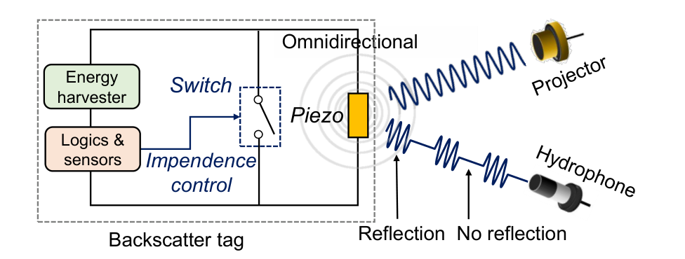

**Original caption:** Figure 2: Principle of underwater acoustic backscatter.

**中文图注:** 图 2：水下声学反向散射原理。

**Reading note:** 图中把标签分成能量采集、逻辑/传感、开关与压电换能器四部分。经典反向散射只利用“反射/不反射”等少数阻抗状态；MetaScatter 的关键扩展是用压电超表面把单次反射变成可编程的相位与方向组合。

**Original:** Most existing underwater backscatter systems [2, 5, 24, 35] adopt binary modulation (e.g., two reflection states corresponding to “0/1”) because it is simple and energy-efficient. However, binary schemes limit the end-to-end throughput. This motivates us to design a system that realizes richer reflection states, which in turn enable higher-order modulations and thereby boost throughput.

**中文:** 现有多数水下反向散射系统 [2, 5, 24, 35] 采用二值调制（例如用两个反射状态表示“0/1”），因为这种方案简单且节能。但二值方案限制了端到端吞吐率，因此作者希望设计一个能产生更丰富反射状态的系统，以支持更高阶调制并提升吞吐率。

## 3 超表面设计 METASURFACE DESIGN

**Original:** This section presents our metasurface design goals, phase-shifting meta-atom design with high reflection efficiency, and underwater-ready assembly.

**中文:** 本节介绍超表面的设计目标、兼具相位调控与高反射效率的 meta-atom 设计，以及面向水下运行的装配方案。

### 3.1 设计目标（Design Goals）

**Original:** To achieve a high-rate backscatter communication system, we have the following design goals for the metasurface design: (1) Real-Time Reconfigurability. The metasurface must dynamically adjust its properties in real-time (e.g., within μs) to modulate the reflected signal phase, supporting high-rate backscatter communication. (2) High Reflection Coefficient. Each meta-atom must exhibit high reflection efficiency to ensure a high SNR. (3) Low Power Consumption. For long-term operation, the metasurface must consume minimal power, ideally within the milliwatt range.

**中文:** 为实现高速反向散射通信，超表面有三个设计目标：(1) 实时可重构：必须在微秒级动态调整属性，以调制反射信号相位并支撑高速反向散射；(2) 高反射系数：每个 meta-atom 都应具有高反射效率，以维持较高 SNR；(3) 低功耗：为长期运行，超表面功耗应尽可能低，理想情况下处于毫瓦级。

### 3.2 meta-atom 设计（Meta-atom Design）

#### 3.2.1 具有相位调控能力的 meta-atom（Designing Meta-atom with Phase Shifting Capability）

**Original:** To realize acoustic meta-atoms with configurable phase-shifting, prior works mainly employed mechanical structures [31, 54, 56], where phase control is achieved by physically altering the propagation path of the meta-atom. While effective, this approach is fundamentally limited in speed and energy efficiency, as it typically relies on stepper motors that are inherently slow and power-hungry.

**中文:** 以往要实现可配置相移的声学 meta-atom，主要采用机械结构 [31, 54, 56]，通过物理改变传播路径来调相。该方案虽然有效，却受限于速度与能效，因为它通常依赖步进电机，而步进电机本身速度慢、功耗高。

**Original:** To overcome these limitations, we use a piezoelectric-material-based structure instead of a mechanically tuned one. Their intrinsic electromechanical coupling enables reflection properties to be jointly determined by material characteristics (e.g., density) and the external electrical load impedance. By adjusting the load impedance, both vibration amplitude and phase can be modulated, enabling real-time meta-atom reconfiguration.

**中文:** 为突破这些限制，作者使用压电材料结构替代机械调谐结构。压电材料固有的机电耦合使反射特性同时由材料属性（例如密度）和外部电阻抗决定；调节负载阻抗即可改变振动幅度与相位，从而实时重构 meta-atom。

**Original:** Based on this principle, we design a copper-backed piezoelectric meta-atom (Figure 3a). This simple two-layer structure—comprising a circular piezoelectric plate (diameter d1, thickness h1) atop a circular copper sheet (diameter d2, thickness h2)—facilitates fabrication and integration while ensuring effective phase control.

**中文:** 基于该原理，作者设计了铜背衬压电 meta-atom（图 3a）。这一简单的双层结构由位于圆形铜片（直径 d_2、厚度 h_2）上方的圆形压电板（直径 d_1、厚度 h_1）组成，便于制造和集成，同时能实现有效相位控制。

### 图 3 铜背衬压电结构基础设计

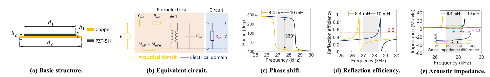

**Original caption:** Figure 3: Basic copper-backed piezoelectric design.

**中文图注:** 图 3：基础铜背衬压电设计。

**Reading note:** (a) 看压电板与铜片的两层几何，(b) 看电气域与声学域之间由变压器比 φ:1 连接的等效电路，(c)(d) 看不同负载电感是否既能产生接近 2π 的相移又能保持反射效率，(e) 暴露原设计的根本问题：与水的声阻抗差太小。

**Original:** When an acoustic wave impinges on the meta-atom, the reflected signal is characterized by the complex reflection coefficient Γ. Γ describes how much of a wave is reflected by the impedance discontinuity between the transmission medium (i.e., water vs. meta-atom surface). Mathematically, it can be expressed as:

**中文:** 当声波入射到 meta-atom 上时，反射信号用复反射系数 Γ 描述。Γ 表示水与 meta-atom 表面之间的阻抗突变使多少声波被反射。数学上可写为：

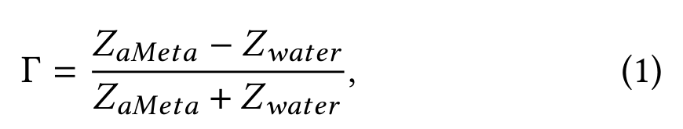

**中文说明：** Z_aMeta 是 meta-atom 的声阻抗，Z_water = ρ_waterc_water 是水的声阻抗；文中取 ρ_water = 1000 kg/m³、c_water = 1500 m/s。反射强弱由两者差值相对大小决定。

**Original:** Since Z_water is constant, controlling the reflection coefficient requires modifying the acoustic impedance of the meta-atom. To this end, we establish an equivalent circuit model of the basic meta-atom, as shown in Figure 3b. The lumped elements represent its electrical properties (static capacitance C_eB), acoustic vibration properties (copper mass M_aCu, piezoelectric-plate mass M_aP, equivalent stiffness C_aP, and mechanical loss R_aP), and piezoelectric coupling properties (transformer ratio φ).

**中文:** 由于 Z_water 基本恒定，要改变反射系数就必须调节 meta-atom 的声阻抗。为此，作者建立基础 meta-atom 的等效电路（图 3b）。集总元件分别表示电学属性（静态电容 C_eB）、声学振动属性（铜质量 M_aCu、压电板质量 M_aP、等效刚度 C_aP 与机械损耗 R_aP）以及压电耦合属性（变压器比 φ）。

**Original:** By connecting an external electrical load Z_eL, the piezoelectric transformer converts impedance between the acoustic and electrical domains, producing an equivalent acoustic impedance Z_aL = φ²Z_eL. The overall acoustic impedance of the meta-atom Z_aMeta can then be derived as:

**中文:** 接入外部电阻抗 Z_eL 后，压电变压器在声学域与电学域之间转换阻抗，形成等效声阻抗 Z_aL = φ²Z_eL。于是基础 meta-atom 的总声阻抗可表示为：

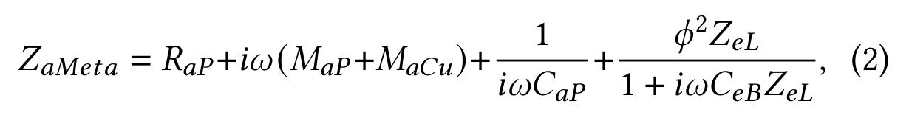

**中文说明：** 前三项描述压电板与铜片的机械振动，最后一项是外部负载经机电耦合映射到声学域的贡献。由此，负载不是“耗能元件”，而是调谐声学反射状态的旋钮。

**Original:** where ω = 2πf_r, and f_r is the resonant frequency of the structure. The parameters are defined as M_aCu = 4ρ_cu h2/(πd2²), M_aP = 4ρ_p h1/(πd1²), C_aP = s^E h1/(πd1²), and R_aP = 2ξ√((M_aCu+M_aP)/C_aP), where ξ is the damping factor, ρ_cu and ρ_p are the densities of copper and PZT-5H, respectively.

**中文:** 式中 ω = 2π f_r，f_r 为结构谐振频率；各参数定义为 M_aCu = 4ρ_cuh_2 / (π d_2²)、M_aP = 4ρ_ph_1 / (π d_1²)、C_aP = s^Eh_1 / (π d_1²)、R_aP = 2ξ(M_aCu + M_aP) / C_aP。ξ 为阻尼因子，ρ_cu 与 ρ_p 分别为铜和 PZT-5H 的密度。

**Original:** From Equation (2), the acoustic impedance of the meta-atom is determined by three factors: geometry (e.g., diameters d1 and d2, thicknesses h1 and h2), material properties (e.g., densities ρ_p and ρ_cu of the piezoelectric and copper plates, and piezoelectric elastic compliance constant s^E), and the external electrical load Z_eL. Once fabricated, the geometry and material properties are fixed and immutable. In contrast, through electromechanical coupling, the acoustic impedance can be dynamically tuned by adjusting the external electrical load Z_eL. This tuning directly controls the reflection coefficient Γ and the signal phase.

**中文:** 由式 (2) 可见，meta-atom 的声阻抗由三类因素决定：几何尺寸（d_1,d_2,h_1,h_2）、材料属性（压电板与铜板密度、压电弹性柔顺常数 s^E）以及外部电阻抗 Z_eL。器件制成后，几何与材料属性固定不变；但通过机电耦合，可以动态调节 Z_eL，进而直接控制反射系数 Γ 和信号相位。

**Original:** To validate this principle, we use COMSOL [1], a finite-element multiphysics simulator, to analyze the phase shift across different frequencies under varying inductances. Specifically, changing the inductor L_eL modifies the electrical load impedance as Z_eL = iωL_eL. As shown in Figure 3c, the results confirm that adjusting L_eL produces a full 2π phase shift, verifying the feasibility of impedance-based phase control.

**中文:** 作者用有限元多物理场仿真器 COMSOL [1] 分析不同电感下相位随频率的变化。具体而言，改变电感 L_eL 会改变负载阻抗 Z_eL = iω L_eL。图 3c 表明，调节 L_eL 可获得完整的 2π 相移，验证了阻抗调相的可行性。

**Original:** Low-power 1-bit Phase Shift Design. We adopt a 1-bit phase design despite the theoretical continuous 0–2π tuning requirement. Continuous-tuning components commonly used in RF metasurfaces (e.g., varactor diodes and tunable inductors) are acoustically incompatible, as their tunable inductance and capacitance are orders of magnitude smaller than the values required for acoustic metasurfaces. While multi-state control circuits could be employed, they significantly increase complexity and power consumption. Instead, we implement a simple solution that toggles between two inductors via a low-power switch, enabling reliable 0/π phase control with minimal hardware and energy overhead.

**中文:** 低功耗 1-bit 相移设计：尽管理论上需要连续 0–2π 调谐，作者仍选择 1-bit 相位设计。射频超表面常用的连续调谐器件（如变容二极管、可调电感）无法直接用于声学系统，因为其可调电感/电容比声学超表面所需值小数个数量级。多状态控制电路虽然可行，却会显著增加复杂度与功耗。作者因此用低功耗开关在两个电感之间切换，以最少的硬件和能量开销实现可靠的 0 / π 相位控制。

#### 3.2.2 高反射效率 meta-atom 设计（Designing Meta-atom with High Reflection Efficiency）

**Original:** Although the basic copper-backed piezoelectric structure enables phase control, it suffers from low reflection efficiency (≤50%) in the target frequency range when operated in underwater environments, as shown in Figure 3d. This limitation arises from a small acoustic impedance difference between water and the meta-atom (Figure 3e), resulting in reduced reflection of the incident acoustic power.

**中文:** 基础铜背衬压电结构虽然能调相，但在水下目标频段内反射效率不足 50%（图 3d）。原因是水与 meta-atom 的声阻抗差太小（图 3e），导致大部分入射声功率没有被有效反射。

**Original:** To overcome this limitation, we introduce a passive shell to increase the effective acoustic impedance of the meta-atom. By coupling the piezoelectric element with a high-impedance shell in series, the overall impedance difference between water and the meta-atom is enlarged, improving reflection efficiency. The structure and its lumped-element equivalent circuit are shown in Figure 4a and Figure 4b. The total acoustic impedance of the new design is:

**中文:** 为提高反射效率，作者加入被动壳层来提高有效声阻抗。将压电元件与高声阻抗壳层串联后，水与 meta-atom 的整体阻抗反差增大，反射效率随之提升。新结构与集总参数等效电路见图 4a、4b，总声阻抗为：

### 图 4 MetaScatter 的 meta-atom 设计

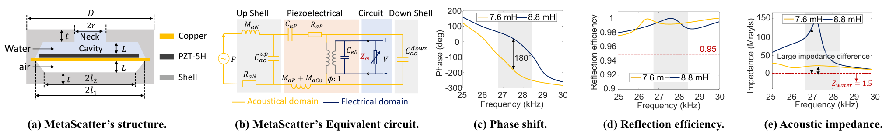

**Original caption:** Figure 4: MetaScatter’s meta-atom design.

**中文图注:** 图 4：MetaScatter 的 meta-atom 设计。

**Reading note:** 与图 3 对比，重点是新增的上下壳层、颈部与腔体。等效电路中的 R_aN、M_aN 与 C_aC 对应壳层和空气腔对声阻抗的重塑；图 4c–4e 则分别检验相移、反射效率与目标频段内的阻抗匹配。

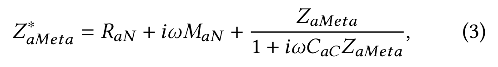

**中文说明：** Z_aMeta^* 是加入被动壳层后的总声阻抗。基础压电结构 Z_aMeta 仍可电调，因此壳层负责提高阻抗反差，压电部分负责保持可重构性。

**Original:** where the lumped parameters of the passive shell are defined as follows:

**中文:** 其中，被动壳层的集总参数定义为：

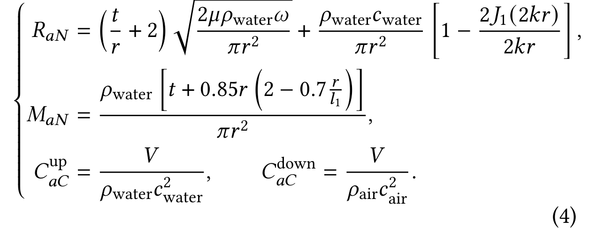

**中文说明：** 空气密度与声速分别为 ρ_air、c_air；J_1 是一阶第一类贝塞尔函数，μ 是动力黏度；V 是腔体体积，t,r,l_1 是图 4a 中的几何参数；k = 2π f_r^new / c_water，f_r^new 是新结构谐振频率。

**Original:** The air density and the sound speed are ρ_air and c_air, respectively. The parameter J1 is the Bessel function of the first kind, and μ is the dynamic viscosity coefficient. The parameter V is the cavity volume, while t, r, and l1 are geometric parameters as illustrated in Figure 4a. We have k = 2πf_r^new/c_water, where f_r^new is the resonant frequency of the new structure. This resonant frequency is determined by both the shell and the basic copper-backed piezoelectric structure.

**中文:** 上述参数中，J_1 的引入说明壳层附近的声场并不是理想平面波；V 则体现封闭空气腔的声顺。新结构的谐振频率同时由壳层几何与基础铜背衬压电结构决定，因此不能单独优化二者中的任何一个。

**Original:** Equations (3) and (4) highlight that the effective acoustic impedance depends on both the shell geometry and the underlying piezo structure Z_aMeta. Thus, we carefully tune the shell’s geometric parameters while adjusting the electrical load of the piezo to preserve the 180° phase shift. The geometry is optimized through enumeration in COMSOL. Results (Figure 4c–4d) confirm that the optimized meta-atom achieves both high reflection efficiency (≥90%) and 180° phase shift in the working band.

**中文:** 式 (3)、(4) 表明，有效声阻抗同时取决于壳层几何与底层压电结构 Z_aMeta。作者因此在调节压电负载以保持 180° 相移的同时，对壳层几何做枚举优化。图 4c–4d 显示，优化后的 meta-atom 在工作频段内同时获得不低于 90% 的反射效率和 180° 相移。

### 图 5 可制造 meta-atom 的结构

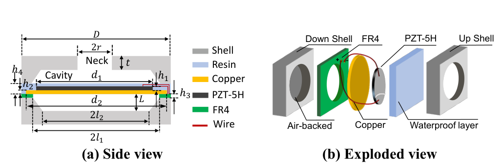

**Original caption:** Figure 5: Design of fabricable meta-atoms.

**中文图注:** 图 5：可制造 meta-atom 的结构。

**Reading note:** 这幅图把“物理设计”转成“可加工结构”：上层壳、下层壳、空气背衬、FR4、防水层、铜、PZT-5H 与导线都在爆炸图中分开标注。后续装配流程中的多层键合、封装和腔体设计都以此为基础。

### 图 6 不同壳层材料的影响

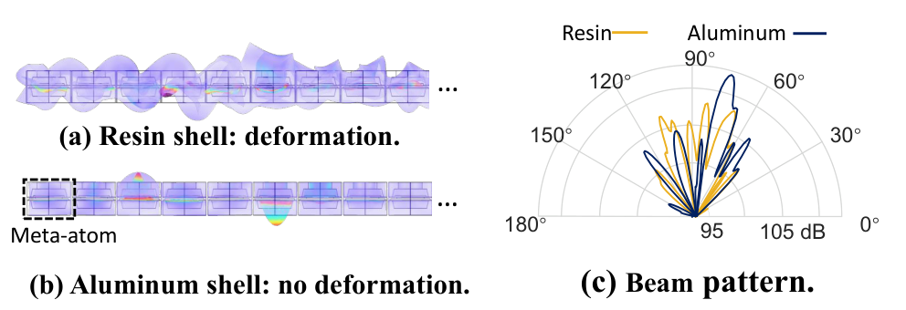

**Original caption:** Figure 6: Impact of different shell materials.

**中文图注:** 图 6：不同壳层材料的影响。

**Reading note:** 树脂壳在水中发生明显形变，导致声能泄漏和相位失真；铝壳保持结构稳定，波束方向图更集中。作者最终选择铝，不只是为了机械强度，而是因为它较低的形变与高声阻抗有利于保持波束成形。

### 3.3 超表面装配（Metasurface Assembly）

**Original:** We now detail the integration of the underwater metasurface, beginning with the electrical connection, waterproofing strategy, and shell material selection, followed by a description of the fabrication workflow.

**中文:** 下面详细介绍水下超表面的集成，包括电气连接、防水策略和壳层材料选择，随后说明制造流程。

### 图 7 压电超表面制造流程

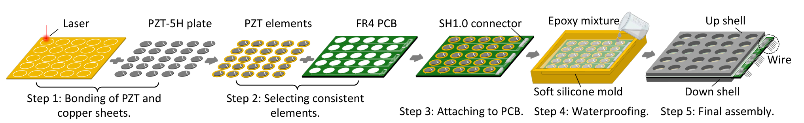

**Original caption:** Figure 7: Workflow of piezoelectric metasurface fabrication.

**中文图注:** 图 7：压电超表面制造流程。

**Reading note:** 五个步骤依次是 PZT 与铜片键合、元件一致性筛选、贴装到 FR4、硅胶模具灌封与真空脱泡、上下铝壳最终装配。真正容易被忽略的是第 2 步：谐振频率和阻抗偏差超过 10% 的单元会被剔除，否则整块超表面的相位一致性会被破坏。

**Original:** Electrical Connection. We use an FR4 substrate to route signals between meta-atoms and the external control circuitry. To minimize the FR4’s impact on the intrinsic resonance, a cavity is carved within the substrate (Figure 7). The electrodes of the piezoelectric plates are wire-bonded to FR4 bonding pads, which are then connected to a unified PCB trace layout. This ensures consistent electrical interfacing across the entire metasurface.

**中文:** 电气连接：作者用 FR4 基板在 meta-atom 与外部控制电路之间布线。为减小 FR4 对本征谐振的影响，基板中挖出腔体（图 7）。压电板电极通过引线键合连接到 FR4 焊盘，再汇入统一 PCB 走线布局，以保证整块超表面电气接口一致。

**Original:** Waterproofing. Waterproofing is essential to prevent electrode short-circuiting in water. A simple rigid coating is not a viable solution as high-impedance materials reflect sound and suppress modulation. To retain tunability, the coating material must instead have an acoustic impedance close to that of water. Guided by this principle, we select a low-cost GOET-1080 epoxy mixture [10]. The epoxy coating, however, also alters the resonant frequency of the metasurface. To mitigate this effect, we jointly optimize the thickness of the epoxy layer and the FR4 substrate to preserve the desired resonance. In the final design (Figure 5), a 3 mm epoxy layer is used, and we provide the details of the geometry parameters of MetaScatter’s structure in Appendix A.

**中文:** 防水：防水是避免电极在水中短路的前提。简单硬质涂层不可行，因为高声阻抗材料会反射声波并削弱调制；为保留可调性，涂层声阻抗应接近水。据此，作者选用低成本 GOET-1080 环氧混合材料 [10]。但环氧层也会改变超表面谐振频率，因此需要联合优化环氧层厚度与 FR4 基板。最终设计（图 5）使用 3 mm 环氧层，几何参数列于附录 A。

**Original:** Shell Material Selection. Since all meta-atoms are coupled through a common shell (Section 3.2.2), the shell material plays a critical role in determining the overall performance. Materials widely used in air, such as resin or PLA [40], deform significantly underwater (Figure 6a). The resin’s low acoustic impedance—stemming from its lower density and sound velocity—causes acoustic energy to leak into the shell. The resulting shell vibrations impose additional forces on the meta-atoms, shifting their resonant frequency and ultimately distorting the reflection phase.

**中文:** 壳层材料选择：由于所有 meta-atom 通过公共壳层耦合（3.2.2 节），壳层材料对整体性能至关重要。空气中常用的树脂或 PLA [40] 在水中会明显形变（图 6a）；树脂密度和声速较低，声阻抗也低，声能容易泄漏进壳层，壳层振动又会对 meta-atom 施加额外作用力，使谐振频率偏移并扭曲反射相位。

**Original:** Consequently, the metasurface fails to maintain effective beamforming in the target frequency band (Figure 6c). In contrast, metals such as aluminum or steel offer a much larger acoustic impedance difference; we therefore select aluminum as the final shell material. As shown in Figures 6b and 6c, the aluminum shell suppresses structural deformation and enables accurate, high-gain beamforming.

**中文:** 因此，树脂壳超表面在目标频段内无法维持有效波束成形（图 6c）。铝、钢等金属能提供更大的声阻抗反差，作者最终选择铝作为壳层材料。图 6b、6c 表明，铝壳能抑制结构形变并实现准确、高增益的波束成形。

**Original:** Fabrication Workflow. We fabricate a piezoelectric acoustic metasurface following the procedure shown in Figure 7. Step 1: Bonding the piezoelectric material with the copper sheets. PZT-5H plates [7] are bonded to copper discs using epoxy adhesive [10]. Step 2: Selecting consistent elements. To ensure uniformity, elements are screened using a WK6500B impedance analyzer [50], and only those with resonant frequencies and impedances within 10% of the theoretical values are retained.

**中文:** 制造流程：压电声学超表面按图 7 完成。步骤 1：用环氧胶 [10] 将 PZT-5H 板 [7] 键合到铜片。步骤 2：使用 WK6500B 阻抗分析仪 [50] 筛选单元，仅保留谐振频率和阻抗在理论值 10% 以内的元件，以确保一致性。

**Original:** Step 3: Attaching to PCB. The copper-backed PZT elements are bonded onto the FR4 PCB, with electrical connections established through soldering and wire bonding. Step 4: Waterproofing. The assembly is encapsulated in a silicone mold and filled with degassed epoxy. To avoid bubble-induced reflections, the epoxy is vacuum degassed, syringe-extracted to remove residual bubbles, and cured for 24 h before CNC polishing (±0.1 mm) to ensure surface flatness.

**中文:** 步骤 3：将铜背衬 PZT 元件粘贴到 FR4 PCB，并通过焊接和引线键合完成电气连接。步骤 4：把组件放入硅胶模具，灌注脱泡环氧。为避免气泡造成声反射，环氧先真空脱泡，再用注射器抽取以去除残余气泡，固化 24 h 后进行 CNC 抛光（公差 ±0.1 mm），保证表面平整。

**Original:** Step 5: Final assembly. Upper and lower shells are CNC-machined from aluminum and bonded to the structure with high-strength epoxy. External leads exit via an SH1.0 connector, which is potted with epoxy for waterproof sealing.

**中文:** 步骤 5：上下铝壳经 CNC 加工后用高强度环氧粘接到底座结构；外部引线通过 SH1.0 连接器引出，并用环氧灌封实现防水密封。

## 4 高阶反向散射通信 HIGH-ORDER BACKSCATTER COMMUNICATION

**Original:** In this section, we aim to achieve long-range high-order backscatter modulation using metasurfaces. First, we select optimal reflection states to enable high-order modulation with strong SNR, and then present the corresponding decoding pipeline.

**中文:** 本节目标是用超表面实现远距离高阶反向散射调制。作者先选择最优反射状态，使高阶调制仍具有足够高的 SNR，再介绍相应的解码流水线。

### 图 8 超表面反射信号模型

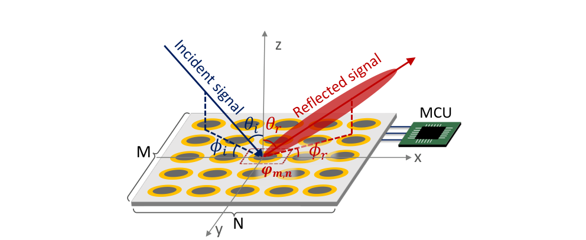

**Original caption:** Figure 8: Metasurface reflection signal model.

**中文图注:** 图 8：超表面反射信号模型。

**Reading note:** 模型中，入射方向为 (θ_i,φ_i)，目标反射方向为 (θ_r,φ_r)，每个 meta-atom 的编码相位为 φ_m,n。接收端看到的是所有单元反射向量的相干叠加，因此同时受绝对相位和相对相位差影响。

### 4.1 高阶调制（High-order Modulation）

**Original:** To enable high-order backscatter modulation, we configure the metasurface’s codebook to fine-tune the reflected signal’s amplitude and phase. As shown in Figure 8, the reflected signal towards the azimuth angle θ_r and elevation angle φ_r can be calculated as:

**中文:** 为实现高阶反向散射调制，需要配置超表面码本来细调反射信号的幅度与相位。如图 8 所示，指向方位角 θ_r、俯仰角 φ_r 的反射信号可计算为：

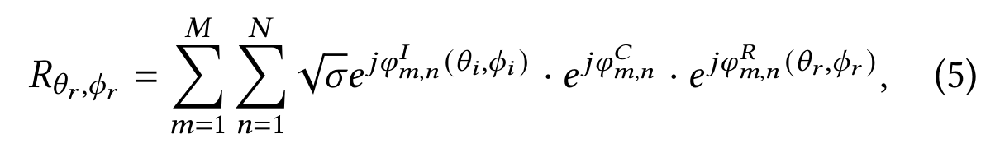

**中文说明：** √(σ) 是单元反射幅度，φ^I_m,n、φ^C_m,n、φ^R_m,n 分别是入射路径相位、编码相位和出射路径相位。改变码本 Φ = {φ^C_m,n} 就能改变整个超表面的叠加反射状态。

**Original:** where √σ is the amplitude. The term e^{jφ^I_{m,n}(θ_i,φ_i)} represents the phase delay introduced by the incident wave from direction (θ_i,φ_i), and e^{jφ^R_{m,n}(θ_r,φ_r)} represents the phase delay introduced by the reflected wave. Equation (5) shows that configuring the phase combination of each meta-atom (i.e., codebook Φ = {φ^C_1,1, φ^C_1,2, ..., φ^C_m,n}) can alter the reflection state. For example, a M × N metasurface can yield 2^(M×N) reflection states.

**中文:** 其中 √(σ) 为幅度，e^jφ^I_m,n(θ_i,φ_i) 表示入射波从 (θ_i,φ_i) 方向到达单元时引入的相位延迟，e^jφ^R_m,n(θ_r,φ_r) 表示反射波前往目标方向时引入的相位延迟。式 (5) 说明，配置所有 meta-atom 的相位组合（即码本 ）就能改变反射状态；对 M × N 超表面，理论上可产生 2^M × N 种状态。

**Original:** For long-range, high-order modulation (e.g., QAM), codebooks must simultaneously: (1) provide beamforming to amplify signals, and (2) ensure sufficient state separation for symbol discrimination. Achieving both, however, requires precise phase control at each meta-atom, and the optimal codebooks for the two objectives differ. Given the vast search space (2^(M×N)), brute-force enumeration is infeasible. We therefore propose an algorithm that decouples the two objectives, efficiently identifying codebooks by modulating states along the beamforming direction.

**中文:** 对远距离高阶调制（例如 QAM），码本必须同时做到：(1) 通过波束成形放大信号；(2) 保证不同状态间有足够间距，便于判别符号。然而，这两个目标的最优码本不同，且搜索空间高达 2^M × N，穷举不可行。作者因此提出算法，通过在波束成形方向上调制状态来解耦两个目标，并高效找到码本。

#### 4.1.1 波束成形（Beamforming）

**Original:** To realize beamforming, the reflected signals from all meta-atoms must be phase-aligned toward the desired direction. As shown in Figure 8, let the angles of the incident wave and desired reflection be (θ_i,φ_i) and (θ_r,φ_r), respectively. The phase delay of the incident wave at the (m,n)th meta-atom is:

**中文:** 要实现波束成形，所有 meta-atom 的反射信号必须在目标方向上相位对齐。设入射波与期望反射方向分别为 (θ_i,φ_i) 和 (θ_r,φ_r)。第 (m,n) 个 meta-atom 处的入射相位延迟为：

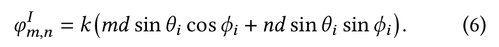

**中文说明：** d 为相邻 meta-atom 间距，k = 2π / λ。该式把入射方向投影到阵列的 x、y 坐标上，得到每个单元相对于参考点的路径相位。

**Original:** To align all paths constructively in the direction (θ_r,φ_r), the phase delay of the outgoing reflected wave should be:

**中文:** 为使所有路径在 (θ_r,φ_r) 方向上建设性叠加，出射反射波的相位延迟应为：

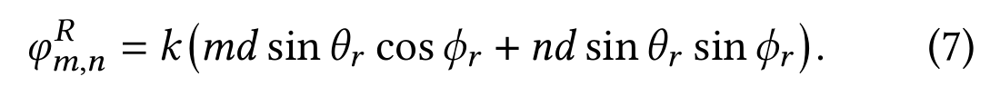

**中文说明：** 式 (7) 与式 (6) 形式相同，只是把入射角换成目标反射角。二者的符号和差值决定了每个单元需要补偿多少相位。

**Original:** Therefore, the (m,n)th meta-atom must apply a compensation phase of

**中文:** 因此，第 (m,n) 个 meta-atom 需要施加的补偿相位为：

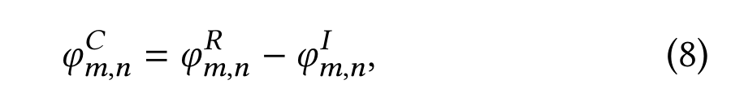

**中文说明：** 由式 (8) 计算出的连续相位集合 Φ^C 构成理想波束成形码本；但实际硬件每个单元只有 0 与 π 两种状态，因此还需要量化。

**Original:** where k = 2π/λ and λ is the wavelength of the incident signal. The set Φ^C = {φ^C_1,1, φ^C_1,2, ..., φ^C_M,N} thus constitutes the beamforming codebook.

**中文:** 其中 k = 2π / λ，λ 是入射信号波长；集合 Φ^C = {φ^C_1,1, φ^C_1,2, …, φ^C_M,N} 构成波束成形码本。

**Original:** According to Equation 8, the ideal beamforming codebook is a set of continuous phase shifts. However, MetaScatter’s metasurface is a 1-bit design with two phase states: 0 and π. To quantize continuous phase compensation into 1-bit phase states, we use the following rule [15]:

**中文:** 式 (8) 给出的理想码本是连续相移，但 MetaScatter 超表面是只有 0 与 π 两种状态的 1-bit 设计。作者采用如下规则 [15] 把连续相位量化到 1-bit：

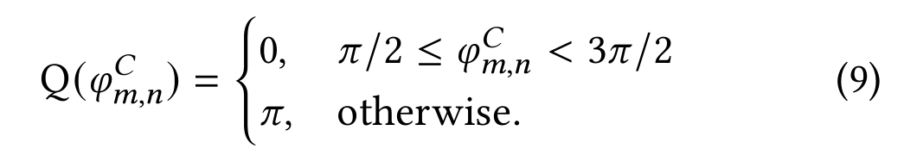

**中文说明：** 量化会引入相位误差并降低波束增益，但只要阵列足够大，误差的影响会趋于统计稳定。图 9 正是在量化这个代价。

### 图 9 连续与 1-bit 超表面的性能差距

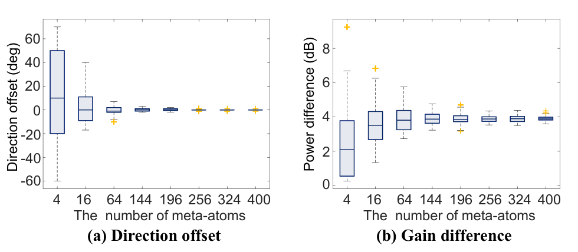

**Original caption:** Figure 9: Performance gap between continuous and 1-bit metasurface in terms of beamforming direction accuracy and power gain.

**中文图注:** 图 9：连续超表面与 1-bit 超表面在波束方向精度和功率增益方面的性能差距。

**Reading note:** 横轴是 meta-atom 数量，左图是方向偏差，右图是功率差。规模越大，方向误差越接近零，功率差稳定在约 3–4 dB。这解释了为什么作者宁愿使用简单的 1-bit 硬件，也不追求昂贵的连续调相。

**Original:** Phase quantization brings phase error and inevitably degrades the beamforming performance. To investigate this impact, we analyze the performance gap between continuous and 1-bit metasurfaces in terms of power gain and beamforming direction accuracy. Figure 9 shows that as the number of meta-atoms in the metasurface increases, the direction offset decreases and eventually approaches zero. The difference in power gain stabilizes at 3–4 dB.

**中文:** 相位量化必然带来误差并降低波束成形性能。作者比较了连续与 1-bit 超表面在功率增益和波束方向精度上的差距。图 9 显示，随着 meta-atom 数量增加，方向偏差逐渐减小并最终趋近于零，功率增益差稳定在 3–4 dB。

**Original:** To summarize, even with just a 1-bit state change (i.e., two states), a metasurface with a large number of meta-atoms (e.g., exceeding 144 meta-atoms) can achieve comparable beamforming performance to that achieved with continuous phase shifts.

**中文:** 总体而言，即使每个单元只有 1 bit（两个状态），只要 meta-atom 数量足够多（例如超过 144 个），超表面也能获得与连续相移相近的波束成形性能。

#### 4.1.2 在不牺牲波束成形能力的情况下编程信号相位（Programming the Signal Phase without Compromising its Beamforming Capability）

**Original:** Next, we aim to design codebooks that enable phase modulation while preserving beamforming gain and direction. To achieve this, our solution is based on two key insights: (1) for a given incident and reflection angle, the overall phase of the reflected signal is determined by the superposition of the absolute phases of individual meta-atoms; and (2) beamforming performance depends only on the relative phase differences between meta-atoms.

**中文:** 接下来，作者要设计既能调相又不破坏波束增益和方向的码本。其方案基于两个关键观察：(1) 对给定入射和反射角，反射信号的总体相位由各 meta-atom 绝对相位的叠加决定；(2) 波束成形性能只取决于 meta-atom 之间的相对相位差。

**Original:** Thus, after computing the beamforming codebook Φ^C = {φ_1,1, φ_1,2, ..., φ_M,N}, we can add the same phase offset Δφ to all elements to form a new codebook Φ^C + Δφ = {φ_1,1 + Δφ, ..., φ_M,N + Δφ}. This effectively rotates all elements by a phase of Δφ while keeping their relative phase differences unchanged, thereby maintaining beamforming but shifting the phase of the superposed signal.

**中文:** 因此，在得到波束成形码本 ^C 后，给所有单元加上同一相位偏移 Δφ，得到 ^C + Δφ。这相当于把所有单元的相位一起旋转 Δφ，相对相位差不变，波束方向与增益得以保持，而叠加信号的相位发生平移。

### 图 10 14 × 14 超表面的相位调制性能

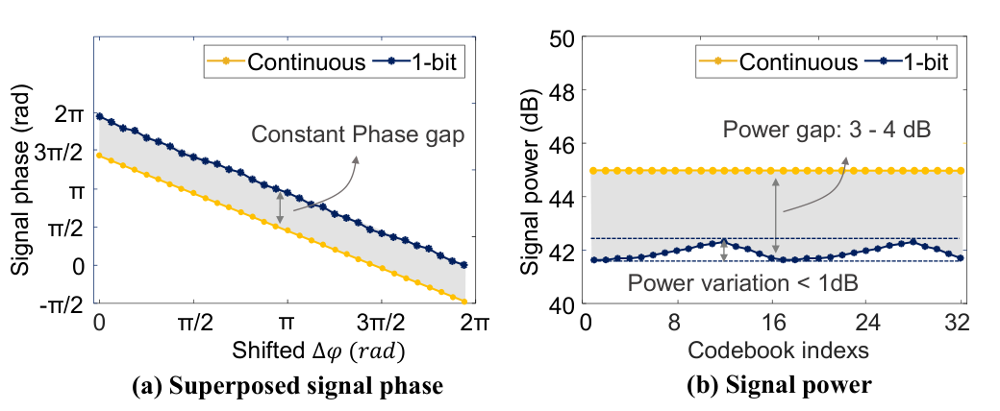

**Original caption:** Figure 10: Phase modulation performance of a 14 × 14 continuous metasurface versus a 14 × 14 1-bit metasurface.

**中文图注:** 图 10：14 × 14 连续超表面与 14 × 14 1-bit 超表面的相位调制性能对比。

**Reading note:** (a) 显示 1-bit 码本仍有明显的“常数相位间隙”，但它随不同 Δφ 近似稳定；(b) 显示主瓣功率波动小于 1 dB。作者的结论是：虽然单元素只支持 1-bit，叠加后的信号仍可视为具备约 32 个准连续相位层。

**Original:** However, directly adding Δφ to a 1-bit codebook results in only two possible phase states (0 and π), which is insufficient for fine-grained phase modulation. Fortunately, we find that for a metasurface with a sufficiently large number of meta-atoms (e.g., 196 in our design), the superposed signal phase error introduced by quantization exhibits statistical stability.

**中文:** 但直接把 Δφ 加到 1-bit 码本上，仍然只有 0 和 π 两个单元素相位状态，似乎不足以实现细粒度调相。作者发现，当 meta-atom 数量足够多（其设计为 196 个）时，量化造成的叠加信号相位误差具有统计稳定性。

**Original:** As shown in Figure 10, the resulting superposed phase difference between the ideal continuous codebooks and the 1-bit codebooks remains approximately constant for different shifts Δφ. As a result, we effectively achieve quasi-continuous phase modulation (e.g., 32 phase levels) of the superposed signal while maintaining power variation below 1 dB—despite the hardware limitation of purely 1-bit phase control.

**中文:** 如图 10 所示，在不同 Δφ 下，理想连续码本与 1-bit 码本产生的叠加相位差近似恒定。因此，尽管硬件严格来说只有 1-bit 相位控制，系统仍能在主瓣功率变化小于 1 dB 的条件下，实现叠加信号的准连续相位调制（例如 32 个相位层）。

#### 4.1.3 编程波束成形信号幅度（Programming the Beamforming Signal Amplitude）

**Original:** We now consider the control of the main-lobe amplitude. Intuitively, for a metasurface with M × N meta-atoms, the reflected signal reaches its maximum amplitude when all reflection vectors are perfectly aligned. To enable amplitude tuning, our basic idea is to align a subset of meta-atoms (i.e., M′ × N′) for beamforming and vary the size of this subset to achieve the desired signal amplitude. We then ensure that the remaining meta-atoms do not interfere with the designed amplitude. Furthermore, the resulting codebooks must preserve the phase-modulation capability described in Section 4.1.2.

**中文:** 接下来考虑主瓣幅度控制。直观上，当 M × N 个 meta-atom 的反射向量完全对齐时，幅度最大。为调幅，作者让一个子阵列 M' × N' 负责波束成形，并通过改变子阵列大小来获得目标幅度；其余 meta-atom 的相位则被优化为不干扰目标幅度，同时保留 4.1.2 节的相位调制能力。

**Original:** We formulate this objective as an optimization problem. Without loss of generality, we assume that the maximum achievable amplitude of an M × N metasurface is normalized to 1. For the desired amplitude of (M′ × N′)/(M × N), we can select a subset of M′ × N′ meta-atoms and calculate their phase states according to the beamforming algorithm. To optimize the phase states of the remaining MN − M′N′ meta-atoms, we define our objective function as below:

**中文:** 作者把该问题写成优化问题。不失一般性，将 M × N 超表面的最大幅度归一化为 1；若目标幅度为 (M' × N') / (M × N)，先选出 M' × N' 个 meta-atom，并按波束成形算法计算其相位，再优化剩余 MN-M'N' 个单元的相位。目标函数为：

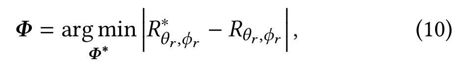

**中文说明：** Φ* 是待优化的剩余单元相位；R_θ_r,φ_r^* 与 R_θ_r,φ_r 分别是目标幅度和实际反射幅度。该式先让主瓣幅度尽量接近期望值。

**Original:** where `R*_(θ_r,φ_r)` (desired amplitude) and `R_(θ_r,φ_r)` (actual amplitude) in direction (θ_r,φ_r) are calculated using Equation (5). To ensure our 1-bit codebooks `{Φ^1-bit_1, Φ^1-bit_2, ..., Φ^1-bit_Q}` achieves a small main-lobe power variation, we refine the objective function as:

**中文:** 其中 R^*_θ_r,φ_r（目标幅度）与 R_θ_r,φ_r（实际幅度）均按式 (5) 在方向 (θ_r,φ_r) 上计算。为保证 1-bit 码本集合 {Φ^1-bit_1, …, Φ^1-bit_Q} 的主瓣功率变化足够小，作者进一步把目标函数改成：

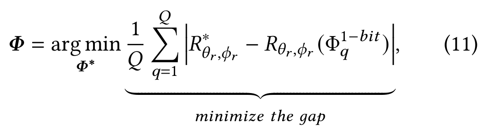

**中文说明：** 该式对所有 Q 个调制码本求平均幅度误差，使它们整体贴近目标幅度，而不是只优化某一个码本。

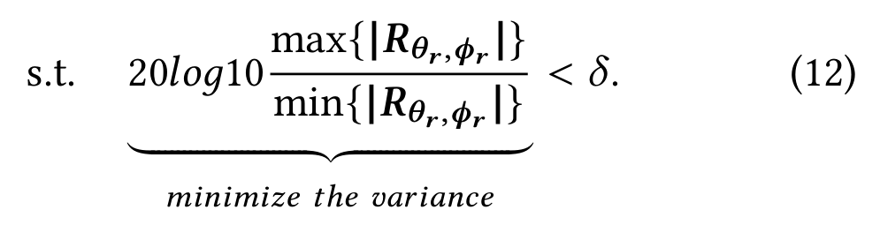

**中文说明：** 约束项要求 Q 个码本的主瓣幅度最大值与最小值之比小于阈值 δ，避免某些调制状态明显更弱。Q 是目标相位数，R_θ_r,φ_r 是这组码本的反射信号集合；可用遗传算法 [23] 或粒子群优化 [25] 求解。

**Original:** where Q represents the desired number of modulation phases, δ represents the threshold of variation value, and R_(θ_r,φ_r) = {R_(θ_r,φ_r)(Φ^1-bit_1), ..., R_(θ_r,φ_r)(Φ^1-bit_Q)} represents the reflection signals of different 1-bit codebooks. This optimization problem can be efficiently solved using Genetic Algorithm [23] or Particle Swarm Optimization [25].

**中文:** 其中 Q 表示期望的调制相位数，δ 是变化阈值；R_θ_r,φ_r 收集不同 1-bit 码本的反射信号。该优化问题可用遗传算法 [23] 或粒子群优化 [25] 求解。

**Original:** We validate this approach in simulation by varying the subset size up to 14 × 14 meta-atoms and generating the corresponding 1-bit codebooks. As shown in Figure 11, the proposed method enables precise main-lobe amplitude tuning while maintaining minimal phase variation.

**中文:** 作者在仿真中把子阵列尺寸变化到 14 × 14，生成对应的 1-bit 码本。图 11 表明，该方法能在保持相位变化很小的同时精确调谐主瓣幅度。

### 图 11 不改变相位的幅度调制

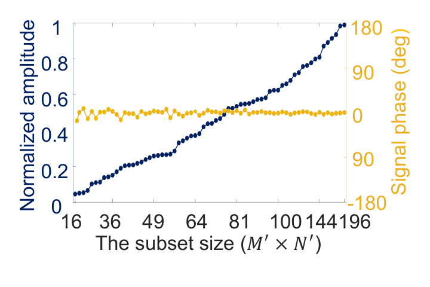

**Original caption:** Figure 11: Amplitude modulation. Configuring the signal amplitude without changing its phase.

**中文图注:** 图 11：幅度调制；在改变信号幅度时不改变其相位。

**Reading note:** 横轴是参与波束成形的子集大小，纵轴是归一化幅度；图内还标出了不同子集对应的相位偏移。论文想表达的不是“任意幅度都能无损实现”，而是在 1-bit 码本优化后，幅度可以连续调节且相位漂移很小。

#### 4.1.4 为不同调制方案选择码本（Identifying Codebooks for Different Modulation Schemes）

**Original:** The above strategy generates codebooks with arbitrary beamforming power and phase for given incidence and reflection angles, as illustrated by the yellow points in Figure 12. The next step is to select codebooks from these candidates for specific modulation schemes. To achieve this, we utilize standard QAM constellation R^ideal = {R^ideal_1, ..., R^ideal_P} as the desired constellation symbols. We then select the codebooks whose corresponding symbols in the I/Q plane lie exactly on the desired constellation points R^ideal. Formally, if R(Φ_q) is the complex reflection coefficient of codebook Φ_q, we aim to select a codebook set C = {Φ_1, ..., Φ_Q} such that:

**中文:** 上述策略可在给定入射与反射角下生成具有任意波束功率和相位的码本，如图 12 中的黄色点。下一步是从候选中为具体调制方案挑选码本。作者以标准 QAM 星座 R^ideal = {R_1^ideal, …, R_P^ideal} 为目标符号，在 I/Q 平面中选取最接近目标点的码本。若 R(Φ_q) 是码本 Φ_q 的复反射系数，则需选择码本集合 C = {Φ_1, …, Φ_Q}，使：

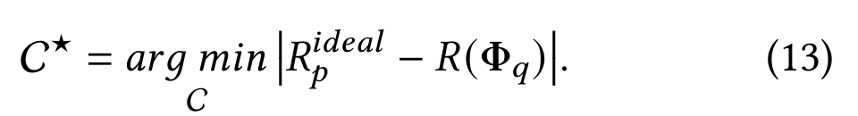

**中文说明：** 该式把码本选择写成最近星座点匹配问题。最终选出的码本映射到标准 QAM 星座，实际可达点与理想点之间的误差决定了调制质量。

### 图 12 不同 QAM 的星座图

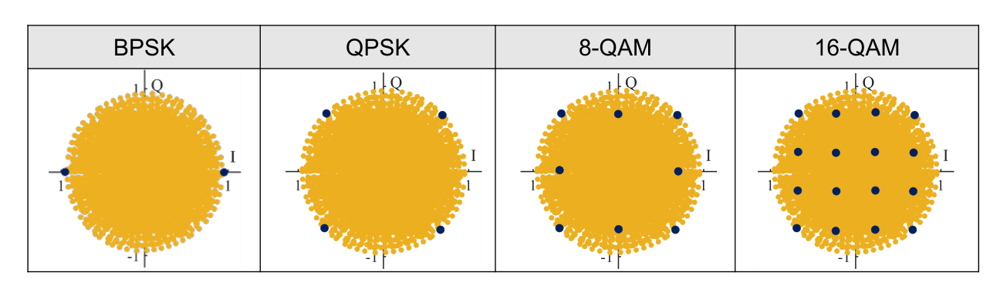

**Original caption:** Figure 12: The constellation diagram of different QAM modulation schemes. The yellow dots represent the full range of phase and amplitude control achievable by 1-bit codebooks generated using our strategy. The dark blue dots represent the selected points to form different n-QAM constellations.

**中文图注:** 图 12：不同 QAM 调制方案的星座图。黄色点表示用作者策略生成的 1-bit 码本所能达到的完整相位—幅度控制范围；深蓝色点是用于构成不同 n-QAM 星座的选定点。

**Reading note:** 四幅子图分别是 BPSK、QPSK、8-QAM、16-QAM。黄色点云说明系统生成的状态空间，深蓝点是实际用于调制的离散星座。16-QAM 的蓝色点最密，因此对 SNR、码本稳定性和均衡器长度的要求也最高。

### 4.2 解调（Demodulation）

**Original:** In practical underwater environments, the received signal is distorted by noise and multipath, resulting in inter-symbol interference (ISI). To mitigate this, we adopt an adaptive multi-channel decision-feedback equalizer (DFE) [44], which performs per-symbol channel estimation. Each packet consists of a preamble sequence p1, ..., pN followed by the data payload. The preamble is used to train the adaptive multi-channel DFE.

**中文:** 在真实水下环境中，接收信号会受到噪声和多径畸变，产生符号间干扰（ISI）。为抑制 ISI，作者采用自适应多通道判决反馈均衡器（DFE）[44]，对每个符号进行信道估计。每个数据包由前导序列 p_1, …, p_N 与数据载荷组成，前导用于训练多通道 DFE。

**Original:** We construct a composite tap vector h that collects K-channel feedforward taps (K = 8) and feedback taps. In the preamble, h(n) is updated at each symbol n using RLS algorithm:

**中文:** 作者构造复合抽头向量 h，包含 K 个通道的前馈抽头（K = 8）和反馈抽头。在前导阶段，h(n) 使用递归最小二乘（RLS）算法在每个符号 n 更新：

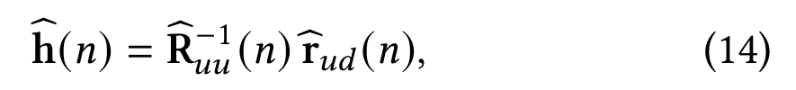

**中文说明：** R_uu(n) = Σ_(m=0)^n λ^(n−m)u(m)u^H(m) 是输入自相关矩阵，r_ud(n) = Σ_(m=0)^n λ^(n−m)u(m)p_m^* 是输入与期望符号的互相关；λ 是遗忘因子，p_m^* 是第 m 个符号的共轭。

**Original:** where R_uu(n) = Σ λ^(n−m)u(m)u^H(m), r_ud(n) = Σ λ^(n−m)u(m)p*_m, p*_m denotes the complex conjugate of the decided symbol at symbol time m, and λ denotes the forgetting factor. The regressor vector u(m) = [v_1^T(m)e^(−jθ̂_1(m)), ..., v_K^T(m)e^(−jθ̂_K(m)), −d̂^T(m)]^T contains the phase-corrected sample vectors v_k(m) (one per hydrophone, after decision-directed PLL rotation θ̂_k(m)) and the previously decided symbols d̂(m) that are fed back for ISI cancellation. After the preamble (n = N), the estimated h(N) is then applied to decode the payload.

**中文:** 式中 R_uu 与 r_ud 分别按上述指数加权求和定义；p_m^* 是第 m 个判决符号的复共轭，λ 是遗忘因子。回归向量 u(m) 由每个水听器经判决导向锁相环旋转 θ_k(m) 后的样本向量 v_k(m)，以及用于 ISI 抵消的历史判决 d(m) 拼接而成。前导结束后，用 h(N) 解码载荷。

**Original:** Lessons Learned from Demodulation: 1) With more channels, we can exploit their spatial diversity to coherently combine multiple arrivals, boosting effective SNR and mitigating fading and ISI. This approach requires no prior knowledge of path angles and works with arbitrary hydrophone array geometries. 2) Higher-order modulation schemes, such as 8-QAM and 16-QAM, require a longer equalizer (i.e., a longer training preamble and more feedforward/feedback taps) to enable accurate decoding. This is because their denser symbol spacing makes them markedly less tolerant to residual ISI and channel distortion.

**中文:** 解调经验：(1) 通道越多，越能利用空间分集相干合并多个到达分量，提高有效 SNR 并缓解衰落与 ISI；该方法无需已知路径角，适用于任意水听器阵列几何。(2) 8-QAM、16-QAM 等高阶方案需要更长的均衡器（更长前导和更多前馈/反馈抽头），因为星座点更密，对残余 ISI 和信道畸变更不宽容。

## 5 原型实现 PROTOTYPE IMPLEMENTATION

### 5.1 超表面实现（Metasurface Implementation）

**Original:** (a) Metasurface Fabrication. We fabricated different sizes of piezoelectric acoustic metasurfaces with 7 × 7, 7 × 14, and 14 × 14 meta-atoms. Each meta-atom is designed with a side length of 2.4 cm, resulting in an overall size of 33.6 cm × 33.6 cm for the 14 × 14 metasurface. An SH1.0 wiring connector protrudes an additional 2 cm from one edge of the panel.

**中文:** (a) 超表面制造：作者制作了 7 × 7、7 × 14 与 14 × 14 三种尺寸的压电声学超表面。每个 meta-atom 边长 2.4 cm，因此 14 × 14 整板的尺寸为 33.6 × 33.6 cm；SH1.0 接线连接器从一边额外伸出 2 cm。

**Original:** Figure 13 illustrates the prototype of the 14 × 14 metasurface, which consists of three layers. The upper and lower layers are aluminum shells, while the middle layer houses 196 custom copper-backed PZT elements with a transparent waterproof coating. The cost of the metasurface is about \$50, and the control module costs about \$70, bringing the total cost (\$120) to a level comparable to that of a low-cost acoustic modem.

**中文:** 图 13 展示了 14 × 14 超表面原型：上层与下层为铝壳，中间层容纳 196 个带透明防水涂层的定制铜背衬 PZT 元件。超表面成本约 50 美元，控制模块约 70 美元，总计约 120 美元，与低成本声学调制解调器相当。

### 图 13 超表面原型

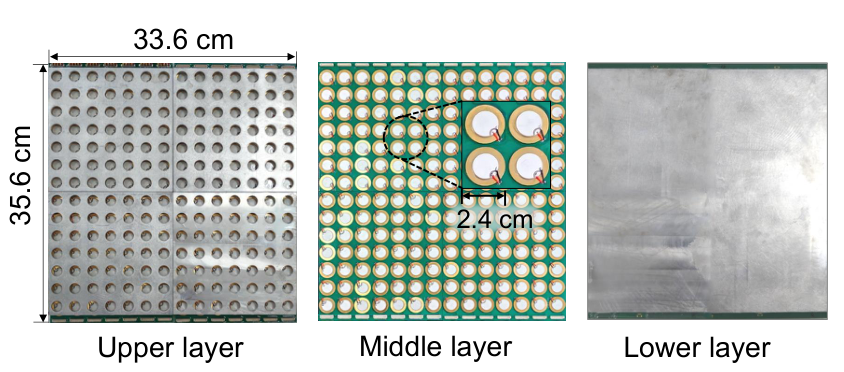

**Original caption:** Figure 13: The prototype of the metasurface.

**中文图注:** 图 13：超表面原型。

**Reading note:** 三层结构是“上铝壳—PZT/铜单元与封装—下铝壳”。图上的 35.6 cm、33.6 cm 与 2.4 cm 分别对应含连接器总宽度、14 × 14 有效阵列宽度和单元间距。原型的关键特征是 196 个独立单元仍由列并行 GPIO 控制，控制复杂度没有随单元数线性爆炸。

**Original:** (b) Hardware Control Module. To control the metasurface, we custom-designed a control circuit, which consists of an MCU (MSP430G2553 [45]), 49 four-channel switch ICs (TMUX-1134PWR [46]), and 392 inductors [28]. Each meta-atom is connected to two inductors and one switch channel.

**中文:** (b) 硬件控制模块：作者定制了控制电路，包括 MSP430G2553 MCU [45]、49 个四通道开关芯片 TMUX-1134PWR [46] 和 392 个电感 [28]。每个 meta-atom 连接两个电感和一个开关通道。

**Original:** To reduce the control overhead, we connect each column of the metasurface to a single GPIO control pin, which requires 14 pins in our implementation. To enable real-time reconfiguration, the GPIO interface is directly connected to supply the bias voltage to the switches, allowing rapid reconfiguration on the microsecond scale due to the short rise/fall times of the GPIO signals and the small time constants of the inductors.

**中文:** 为降低控制开销，每列超表面只接一个 GPIO 控制脚，因此本实现只需 14 个引脚。GPIO 直接为开关提供偏置电压；由于 GPIO 上升/下降时间短，电感时间常数也小，系统可在微秒尺度快速重构。

### 5.2 阅读器实现（Reader Implementation）

**Original:** MetaScatter can operate with the transmitter and receiver either separated or co-located. In this paper, we focus on the co-located configuration, where both are integrated into a single reader unit comprising two main components:

**中文:** MetaScatter 的发射器与接收器既可以分离，也可以共址。本文重点研究共址配置：二者集成在一个阅读器单元内，主要由两部分组成。

**Original:** (a) Transmitter. The transmitter serves as the carrier source, continuously emitting a pure-tone carrier. We use a commercial transducer [53] as the projector. A sine wave of the desired amplitude and frequency is generated by a RIGOL DG1022 arbitrary waveform generator [42] and fed into an Aigtek ATA-214 power amplifier [4], whose output drives the transducer. Due to the transducer’s directional nature, self-leakage into the co-located receiver array is minimized.

**中文:** (a) 发射器：发射器连续发出纯音声载波。作者用商用换能器 [53] 作为投影器，由 RIGOL DG1022 任意波形发生器 [42] 产生目标幅度和频率的正弦波，再经 Aigtek ATA-214 功率放大器 [4] 驱动换能器。换能器具有指向性，因此共址接收阵列受到的自泄漏影响较小。

**Original:** (b) Receiver Array. The backscattered signal is received by an 8-element receiver array shown in Figure 14, which consists of 8 low-cost Aquarian Audio H1a hydrophones [8]. Each H1a hydrophone is connected to a 26 dB PA6 amplifier [9]. The received signal is sampled by ZOOM-F8N PRO [57]. The recorded data are then fed into the decoding pipeline as described in Section 4.2.

**中文:** (b) 接收阵列：反射信号由 8 元接收阵列接收（图 14），其中包含 8 个低成本 Aquarian Audio H1a 水听器 [8]。每个水听器接 26 dB PA6 放大器 [9]，信号由 ZOOM-F8N PRO [57] 采样，随后进入 4.2 节的解码流水线。

### 图 14 系统实验设置

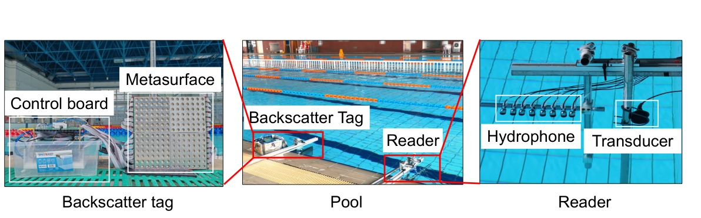

**Original caption:** Figure 14: The system setup.

**中文图注:** 图 14：系统实验设置。

**Reading note:** 图中同时标出反向散射标签、超表面、控制板、泳池、阅读器、水听器与投影换能器。阅读器与标签共址时，发射换能器的方向性用于压低直接泄漏；接收端另用 8 个水听器形成空间分集。

### 5.3 评估设置（Evaluation Setup）

**Original:** (a) Testing Environment. The experiments were conducted in a 30 m × 50 m × 2 m swimming pool (Figure 14). We fixed the equipment on the poolside and used a rigid pole to lower the reader and metasurface to a depth of about 1 m.

**中文:** (a) 测试环境：实验在 30 × 50 × 2 m 的游泳池中进行（图 14）。设备固定在池边，并用刚性杆把阅读器和超表面下放至约 1 m 水深。

**Original:** (b) Metrics. We evaluate performance in terms of effective data rate, bit-error rate (BER), and signal-to-noise ratio (SNR).

**中文:** (b) 指标：采用有效数据率、误码率（BER）和信噪比（SNR）评估性能。

**Original:** (c) Backscatter Modulation Schemes. MetaScatter supports different modulations—from OOK and BPSK to higher-order modulations such as QPSK, 8-QAM, and 16-QAM. In the overall performance evaluation (Section 6.1), we report their communication range, maximum data rate, BER, and SNR. In other controlled experiments, we use QPSK as the default modulation scheme.

**中文:** (c) 反向散射调制方案：MetaScatter 支持从 OOK、BPSK 到 QPSK、8-QAM、16-QAM 的不同调制。6.1 节综合评价报告各方案的通信距离、最大数据率、BER 与 SNR；其余受控实验默认使用 QPSK。

## 6 评估 EVALUATION

### 6.1 总体性能（Overall Performance）

**Original:** Communication Range. In this section, we first evaluate the uplink communication range at which we can reliably communicate (i.e., BER < 10^-2) for different modulation schemes. In this experiment, the backscatter switch rate was fixed at 1000 Hz, while the distance between the backscatter tag and the reader was varied. At each distance, we conducted 5 trials per modulation scheme. Figure 15 plots the median BER versus the communication range.

**中文:** 通信距离：首先评估不同调制方式下可靠通信（即 BER < 10⁻²）的上行距离。实验中反向散射开关速率固定为 1000 Hz，改变标签与阅读器之间的距离；每个距离、每种调制方案重复 5 次。图 15 给出 BER 中位数随距离的变化。

**Original:** The achievable range decreases for higher-order modulations due to their denser constellation spacing. Nevertheless, even with a 16-QAM modulation scheme, we achieve a round-trip range of 20 m, while 8-QAM and QPSK extend the range to 40 m and 60 m, respectively. For simpler binary modulations (i.e., OOK/BPSK), we can support a round-trip communication range of 100 m at the BER of 3.12 × 10^-4 and 4.12 × 10^-4, respectively. According to the recent underwater backscatter link budget theory [5], MetaScatter’s uplink communication range can theoretically reach 170 m. These results demonstrate that MetaScatter significantly extends the range of underwater backscatter communication.

**中文:** 高阶调制星座更密，因此可达距离缩短。即便如此，16-QAM 仍实现 20 m 往返通信，8-QAM 与 QPSK 分别达到 40 m 和 60 m；对更简单的 OOK/BPSK，100 m 往返距离下的 BER 分别为 3.12 × 10⁻⁴ 和 4.12 × 10⁻⁴。按近期水下反向散射链路预算理论 [5]，MetaScatter 的上行距离理论上可达 170 m。这些结果说明其显著扩展了水下反向散射通信距离。

### 图 15 通信距离

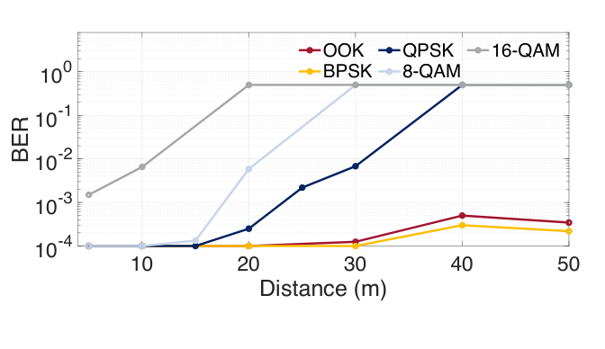

**Original caption:** Figure 15: Communication range.

**中文图注:** 图 15：通信距离。

**Reading note:** 曲线越低表示 BER 越好；虚线或水平参照通常是 10⁻² 的可用链路阈值。读图时不要只比较最远点，还要看同一距离下不同调制阶数的余量：16-QAM 在近距离吞吐更高，但距离一拉长就最先失效。

**Original:** Throughput. In this experiment, we varied the backscatter switch rate and measured the maximum data rate achieved by the backscatter node while maintaining a bit error rate below 10^-2. Each configuration was repeated five times. Figure 16 reports the achievable data rate and corresponding backscatter switch rate under different modulation orders and distances.

**中文:** 吞吐率：实验改变反向散射开关速率，测量节点在 BER < 10⁻² 时可达的最大数据率。每组配置重复 5 次。图 16 给出不同调制阶数与距离下的数据率和对应开关速率。

**Original:** At short ranges (5–10 m), higher-order constellations generally yield higher throughput, since each symbol encodes more bits. For example, 8-QAM achieves up to 25.2 kbps at 5 m, outperforming both BPSK and QPSK. However, 16-QAM exhibits a counter-intuitive drop in throughput. This is because higher-order modulations impose stricter SNR requirements on the switch rate: as shown in the right panel, 16-QAM can only sustain 2 kHz at 5 m, compared to 20 kHz for BPSK. The reduced switching capability directly constrains the maximum data rate, making 16-QAM inferior to lower-order modulations in practice.

**中文:** 在 5–10 m 近距离，高阶星座通常吞吐更高，因为每符号携带更多比特。例如 8-QAM 在 5 m 达到 25.2 kbps，优于 BPSK 与 QPSK。但 16-QAM 的吞吐率反而下降：高阶调制对 SNR 的要求更严，从而限制可用的开关速率。图 16 右图显示，5 m 时 16-QAM 仅能维持 2 kHz，而 BPSK 可达 20 kHz；开关能力下降直接限制了最大数据率，使 16-QAM 在实际中反而不如低阶调制。

**Original:** At 20 m, 8-QAM throughput falls sharply, leaving QPSK as the best performer. At 40 m, only BPSK maintains a usable link, achieving the highest throughput at this range. These results highlight that throughput is jointly determined by modulation order and feasible switch rate: although higher-order modulations theoretically offer higher data rates, their greater SNR sensitivity limits the effective switch rate, resulting in lower throughput than simpler modulations at longer distances.

**中文:** 到 20 m 时，8-QAM 吞吐率急剧下降，QPSK 成为最佳方案；到 40 m 时，只有 BPSK 仍保持可用链路，并在该距离取得最高吞吐。可见吞吐率由调制阶数与可行开关速率共同决定：高阶调制理论数据率更高，但对 SNR 更敏感，实际可用开关速率反而受限，因此在远距离上可能不如低阶调制。

### 图 16 最大数据率与对应开关速率

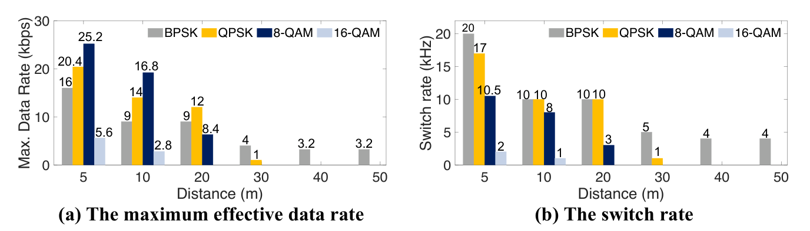

**Original caption:** Figure 16: The maximum data rate and the corresponding switch rate.

**中文图注:** 图 16：最大数据率与对应的反向散射开关速率。

**Reading note:** 左图是数据率，右图是能维持该数据率的开关速率。最重要的反直觉结论是：16-QAM 并不总比 8-QAM 快；当 SNR 只允许较低开关速率时，每符号更多比特并不足以弥补符号率下降。图中标注数值可用来核对不同距离下的最优点。

### 6.2 基准对比（Benchmark）

**Original:** In this section, we evaluate the effect of each individual design component. We use QPSK modulation schemes as the representative case.

**中文:** 本节评估各设计组件的独立贡献，以 QPSK 作为代表性调制方案。

**Original:** Random Codebooks vs. Optimized Codebooks. To quantify the benefit of the codebook optimization introduced in Section 4, we compare the performance of our optimized QPSK codebooks against randomly generated ones. The experiment was conducted at three reader-to-tag distances: 5 m, 10 m, and 20 m. At each distance, we generated 10 random QPSK codebooks and compared BER. Figure 17 presents the result.

**中文:** 随机码本与优化码本：为量化第 4 节码本优化的收益，作者在 5 m、10 m、20 m 三个距离比较优化的 QPSK 码本与随机生成码本。每个距离生成 10 组随机 QPSK 码本并比较 BER，结果见图 17。

**Original:** While random codebooks are capable of achieving a low BER at 5 m, their performance deteriorates sharply as the range extends to 10 m and 20 m. In contrast, our optimized codebook maintains a robust and stable medium BER around 10^-4 and 3.75 × 10^-4, respectively. This superior performance stems from our optimization process, designed to simultaneously maximize the backscatter signal power and the phase separation between constellation points.

**中文:** 随机码本在 5 m 尚能获得较低 BER，但距离增至 10 m、20 m 后性能迅速恶化；优化码本则分别维持约 10⁻⁴ 与 3.75 × 10⁻⁴ 的稳健中位 BER。其优势来自优化过程同时最大化反向散射功率和星座点间的相位分离。

### 图 17 随机码本与优化码本

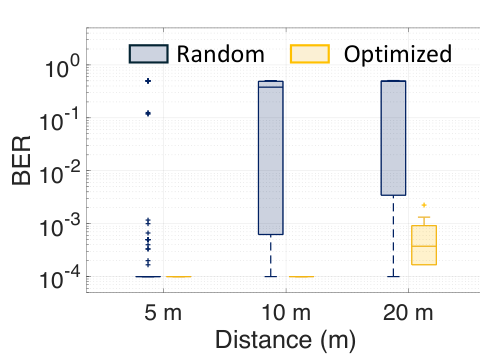

**Original caption:** Figure 17: Random vs. Optimized codebooks.

**中文图注:** 图 17：随机码本与优化码本对比。

**Reading note:** 该图比较的是“随机生成的 QPSK 码本集合”与“第 4 节优化后的码本集合”。近距离时随机码本也能工作，说明硬件本身具备基本能力；距离拉远后，优化码本的价值才显现为稳定的码本间距离和主瓣增益。

**Original:** Performance across Different Hydrophone Channels. In this section, we would like to quantify the impact of the number of hydrophone channels at the receiver on the BER performance. To this end, we used the same QPSK received signals from Section 6.1 but processed the data by varying the number of hydrophone channels. Specifically, for each trial, we used a multichannel DFE decoder but applied it to a different number of hydrophone channels. For completeness, we used every possible combination of N = 2, 4, 6, 8 hydrophone channels in generating these results.

**中文:** 不同水听器通道数的影响：为量化接收通道数对 BER 的影响，作者复用 6.1 节的 QPSK 接收信号，只改变参与多通道 DFE 的通道数。为完整起见，对 N = 2,4,6,8 的所有可能通道组合都进行了评估。

**Original:** Specifically, for any number of selected receive channels N, we generate C(N,8) unique combinations of receive channels to use in the decoding pipeline and compute CDFs of these selected combinations. As shown in Figure 18, MetaScatter’s median and 90% BER decrease from 2×10^-2 and 0.5 to 10^-4 and 10^-2, respectively, as the hydrophone channels increases from 2 to 8. This is because multiple channels provide gains in received power and spatial diversity.

**中文:** 对任意接收通道数 N，作者枚举 C(8,N) 种组合并计算 BER 累积分布。图 18 表明，当通道数从 2 增至 8 时，BER 中位数从 2 × 10⁻² 降到 10⁻⁴，90% 分位从 0.5 降到 10⁻²。原因是多通道同时带来接收功率增益和空间分集。

**Original:** Additionally, the system maintains a BER of about 10^-3 in 80% of the cases when using an 8-channel hydrophone array, demonstrating the robustness of MetaScatter’s decoding capability.

**中文:** 此外，使用 8 通道水听器阵列时，80% 的情况下 BER 仍约为 10⁻³，说明 MetaScatter 的解码能力具有较好鲁棒性。

### 图 18 水听器通道数的影响

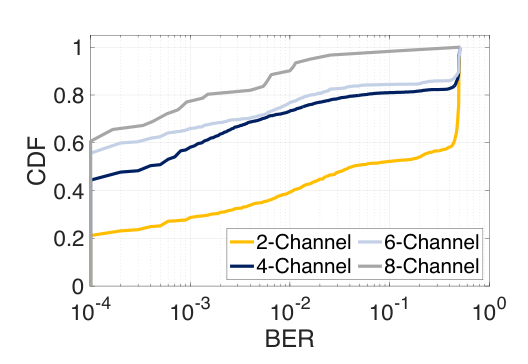

**Original caption:** Figure 18: Impact of hydrophone channels.

**中文图注:** 图 18：水听器通道数的影响。

**Reading note:** 读 CDF 时，曲线越靠左表示低 BER 的比例越高。2 通道在 90% 分位附近仍有大量高误码样本，8 通道则把整体分布显著推向低 BER。该结果支持“空间分集不是附属优化，而是高阶调制能稳定解码的必要条件之一”。

**Original:** Performance across Different Metasurface Sizes. We further evaluated how MetaScatter’s gain varies with its physical size. In the experiment, we fixed the distance between the reader and metasurface as 10 m and compared the SNR and BER performance of metasurfaces sized 7 × 7 (16.8 cm × 16.8 cm), 7 × 14 (16.8 cm × 33.6 cm), and 14 × 14 (33.6 cm × 33.6 cm).

**中文:** 超表面尺寸的影响：作者进一步评估物理尺寸对增益的影响。实验固定阅读器与超表面距离为 10 m，比较 7 × 7（16.8 × 16.8 cm）、7 × 14（16.8 × 33.6 cm）和 14 × 14（33.6 × 33.6 cm）超表面的 SNR 与 BER。

**Original:** As shown in Figure 19, increasing the metasurface size from 7 × 7 to 7 × 14 and then to 14 × 14 raises the median SNR from 10 dB to 15 dB and 22 dB, respectively. The increasing trend in SNR is expected, as adding more meta-atoms to the metasurface array increases its gain, which in turn improves the SNR. Similarly, the median BER decreases from 10^-2 to 10^-3 and then to 10^-4 as the metasurface size increases due to the SNR improvement.

**中文:** 如图 19 所示，超表面从 7 × 7 增至 7 × 14、再到 14 × 14，中位 SNR 分别从 10 dB 升至 15 dB 和 22 dB。更多 meta-atom 带来更高阵列增益，因而 SNR 提升。相应地，中位 BER 从 10⁻² 降至 10⁻³，再降至 10⁻⁴。

### 图 19 超表面尺寸的影响

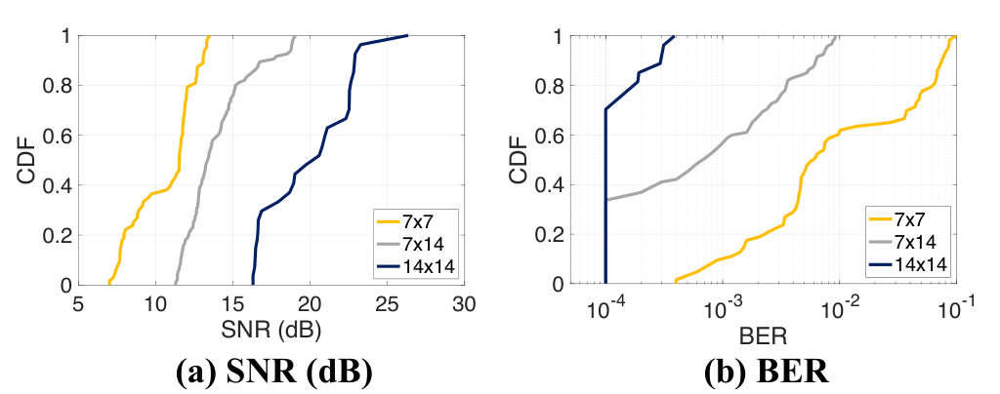

**Original caption:** Figure 19: Impact of metasurface size.

**中文图注:** 图 19：超表面尺寸的影响。

**Reading note:** 左图比较 SNR，右图比较 BER。尺寸扩大本身不是目的，关键在于增加阵列孔径带来的波束增益与更窄主瓣；代价是重量、成本、控制走线和部署体积都会增加。

### 6.3 性能影响因素（Factors Affecting Performance）

**Original:** Performance under Different Dynamic Interference. In this section, we evaluate the performance of MetaScatter under varying levels of dynamic interference—namely, quiet, noisy, and busy conditions. The experiment setup is shown in Figure 20 (left), where the reader-metasurface distance is set to be 10 m.

**中文:** 动态干扰下的性能：作者评估 MetaScatter 在安静、噪声和繁忙三种动态干扰条件下的性能。图 20 左图给出实验布置，阅读器与超表面距离为 10 m。

**Original:** The noisy (R1&R2) and busy conditions (R3) are created by volunteers swimming either near (R2) to or far (R1) from the link path, or repeatedly crossing it (R3), thereby generating time-varying multipath reflections and surface-wave turbulence that progressively degrade channel quality. As shown in Figure 20 (right), the BER slightly increases in the presence of such interference. The BER at location R3 is slightly higher than those at other locations. Nevertheless, the averaged BER remains below 2 × 10^-3, demonstrating MetaScatter’s robustness against interference.

**中文:** 噪声条件（R1、R2）由志愿者在链路远处（R1）或近处（R2）游泳产生；繁忙条件（R3）则由志愿者反复穿过链路形成。这些运动会引入时变多径反射与水面波湍流，逐步降低信道质量。图 20 右图显示，干扰下 BER 仅略有上升，R3 略高于其他位置，但平均 BER 仍低于 2 × 10⁻³，说明 MetaScatter 对干扰具有鲁棒性。

**Original:** This resilience stems from MetaScatter’s beamforming capability and its multi-channel DFE algorithm, which jointly provide the high SNR needed for high-order modulation.

**中文:** 该鲁棒性来自超表面的波束成形能力与多通道 DFE：前者提高主瓣方向上的信号功率，后者利用空间分集和反馈抽头抑制多径与 ISI。

### 图 20 动态干扰

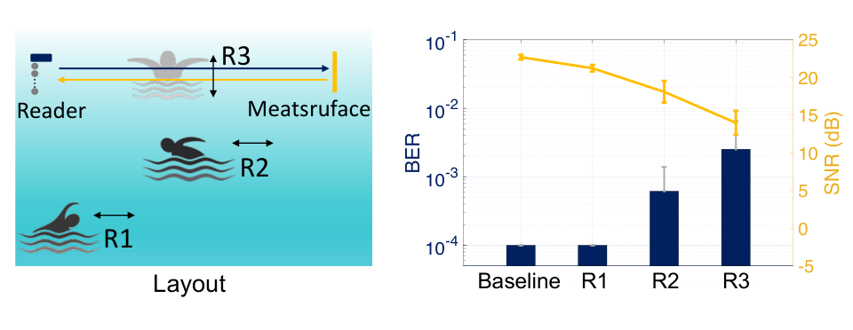

**Original caption:** Figure 20: Dynamic interference.

**中文图注:** 图 20：动态干扰。

**Reading note:** 左图是干扰场景布局，R1/R2/R3 代表不同的游泳干扰位置，B 代表基线；右图比较 BER/SNR。读图时应关注“最强干扰是否仍低于可用阈值”，而不是只看平均值。实验中的游泳者只模拟了局部动态多径，并不等同于长期海洋环境。

**Original:** Performance across Different Angles. We consider the retro-reflection scenario, in which the incident signal is reflected back toward the source, to evaluate the beam-steering capability. We configure MetaScatter to operate in retro-reflective mode for incident angles ranging from 10° to 50° relative to broadside. Figure 21 compares the BER and SNR at the main lobe and at the specular-reflection direction.

**中文:** 不同角度下的性能：作者采用回反射场景，即入射信号沿原方向返回，以评估波束引导能力。让 MetaScatter 在相对法线 10°–50° 的入射角下工作在回反射模式。图 21 比较主瓣方向与镜面反射方向的 BER 和 SNR。

**Original:** As the reflection angle increases, the retro-reflected SNR gradually decreases, mainly owing to the limited field of view (FoV) of the metasurface. Nevertheless, the averaged BER remains below 10^-3, and the effective FoV of MetaScatter is approximately ±50°.

**中文:** 随着反射角增大，回反射 SNR 逐渐下降，主要原因是超表面的视场角有限。不过平均 BER 仍低于 10⁻³，有效视场约为 ±50°。

### 图 21 入射角的影响

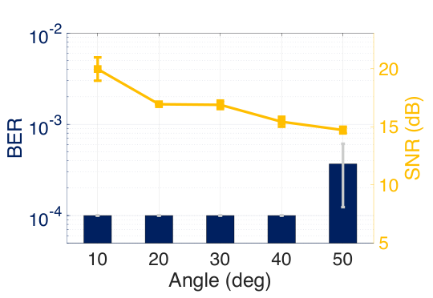

**Original caption:** Figure 21: Impact of angle.

**中文图注:** 图 21：角度的影响。

**Reading note:** 角度增大时，主瓣方向的 SNR 与镜面方向的 SNR 会逐渐分离；论文关心的是主瓣 BER 是否仍低于阈值。±50° 的 FoV 是本文实验条件下的有效范围，不代表任意阵列尺寸和频率都相同。

**Original:** Performance across Different Backscatter Switch Rates. To evaluate MetaScatter’s ability to communicate across different bitrates, we fixed the distance between the reader and the metasurface at 10 m and varied the backscatter switch rate. In each experimental trial, we repeated the measurement five times. The hydrophone received the backscatter node’s packets and computed the BER and SNR of the received signals.

**中文:** 不同反向散射开关速率下的性能：为评估系统在不同码率下的通信能力，固定阅读器与超表面距离为 10 m，改变反向散射开关速率；每组实验重复 5 次。水听器接收节点数据包并计算 BER 与 SNR。

**Original:** As shown in Figure 22, the SNR decreased and the BER increased with higher switch rates, because the fixed transmit power was spread over a proportionally wider bandwidth, reducing the energy per symbol. Nevertheless, MetaScatter achieved reliable QPSK decoding at a switch rate of about 10 kHz.

**中文:** 如图 22 所示，开关速率越高，SNR 越低、BER 越高，因为固定发射功率被摊到更宽带宽上，每个符号的能量随之减少。尽管如此，MetaScatter 在约 10 kHz 开关速率下仍能可靠解码 QPSK。

### 图 22 反向散射开关速率的影响

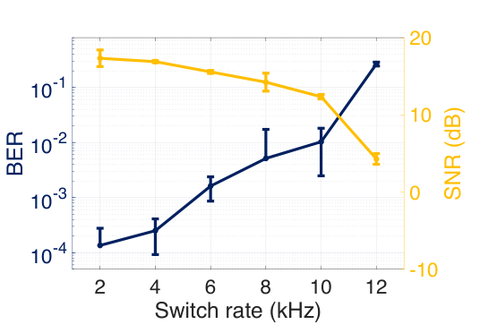

**Original caption:** Figure 22: Impact of switch rate.

**中文图注:** 图 22：反向散射开关速率的影响。

**Reading note:** 这张图连接“硬件切换速度”和“可用数据率”。在固定发射功率下，提高开关速率会把每个符号的能量压得更低，因此不能简单把开关频率当成吞吐率。图中的可靠工作点应对应 BER 阈值，而不是只看 SNR 曲线的最高点。

**Original:** Performance across Different Transmitter Voltages. Next, we evaluate the impact of the reader’s transmit power on MetaScatter. Although the MetaScatter backscatter node consumes a constant amount of power, the overall system performance still depends on the transmit power of the reader. Since higher transmit power leads to stronger backscattered signals, we expect a higher SNR at the receiver and, consequently, improved BER performance.

**中文:** 不同发射电压下的性能：作者评估阅读器发射功率对系统的影响。虽然 MetaScatter 标签自身功耗基本恒定，但整体性能仍取决于阅读器发射功率。发射功率越高，反向散射信号越强，接收端 SNR 越高，BER 也应随之降低。

**Original:** We fixed the distance between the reader and metasurface at 10 m and compared the BER performance of QPSK under different transmit power levels. Here, we applied an input voltage of 5–100 V to drive the 200 Ω transducer, which is consistent with prior work [24]. At each transmitter voltage level, we conducted five trials at a data rate of 1000 bps. Figure 23 shows the median BER as a function of transmitter voltage.

**中文:** 作者固定距离为 10 m，比较不同发射功率下的 QPSK BER。实验在 200 Ω 换能器上施加 5–100 V 输入电压，与先前工作 [24] 一致；每个电压等级在 1000 bps 数据率下重复 5 次。图 23 给出 BER 中位数随发射电压的变化。

**Original:** As the transmitter voltage increases, the BER consistently improves. When the transmitter voltage exceeds 10 V, the BER falls below 10^-2, and at 50 V, the median BER reaches approximately 10^-4. These results highlight MetaScatter’s ability to achieve reliable performance even at low transmitter voltages, owing to its high gain.

**中文:** 随着发射电压升高，BER 持续改善。电压超过 10 V 后 BER 低于 10⁻²，到 50 V 时中位 BER 约为 10⁻⁴。结果表明，凭借超表面的高增益，MetaScatter 即使在较低发射电压下也能可靠工作。

### 图 23 发射电压的影响

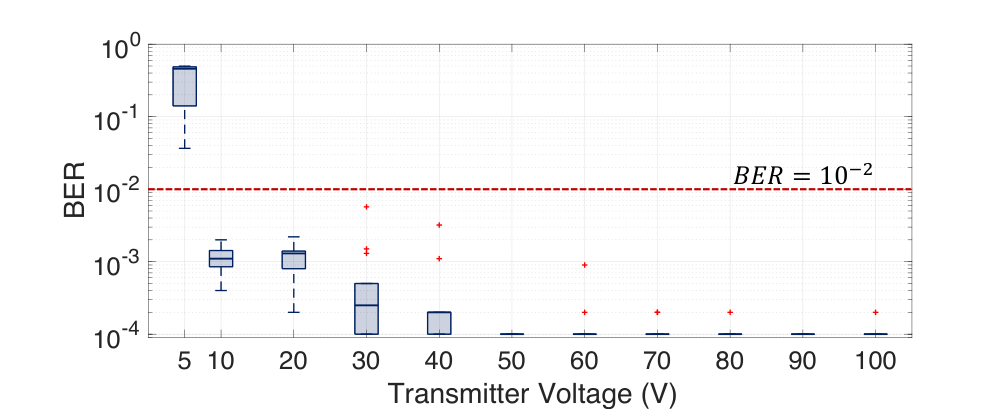

**Original caption:** Figure 23: Impact of different transmitter voltages.

**中文图注:** 图 23：不同发射电压的影响。

**Reading note:** 横轴是驱动发射换能器的电压，纵轴是 QPSK 的 BER。该图说明系统能在较低发射电压下越过 10⁻² 阈值，但也提示“低功耗标签”并不等于“低功耗整个系统”：阅读器端的发射功率仍是链路预算的一部分。

### 6.4 功耗（Power Consumption）

**Original:** In this section, we evaluate the power consumption of MetaScatter’s backscatter tag. We used a Monsoon power monitor (AAA10F [33]) to measure the power consumption. Table 1 presents the measured power when the MetaScatter tag is in idle state (waiting to receive a downlink signal) as well as when it is backscattering. Each state’s measurement includes the power consumption of the MCU and electronic switches.

**中文:** 本节评估 MetaScatter 标签的功耗，使用 Monsoon 功耗监视器（AAA10F [33]）测量。表 1 给出标签在空闲状态（等待下行信号）与反向散射状态下的功耗，每个状态均包含 MCU 与电子开关的功耗。

**Original:** The table shows that the power consumption in idle state is 0.18 mW and increases to around 1.116 mW for the backscattering state. We note that the core component of our electronic switch implementation (i.e., the TMUX1134PWR switches) consumes only 4 μW for each 4-channel switch when modulating the backscatter signal at a 1 kHz rate, which aligns with the prior works [18, 24].

**中文:** 表 1 显示空闲功耗为 0.18 mW，反向散射状态约为 1.116 mW。作者指出，核心电子开关 TMUX1134PWR 在 1 kHz 调制时每个四通道开关仅耗约 4 μW，与先前工作 [18, 24] 一致。

**Original:** The total power consumption of the active mode is slightly higher than existing underwater backscatter technologies. This is because MetaScatter’s MCU requires additional pins and switches to control the metasurface for beamforming. Nevertheless, the overall power consumption remains around 1 mW, which is much lower than that of active transmission.

**中文:** 有源模式总功耗略高于现有水下反向散射技术，因为 MetaScatter 的 MCU 需要额外引脚和开关来控制超表面波束成形。但整体仍约为 1 mW，远低于主动发射方案。

### 表 1 MetaScatter 的功耗

| 组件 | 空闲功耗 / mW | 有源功耗 / mW |
|---|---:|---:|
| MCU | 0.18 | 0.92 |
| Switches | / | 0.196 |
| **总计** | **0.18** | **1.116** |

**Original caption:** Table 1: Power consumption of MetaScatter.

**中文表注:** 表 1：MetaScatter 的功耗。

**Reading note:** 表中“有源”指反向散射调制状态，不是发射状态。0.92 mW 的 MCU 功耗占主导，开关只占 0.196 mW；这与传统主动声纳/调制解调器的功耗不在同一量级。注意此表没有把阅读器端发射器、功放和接收阵列的功耗计入标签功耗。

## 7 相关工作 RELATED WORK

**Original:** Acoustic Backscatter. Acoustic backscatter [19, 24, 38] is an emerging ultra-low-power communication technique designed for scenarios in which electromagnetic waves are ineffective. For example, previous studies have investigated the use of backscatter in underwater environments to support a range of applications. PAB [24] designed a backscatter node capable of measuring parameters such as pH, temperature, and pressure. SeaScan [35] and a recent study [2] proposed systems for marine imaging, while VAB [14] employed a Van Atta structure in underwater backscatter to enable long-range communication.

**中文:** 声学反向散射：声学反向散射 [19, 24, 38] 是一种面向电磁波失效场景的新型超低功耗通信技术。已有研究探索了它在水下环境中的应用：PAB [24] 设计了可测量 pH、温度、压力等参数的标签；SeaScan [35] 与近期工作 [2] 提出海洋成像系统；VAB [14] 利用 Van Atta 结构实现远距离水下反向散射。

**Original:** However, these solutions still rely on binary modulation, resulting in low data rates. To improve throughput, U2B [18] proposed an ultra-wideband underwater backscatter using piezoelectric metamaterials. MetaScatter complements this wideband design by improving spectrum utilization with high-order modulation.

**中文:** 但这些方案仍依赖二值调制，数据率较低。为提高吞吐率，U2B [18] 提出使用压电超材料的超宽带水下反向散射。MetaScatter 与这种宽带路线互补：前者通过高阶调制提高频谱利用率，而不是单纯扩展带宽。

**Original:** High-order Acoustic Backscatter Communication. High-order modulation schemes have been demonstrated to increase data rates in existing wireless communication systems. Some works [3, 38] introduced high-order acoustic backscatter modulation by toggling between multiple impedance states. Despite these advancements, state-of-the-art underwater backscatter systems remain limited to four reflection states (i.e., QPSK) and achieve only a short communication range.

**中文:** 高阶声学反向散射通信：高阶调制已在现有无线通信系统中证明能提高数据率。部分工作 [3, 38] 通过切换多个阻抗状态实现高阶声学反向散射调制。尽管如此，当时最先进的水下反向散射系统仍局限于四种反射状态（即 QPSK），通信距离也较短。

**Original:** The fundamental bottleneck is that existing tags rely on an omnidirectional PZT cylinder, which reflects signals in all directions. This spherical power spreading leads to power loss and substantially degrades the received SNR. Increasing the number of reflection states further exacerbates the problem, as the reduced symbol spacing makes the system even more sensitive to SNR degradation.

**中文:** 根本瓶颈在于现有标签使用全向 PZT 圆柱，会向所有方向反射信号。功率在球面上扩散，造成严重能量损失并显著降低接收 SNR。增加反射状态数量又会缩小符号间距，使系统对 SNR 下降更加敏感。

**Original:** In contrast, MetaScatter introduces both hardware and software designs to enable simultaneous beamforming and high-order modulation. For QPSK, MetaScatter achieves a round-trip communication range of 60 m, significantly exceeding the 10 m range reported in existing work [3]. Moreover, our system supports higher-order modulations such as 8-QAM and 16-QAM.

**中文:** MetaScatter 则同时从硬件与软件两方面实现波束成形与高阶调制。在 QPSK 下，其往返距离达到 60 m，明显超过现有工作 [3] 报告的 10 m；系统还支持 8-QAM 与 16-QAM 等更高阶调制。

**Original:** RF-based Metasurface Modulation. Numerous metasurfaces operating in the radio signal frequency (RF) band have been proposed [12, 15, 22, 27, 29, 32, 39, 43, 49]. By controlling the phase configuration (i.e., codebook) of each meta-atom, metasurfaces can modulate data onto the incident carrier wave [12, 22]. However, acoustic signals are mechanical waves, and existing RF metasurface hardware designs cannot be directly applied to them.

**中文:** 基于 RF 的超表面调制：已有大量工作研究射频（RF）超表面 [12, 15, 22, 27, 29, 32, 39, 43, 49]。通过控制每个 meta-atom 的相位配置（码本），超表面可以把数据调制到入射载波上 [12, 22]。但声波是机械波，RF 超表面的硬件设计不能直接照搬到声学系统。

**Original:** Furthermore, existing RF metasurfaces typically rely on spatio-temporal modulation [12, 22], which incurs high computational complexity. Some designs [12] mitigate this burden using continuously tunable phase. However, achieving continuously tunable phase in acoustic metasurfaces is challenging, as components commonly used in RF systems, such as varactor diodes, are not available in acoustic systems.

**中文:** 此外，现有 RF 超表面通常采用时空调制 [12, 22]，计算复杂度较高。部分设计 [12] 使用连续可调相位来降低负担，但在声学超表面中实现连续调相很困难，因为变容二极管等 RF 常用器件并不适用于声学系统。

**Original:** In contrast, MetaScatter shows that for typical metasurfaces with tens of meta-atoms or more, even a simple 1-bit metasurface is sufficient to enable both effective beamforming and high-order modulation. The resulting search space of O(2^N × N) is further reduced to O(LNN) in our system.

**中文:** MetaScatter 表明，对含数十个或更多 meta-atom 的典型超表面而言，简单的 1-bit 硬件已足以同时完成有效波束成形和高阶调制。系统还把原本约为 O(2^N × N) 的搜索空间进一步降到 O(LNN) 级别。

**Original:** Acoustic Metasurface. Acoustic metasurfaces are structures capable of manipulating the propagation of acoustic waves, including their reflection [21], transmission [16, 17, 55], and absorption [52]. Previous studies [16, 17, 21, 48, 51, 54, 55] have demonstrated that deploying metasurfaces can create an intelligent environment to strengthen wireless communication and sensing links.

**中文:** 声学超表面：声学超表面能够操控声波传播，包括反射 [21]、透射 [16, 17, 55] 与吸收 [52]。已有研究 [16, 17, 21, 48, 51, 54, 55] 表明，部署超表面可以构造智能环境，增强无线通信与感知链路。

**Original:** Most of these studies [16, 17, 55] rely on passive structures, such as Helmholtz resonators. Some other metasurfaces use mechanical structures [21] or emerging materials [48, 54] that are controlled by slow mechanical movements or power-hungry magnetic fields. The most closely related work involves piezoelectric materials to enable PZT-metasurface [40]. However, existing PZT-metasurface designed for in-air operation exhibit a small impedance difference from water, leading to efficiency loss and fundamentally limiting their underwater applicability.

**中文:** 这些研究大多依赖 Helmholtz 共振器等被动结构；另一些超表面使用机械结构 [21] 或由缓慢机械运动、高功耗磁场控制的新兴材料 [48, 54]。最相关的工作是用压电材料实现 PZT 超表面 [40]，但面向空气的现有 PZT 超表面与水之间阻抗差很小，会产生效率损失，从根本上限制其水下适用性。

**Original:** To overcome this, we leverage a shell coupled to the piezoelectric meta-atom and optimize its geometry and material to enhance its acoustic impedance, thereby improving the overall reflection efficiency. We also provide a detailed fabrication workflow and waterproofing scheme to facilitate underwater experiments for the research community.

**中文:** 为此，MetaScatter 给压电 meta-atom 耦合被动壳层，并优化其几何与材料以提高声阻抗和整体反射效率；论文还给出详细制造流程与防水方案，便于研究社区复现水下实验。

## 8 讨论 DISCUSSION

**Original:** Supporting Higher-order Modulation Schemes. The current implementation of MetaScatter supports up to 16-QAM. Scaling to higher orders is challenging, as constellation points become less separable and demand higher SNR for reliable decoding. A promising approach is to increase the metasurface size to enhance beamforming gain, thereby supporting even higher-order modulations.

**中文:** 支持更高阶调制：当前 MetaScatter 最高支持 16-QAM。继续提升阶数很困难，因为星座点更密集、更难区分，可靠解码需要更高 SNR。一个可行方向是增大超表面尺寸以提高波束增益，从而支撑更高阶调制。

**Original:** Device Mobility. The current design of MetaScatter primarily targets stationary deployments, which are typical in coastal monitoring and other low-mobility environments. In mobile scenarios, however, MetaScatter would need to incorporate beam steering to continuously track and align with the receiver’s main lobe. As future work, we plan to extend MetaScatter to support mobility, enabling applications on underwater drones and surface vessels.

**中文:** 设备移动性：当前设计主要面向海岸监测等低移动性场景中的固定部署。在移动场景下，MetaScatter 需要引入波束引导，持续跟踪并对准接收器主瓣。作者计划在未来扩展移动支持，用于水下无人机与水面舰艇。

## 9 结论 CONCLUSION

**Original:** We present MetaScatter, a low-power, metasurface-based underwater backscatter system that enables high-order modulation and passive beamforming for underwater communication. By intelligently controlling the signal phase, MetaScatter simultaneously achieves beamforming and high-order modulation.

**中文:** 本文提出 MetaScatter——一种低功耗、基于超表面的水下反向散射系统，为水下通信同时提供高阶调制与被动波束成形。通过智能控制信号相位，MetaScatter 将波束成形与高阶调制统一起来。

**Original:** Real-world experiments demonstrate robust links, with significant improvements in throughput and range over state-of-the-art systems. These results highlight the potential of metasurface-assisted backscatter as a foundation for scalable, energy-efficient underwater IoT.

**中文:** 真实环境实验展示了稳健链路，并在吞吐率和距离上显著优于当时最先进系统。这些结果说明，超表面辅助反向散射有望成为可扩展、低能耗水下物联网的基础。

## 10 致谢 ACKNOWLEDGMENTS

**Original:** This work is supported by the National Natural Science Foundation of China under Grants (62572395, 62372374, 62502384) and the Key Research and Development Program of Shaanxi under Grants (2024GH-ZDXM-46 and 2024GH-ZDXM-49). We thank the anonymous reviewers and the shepherd for their valuable feedback.

**中文:** 本工作受国家自然科学基金（62572395、62372374、62502384）和陕西省重点研发计划（2024GH-ZDXM-46、2024GH-ZDXM-49）资助。作者感谢匿名审稿人与领域主席（shepherd）的宝贵意见。

## 附录 APPENDIX

**Original:** Table 2: Parameters of the meta-atom.

**中文:** 表 2：meta-atom 参数。

### 表 2 meta-atom 几何参数

| 参数 | 数值 / mm | 参数 | 数值 / mm |
|---|---:|---|---:|
| D | 24 | h_1 | 1 |
| r | 7 | h_2 | 1 |
| t | 4 | h_3 | 1 |
| L | 5 | h_4 | 3 |
| d_1 | 22 | l_1 | 10 |
| d_2 | 15 | l_2 | 9 |

**Original caption:** Table 2: Parameters of the meta-atom.

**中文表注:** 表 2：meta-atom 参数。

**Reading note:** 表中 D,d_1,d_2 决定压电与铜片的外径/直径，h_1–h_4、t、L,l_1,l_2 决定铜背衬、壳层、颈部与腔体的厚度和长度。它们共同决定图 4 中的等效声阻抗与谐振频率；改动任一尺寸都可能同时影响反射效率和相位。

## 阅读提示 / Critical Reading Notes

### 论文解决的问题与核心主张

1. **问题**：现有水下声学反向散射主要依赖二值或少量离散反射状态，数据率低；简单增加状态数又会压缩星座间距，在严重多径和强衰减下降低 SNR，并限制通信距离。
2. **核心主张**：用可编程压电超表面同时完成高阶调制与被动波束成形；把波束成形依赖的“相对相位差”和调制依赖的“叠加信号绝对相位”解耦，从而避免穷举 2^M × N 个码本。
3. **硬件路线**：PZT-5H + 铜背衬 meta-atom；通过外部电感切换实现 1-bit 相位控制；用铝壳与空气背衬被动谐振结构把水下反射效率从不足 50% 提高到 90% 以上。
4. **系统路线**：14 × 14 超表面、MSP430 控制板、8 元水听器阵列、多通道 RLS-DFE；支持 OOK、BPSK、QPSK、8-QAM、16-QAM。

### 证据链与结论边界

- **反射与相位**：图 3–4 给出 COMSOL 仿真，说明负载电感可产生约 2π 相移，被动壳层把反射效率提高到 90% 以上。
- **1-bit 波束成形**：图 9 说明当阵元数足够多时，1-bit 超表面的方向误差趋近于零，功率差稳定在 3–4 dB。
- **准连续调相**：图 10 说明叠加信号在不同 Δφ 下保持近似恒定的量化相位间隙，主瓣功率变化小于 1 dB，可形成约 32 个等效相位层。
- **幅度与星座**：图 11–12 给出调幅与 QAM 星座选择；这是“1-bit 单元仍可产生高阶符号”的核心证据。
- **通信距离**：QPSK、8-QAM、16-QAM 的可用往返距离分别为 60 m、40 m、20 m；OOK/BPSK 可到 100 m。170 m 是链路预算理论外推，不是实测。
- **吞吐率**：5 m 处 8-QAM 最高约 25.2 kbps；16-QAM 因可用开关速率仅 2 kHz，实际吞吐反而低于低阶方案。论文的“500% 提升”主要对应短距离与特定基线 [24]。
- **鲁棒性**：8 通道阵列把 BER 中位数与 90% 分位显著压低；动态游泳干扰下平均 BER 仍低于 2 × 10⁻³；回反射有效 FoV 约 ±50°。
- **功耗**：标签空闲 0.18 mW、反向散射状态 1.116 mW；阅读器端发射器、功放和 8 通道采集系统未计入该数字。

### 值得注意的局限与风险

- **“低功耗”边界**：论文主要降低的是标签功耗。阅读器仍需任意波形发生器、功率放大器、8 个水听器、放大器和多通道记录仪；系统级能耗与部署成本必须单独核算。
- **实测环境单一**：实验在 30 × 50 × 2 m 游泳池完成，水深约 1 m。真实海况中的温跃层、盐度变化、沉积物、生物附着、船艇噪声与长时漂移尚未系统评估。
- **静止部署假设**：当前波束指向在配置后基本固定，移动标签或强水流会使主瓣偏离；作者也把移动性列为未来工作。
- **1-bit 的代价**：准连续相位来自大阵列的统计叠加，不是真正连续调相；阵元数减少、单元不一致或局部损坏时，量化误差与旁瓣会上升。
- **码本与信道耦合**：码本是在给定入射/反射角下设计的；角度变化或强多径会改变实际叠加结果，DFE 能缓解但不能替代周期性重估码本。
- **高阶调制的实际收益有限**：16-QAM 在近距离的实测吞吐低于 8-QAM，说明“调制阶数更高”不等于“端到端更快”；开关速率、SNR、均衡器长度共同决定吞吐。
- **补充材料缺失**：Zotero 条目只有正文 PDF，没有独立 SI；因此本博客完整覆盖正文 15 页与 Appendix A，但无法核验可能存在于会议附加材料中的额外实验、视频或代码。
- **引用与版本**：论文标注为 MobiCom ’26，作者条目在 Zotero 中仅记录了 Juan He；本页按 PDF 首页与 ACM Reference Format 补全作者与会议信息。正式引用时仍应以 ACM 出版页为准。

### 与领域的关系

- 与 PAB、SeaScan、VAB、U2B 等工作相比，MetaScatter 的差异不是单纯“更省电”或“更远”，而是用**可编程超表面把方向增益和符号状态一起编码**。
- 与 RF 超表面相比，它把时空调制问题转化为声学阻抗与 1-bit 相位码本问题；与机械声学超表面相比，它把响应时间从秒级降到微秒级，并把控制功耗压到毫瓦级以下。
- 它位于水下物联网、无源通信、压电材料、声学超表面与多通道均衡的交汇点；对后续“通信—感知—供能一体化”的超表面节点具有直接参考价值。

### 延伸阅读建议

- 水下反向散射与远距离链路：Jang & Adib (2019) [24]；VAB (2023) [14]；U2B (2020) [18]。
- 压电超材料与声学超表面：Ghaffarivardavagh et al. (2020) [18]；CW-AcousLen (2024) [21]；PZT-metasurface [40]。
- 高阶声学调制与多通道解码：现有高阶声学反向散射工作 [3, 38]；自适应 DFE、RLS 与多通道空间分集 [44]。
- 工程复现重点：PZT/铜片键合一致性、环氧层的声阻抗与厚度、铝壳耦合、码本标定，以及阅读器端发射功率与接收阵列的联合链路预算。
