| 元数据 | 内容 |
|---|---|
| 标题 | Space-time-coding digital metasurfaces |
| 作者 | Lei Zhang, Xiao Qing Chen, Shuo Liu, Qian Zhang, Jie Zhao, Jun Yan Dai, Guo Dong Bai, Xiang Wan, Qiang Cheng（程强）, Giuseppe Castaldi, Vincenzo Galdi（通讯作者）, Tie Jun Cui（崔铁军，通讯作者） |
| 单位 | 东南大学毫米波国家重点实验室；东南大学无线通信技术协同创新中心；意大利桑尼奥大学工程系场与波实验室（Fields & Waves Lab, University of Sannio） |
| 期刊 | Nature Communications（《自然·通讯》）2018 年，第 9 卷，文章号 4334 |
| DOI | https://doi.org/10.1038/s41467-018-06802-0 |
| 论文类型 | 理论 + 实验论文（期刊 Article），正文 11 页；补充材料 16 页 |
| 来源 | Zotero 本地正文 PDF + 补充材料 PDF（均为 selectable-text） |

## 章节索引

| 章节 | 内容 |
|---|---|
| 摘要 ABSTRACT | 时空编码数字超表面的概念；同时调控空间传播方向与谐波功率分布；FPGA 样机验证 |
| 1 引言 INTRODUCTION | 超表面与时空调制背景；数字编码/可编程超表面现状；本文提出的时空编码思路 |
| 2 结果 RESULTS — 理论 THEORY | 时域远场散射表达式、移位脉冲函数展开、傅里叶级数系数、谐波远场方向图（式 1–7） |
| 2 结果 RESULTS — 谐波波束扫描 HARMONIC BEAM STEERING | AM 与 PM 对比、BPSO 优化时间编码序列、谐波功率均衡（图 2、图 3） |
| 2 结果 RESULTS — 中心频率的波束扫描与整形 | 等效 3 比特编码、中心频率偏折 14.5°、涡旋波束 OAM（图 4） |
| 2 结果 RESULTS — 雷达散射截面缩减 | 均匀/棋盘/优化空间编码叠加时间编码，在空间与频谱同时分散散射功率（图 5） |
| 2 结果 RESULTS — 实验验证 | 8×8 样机、PIN 二极管、FPGA、暗室实测谐波波束扫描（图 6） |
| 3 讨论 DISCUSSION | 方法总结；与“相位切换屏”对比；向太赫兹/光学/声学与非互易推广 |
| 代码与数据可用性 | 代码与数据可向通讯作者合理索取 |
| 附录 A：补充材料（APPENDIX） | 9 个补充注记、9 幅补充图、1 张补充表、11 个补充公式 |

## 公式索引

- [E001 · Eq. (1)](#E001) — 时空编码超表面的时域远场散射表达式
- [E002 · Eq. (2)](#E002) — 时变反射系数在一个周期内按移位脉冲函数展开
- [E003 · Eq. (3)](#E003) — 周期脉冲函数 Uₚqⁿ(t) 的定义
- [E004 · Eq. (4)](#E004) — 脉冲函数的傅里叶级数展开
- [E005 · Eq. (5)](#E005) — 傅里叶系数 cₚq^mn 的积分定义
- [E006 · Eq. (6)](#E006) — 反射系数傅里叶系数 aₚq^m 的解析式（sinc 形式）
- [E007 · Eq. (7)](#E007) — 第 m 次谐波频率处的远场散射方向图 Fᵐ(θ, φ)
- [E008 · 补充式 (1)](#E008) — aₚq^m 的完整推导结果
- [E009 · 补充式 (2)](#E009) — 等效幅度 Aₚq^m 与等效相位 φₚq^m 的解析式
- [E010 · 补充式 (3)](#E010) — 中心频率的等效相位 φₚq⁰ 只能取 0° 或 180°
- [E011 · 补充式 (4)](#E011) — 时间移位在频域引入附加相位因子
- [E012 · 补充式 (5)](#E012) — 相邻单元在第 m 次谐波处的相位差
- [E013 · 补充式 (6)](#E013) — 广义斯涅尔定律的简化形式
- [E014 · 补充式 (7)](#E014) — 由时间移位给出的谐波波束指向角
- [E015 · 补充式 (8)](#E015) — BPSO 粒子速度更新公式
- [E016 · 补充式 (9)](#E016) — 速度到概率的 sigmoid 映射
- [E017 · 补充式 (10)](#E017) — BPSO 粒子位置更新公式
- [E018 · 补充式 (11)](#E018) — BPSO 适应度函数（角度误差 + 旁瓣电平）

## 术语表（Terminology Ledger）

| 原文术语 | 中文 | 说明 |
|---|---|---|
| space-time-coding digital metasurface | 时空编码数字超表面 | 在空间编码基础上引入时间调制（周期性循环切换编码序列）的数字编码超表面 |
| coding element / meta-atom | 编码单元 / 超原子 | 加载 PIN 二极管、可在“0/1”状态间切换的最小结构单元 |
| reflection coefficient | 反射系数 | 单元对入射波的复反射响应，Γ = A·exp(jφ) |
| time-coding sequence | 时间编码序列 | 单个单元在一个调制周期内的时间状态序列 |
| space-time-coding matrix | 时空编码矩阵 | 描述 (M, N, L) 三个维度编码状态的三维矩阵 |
| modulation period / pulse width | 调制周期 / 脉冲宽度 | 分别为 T₀ = 1/f₀ 与 τ = T₀/L |
| harmonic frequency | 谐波频率 | fc + mf₀，m 为谐波阶数 |
| amplitude modulation (AM) | 幅度调制 | 传统时间切换阵列方案：同一时刻只有一个单元在散射 |
| phase modulation (PM) | 相位调制 | 本文方案：单元幅度不变、相位在 0°/180° 间切换 |
| equivalent amplitude / phase | 等效幅度 / 等效相位 | 时间编码序列在谐波频率处“合成”出的等效激励幅度与相位 |
| equivalent multi-bit coding | 等效多比特编码 | 1 比特物理单元经时间调制后在中心频率呈现的多比特相位响应 |
| harmonic beam steering | 谐波波束扫描 | 不同谐波频率的主波束指向不同方向 |
| BPSO (binary particle swarm optimization) | 二进制粒子群优化 | 用于优化时间编码序列、均衡各谐波功率的全局优化算法 |
| vortex beam / OAM | 涡旋波束 / 轨道角动量 | 携带轨道角动量模式 l 的螺旋相位波束 |
| RCS (radar cross section) | 雷达散射截面 | 目标对雷达波的散射强度；RCS 缩减即降低回波 |
| sidelobe level (SLL) | 旁瓣电平 | 波束旁瓣相对主瓣的幅度水平 |
| IFFT | 逆快速傅里叶变换 | 用于快速计算谐波散射方向图，降低优化计算量 |
| FPGA | 现场可编程门阵列 | 提供动态偏置电压并控制编码序列时序的控制核心 |
| PIN diode | PIN 二极管 | 通过偏置电压在 ON/OFF 状态间切换的有源器件 |
| generalized Snell's law | 广义斯涅尔定律 | 由界面相位梯度决定波束偏折方向的定律 |
| phase-switched screen | 相位切换屏 | 早期通过简单时间切换序列把散射功率搬到奇次谐波的方案 |
| time-modulated array | 时间调制阵列 | 天线领域通过时间调制实现谐波控制的经典方案 |

## 摘要 ABSTRACT

**Original:** The recently proposed digital coding metasurfaces make it possible to control electromagnetic (EM) waves in real time, and allow the implementation of many different functionalities in a programmable way. However, current configurations are only space-encoded, and do not exploit the temporal dimension. Here, we propose a general theory of space-time modulated digital coding metasurfaces to obtain simultaneous manipulations of EM waves in both space and frequency domains, i.e., to control the propagation direction and harmonic power distribution simultaneously. As proof-of-principle application examples, we consider harmonic beam steering, beam shaping, and scattering-signature control. For validation, we realize a prototype controlled by a field-programmable gate array, which implements the harmonic beam steering via an optimized space-time coding sequence. Numerical and experimental results, in good agreement, demonstrate good performance of the proposed approach, with potential applications to diverse fields such as wireless communications, cognitive radars, adaptive beamforming, holographic imaging.

**中文:** 近期提出的数字编码超表面使电磁波（EM 波）的实时调控成为可能，并允许以可编程方式实现多种功能。然而，现有构型仅做了空间编码，并未利用时间维度。本文提出时空调制数字编码超表面的普适理论，以同时操控电磁波在空间域与频率域的行为，即同时控制传播方向与谐波功率分布。作为原理验证性的应用示例，我们考察了谐波波束扫描、波束整形与散射特征控制。为进行验证，我们制作了一个由现场可编程门阵列（FPGA）控制的样机，通过优化后的时空编码序列实现谐波波束扫描。数值与实验结果吻合良好，证明了该方法的良好性能，并有望应用于无线通信、认知雷达、自适应波束赋形、全息成像等多类领域。

## 1 引言 INTRODUCTION

**Original:** During the past decades, electromagnetic (EM) metamaterials have experienced exponential developments due to their unique, finely tailorable properties that are not necessarily available in nature. Metamaterials are artificially engineered structures which have been widely used to manipulate EM waves in unconventional ways, leading to many exciting phenomena and novel devices. Metasurfaces, as the two-dimensional (2D) equivalence of metamaterials, are attracting a steadily growing interest from researchers in both science and engineering communities, owing to their capability to provide abrupt phase shift, amplitude modulation (AM), and polarization conversion of EM waves. Compared with three-dimensional (3D) bulk metamaterials, metasurfaces exhibit a negligible electrical thickness, thereby providing much better integrability and lower insertion losses. In 2011, Yu et al. put forward the idea of generalized Snell's laws of reflection and refraction, by designing a metasurface capable of impressing an abrupt phase shift, resulting in phase discontinuities that could be used to control (e.g., steer and focus) the light wavefronts. Since then, metasurfaces have experienced a fast-paced development, leading to many interesting devices capable of manipulating microwaves, terahertz waves, and visible light. However, metasurfaces governed by the generalized Snell's laws exhibit only space-gradient phase discontinuities on the interfaces, and are inherently constrained by Lorentz reciprocity and time-reversal symmetry. In 2015, Hadad et al. proposed the concept of space-time gradient metasurfaces, by applying time modulation to the electronic properties of the surface impedance, thereby attaining space-time modulation of the EM waves and breaking the time-reversal symmetry. In the same year, Shaltout et al. proposed time-varying metasurfaces by introducing a time-gradient phase discontinuity, which can break Lorentz reciprocity and bring about a new degree of freedom in controlling EM waves. The reader is also referred to refs. 14–17 for more recent examples of applications and modeling of space-time-modulated metasurfaces. It is worth stressing that most of the above studies deal with theoretical and numerical investigations, whereas experimental realizations remain quite limited.

**中文:** 过去几十年间，电磁（EM）超材料因其独特且可精细裁剪、而自然界未必具备的性质而获得指数级发展。超材料是人工设计的结构，已被广泛用于以非常规方式操控电磁波，催生了许多引人注目的现象与新型器件。超表面作为超材料的二维（2D）对应物，能够提供电磁波的突变相位、幅度调制（AM）与极化转换，因而持续吸引着科学与工程界研究者的关注。与三维（3D）体超材料相比，超表面的电厚度可忽略不计，因而具有更好的可集成性与更低的插入损耗。2011 年，Yu 等人提出反射与折射的广义斯涅尔定律：通过设计能够施加突变相位的超表面产生相位不连续，从而控制（例如偏折与聚焦）光波前。此后超表面进入快速发展期，出现了大量可操控微波、太赫兹波与可见光的器件。然而，受广义斯涅尔定律支配的超表面只在界面上呈现空间梯度相位不连续，并且本质上受洛伦兹互易性与时间反演对称性约束。2015 年，Hadad 等人提出时空梯度超表面的概念，通过对表面阻抗的电子学性质施加时间调制，实现电磁波的时空调制并打破时间反演对称性。同年，Shaltout 等人提出通过引入时间梯度相位不连续构造时变超表面，可打破洛伦兹互易性，为电磁波调控带来新的自由度。关于时空调制超表面更近期的应用与建模示例，读者可参阅文献 14–17。需要强调的是，上述研究大多停留在理论与数值研究层面，实验实现仍然相当有限。

**Original:** On the other hand, digital coding and programmable metasurfaces have rapidly evolved since they were initially proposed in 2014. These structures were originally put forward to digitally control EM waves, by designing two distinct coding elements with opposite reflection phases (e.g., 0° and 180°) as the digital bits "0" and "1" (binary case). This concept can be extended from binary (1-bit) to multi-bit configurations. For example, a 2-bit coding metasurface is constructed by a sequence of four coding elements "00", "01", "10", and "11", exhibiting 0°, 90°, 180°, and 270° phase responses, respectively. Digital coding metasurfaces could greatly simplify the design and optimization procedures since the phase of the reflection (or transmission) coefficient is digitally discretized in the unit-cell and system designs, thereby substantially reducing the parameter search space. By arranging the coding elements on a 2D plane with pre-designed coding sequences, such metasurfaces can be used to manipulate EM waves in a simple and effective way. It is worth noting that the application range of coding metasurfaces is not limited to microwave frequencies, but it has also been extended to the terahertz band, as well as to acoustic scenarios. Remarkably, digital coding metasurfaces have built a bridge between the physical and digital worlds, making it possible to revisit metamaterials from the perspective of information science. Most importantly, the digital description of coding metasurfaces is naturally suited to the integration with active elements, such as positive-intrinsic-negative (PIN) diodes, varactors, and micro-electro-mechanical systems (MEMS). Therefore, all coding elements of a digital coding metasurface can be independently controlled by a field-programmable gate array (FPGA). By changing the coding sequences stored in the FPGA, many different functionalities can be switched in real time, thereby leading to programmable metasurfaces. Digital coding and programmable metasurfaces have been employed successfully to generate vortex beams, reprogrammable holograms, reflect/transmit arrays, diffuse scattering, etc.

**中文:** 另一方面，数字编码与可编程超表面自 2014 年首次提出以来发展迅速。这类结构最初的初衷是用数字方式调控电磁波：设计两种反射相位相反（例如 0° 与 180°）的编码单元，分别代表数字比特“0”与“1”（二值情形）。该概念可以从二值（1 比特）推广到多比特构型。例如，2 比特编码超表面由“00”“01”“10”“11”四个编码单元构成，分别呈现 0°、90°、180°、270° 的相位响应。由于反射（或透射）系数的相位在单元与系统设计中被数字离散化，数字编码超表面可以极大简化设计与优化流程，显著缩小参数搜索空间。将编码单元按预先设计的编码序列排布在二维平面上，即可用简单而有效的方式操控电磁波。值得注意的是，编码超表面的适用范围并不限于微波频段，还扩展到太赫兹频段以及声学场景。尤为重要的是，数字编码超表面在物理世界与数字世界之间架起了桥梁，使人们可以从信息科学的角度重新审视超材料。最关键的是，编码超表面的数字描述天然适合与有源元件集成，例如正-本征-负（PIN）二极管、变容二极管与微机电系统（MEMS）。因此，数字编码超表面的所有编码单元都可以由现场可编程门阵列（FPGA）独立控制。通过改变存储在 FPGA 中的编码序列，即可实时切换多种不同功能，从而形成可编程超表面。数字编码与可编程超表面已被成功用于产生涡旋波束、可重构全息图、反射/透射阵列、漫散射等。

**Original:** In the above described digital programmable architectures, however, only space coding has hitherto been considered, whereas the time dimension has not been exploited. In other words, the coding sequences are generally fixed in time, and are changed by the control system only to switch the functionalities whenever needed. As previously mentioned, time modulation of metasurfaces has been suggested in refs. 11–13, but these theoretical approaches were based on analog modulations, which are very difficult to realize in practice. As an alternative viable route, we introduce the concept of space-time-coding to extend the arsenal of metasurface-based wave manipulations.

**中文:** 然而在上述数字可编程架构中，迄今只考虑了空间编码，时间维度尚未被利用。换言之，编码序列通常在时间上固定，仅当需要切换功能时才由控制系统改变。如前所述，文献 11–13 已提出对超表面进行时间调制，但这些理论方法基于模拟调制，在实践中很难实现。作为另一条可行路线，我们引入“时空编码”的概念，以扩展基于超表面的波调控手段。

**Original:** Accordingly, in this paper, we consider space-time-coding digital metasurfaces based on the time modulation of the reflection coefficient. Specifically, a set of coding sequences are switched cyclically in a predesigned time period, leading to the desired harmonic scattered-power distributions in the frequency domain. To some extent, our approach combines the concept of digital coding metasurfaces with that of "phase-switched screens" and "time-modulated arrays". Firstly, we outline the fundamental theory of time-varying coding metasurfaces based on the Fourier transform method. Subsequently, we present several illustrative examples to demonstrate the potential of our approach in manipulating the spectral powers. The first example deals with attaining harmonic beam steering by exploiting a binary particle swarm optimization (BPSO) algorithm to design the space-time-coding sequences. The second and third examples are focused on beam steering and shaping at the central frequency, and the remaining examples are aimed at reducing the scattering by suitably redistributing the power across the frequency spectrum. Finally, an 8 × 8 space-time coding and programmable metasurface loaded with PIN diodes is fabricated and experimentally tested. The proposed approach is expected to broaden the applications of digital coding metasurfaces significantly, and promises important advantages in scenarios such as wireless communication and radar systems.

**中文:** 因此，本文研究基于反射系数时间调制的时空编码数字超表面。具体而言，一组编码序列在预先设计的时间周期内循环切换，从而在频率域得到期望的谐波散射功率分布。在某种程度上，我们的方法把数字编码超表面的概念与“相位切换屏”和“时间调制阵列”的概念结合起来。首先，我们基于傅里叶变换方法概述时变编码超表面的基础理论；随后给出若干示例，展示该方法在操控频谱功率方面的潜力。第一个示例利用二进制粒子群优化（BPSO）算法设计时空编码序列以实现谐波波束扫描；第二、第三个示例聚焦于中心频率的波束扫描与整形；其余示例则致力于通过在频谱上合理重新分配功率来降低散射。最后，我们制作了一个加载 PIN 二极管的 8 × 8 时空编码可编程超表面并进行了实验测试。该方法有望显著拓宽数字编码超表面的应用范围，并在无线通信与雷达系统等场景中展现重要优势。

## 2 结果 RESULTS

### 2.1 理论（Theory）

**Original:** We consider a space-time-coding digital metasurface that contains a 2D array of M × N elements loaded with PIN-diodes, as shown in Fig. 1. By applying a control voltage to a PIN diode, the reflection coefficient of the element can be dynamically controlled with discrete phase or amplitude states. For the 1-bit case, the reflection phase or amplitude of each coding element can be periodically switched according to the digital "0/1" space-time-coding matrix in the bottom-right corner of Fig. 1, in which the red and green dots represent the "1" and "0" digits, respectively. The space-time-coding strategy enables simultaneous control of EM waves in both spatial propagation and harmonic power distribution.

**中文:** 我们考虑一个时空编码数字超表面，它包含一个加载 PIN 二极管的 M × N 二维单元阵列，如图 1 所示。对 PIN 二极管施加控制电压，即可用离散的相位或幅度状态动态控制该单元的反射系数。在 1 比特情形下，每个编码单元的反射相位或幅度可按照图 1 右下角的数字“0/1”时空编码矩阵周期性切换，其中红点与绿点分别代表数字“1”与“0”。时空编码策略可以同时控制电磁波的空间传播与谐波功率分布。

### 图 1 时空编码数字超表面的概念示意

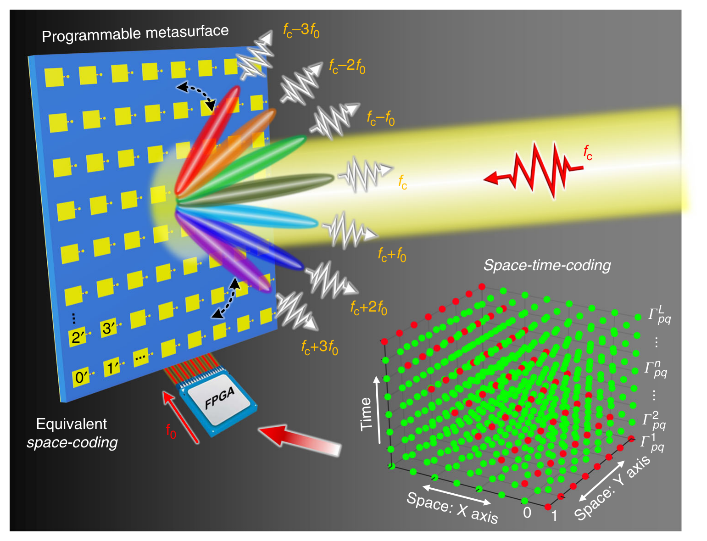

**Original caption:** Fig. 1 Conceptual illustration of a space-time-coding digital metasurface. The reflection coefficient of the metasurface elements is dynamically controlled with discrete phase or amplitude states by applying control voltages to PIN diodes. In the illustrated example, the reflection phase of each coding element is periodically switched according to the digital "0/1" space-time-coding matrix, which can result in an equivalent multi-bit space-coding, such as "0′", "1′", "2′" and "3′" (equivalent 2-bit case). This coding strategy enables precise control of EM waves in both space and frequency domains

**中文图注:** 图 1：时空编码数字超表面的概念示意。通过对 PIN 二极管施加控制电压，超表面单元的反射系数可在离散的相位或幅度状态间被动态控制。在图中示例里，每个编码单元的反射相位按照数字“0/1”时空编码矩阵周期性切换，可等效出一种多比特空间编码，例如“0′”“1′”“2′”“3′”（等效 2 比特情形）。这种编码策略能够在空间域与频率域同时精确操控电磁波。

**Reading note:** 读图时把“坐标轴”与“矩阵”对应起来看：左下到右上依次是等效空间编码（0′/1′/2′/3′）、空间-时间-频率的三维关系、以及右下角的数字“0/1”时空编码矩阵（红点=1、绿点=0）。关键点是——物理单元只有 0°/180° 两种反射相位，但按不同时间序列循环切换后，在一个调制周期内平均出的“等效激励”可以呈现出近似 360° 的连续相位，即“用时间换相位比特”。这也解释了标题中“space-time-coding”的含义：空间编码决定波束方向，时间编码决定功率落到哪个谐波。

**Original:** By assuming the time-modulation speed much smaller than the EM-wave frequency, and based on physical-optics-type approximations, we can adiabatically extend the approximate modeling that was originally introduced for space-coding metasurfaces. Accordingly, under normal incidence of plane waves with suppressed time-harmonic dependence exp(j2πfct), the time-domain far-field pattern scattered by the space-time-coding digital metasurface can be expressed approximately as

**中文:** 在假定时间调制速度远小于电磁波频率的前提下，并基于物理光学类型的近似，我们可以绝热地把原本针对空间编码超表面的近似建模推广过来。于是，在时间谐波依赖项 exp(j2πfct) 已被抑制的平面波正入射条件下，时空编码数字超表面散射的时域远场方向图可近似表示为

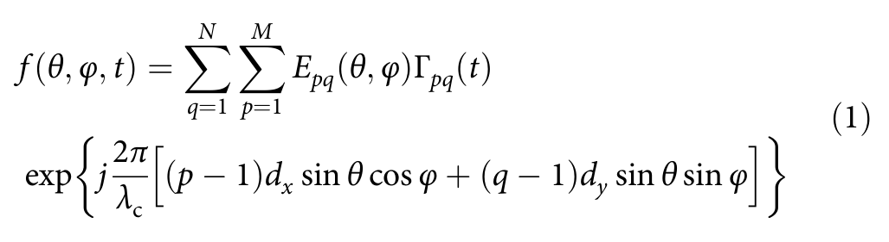

**中文说明：** 式 (1) 给出时域远场 f(θ, φ, t)：对全部编码单元求和，每项由单元远场方向图 Eₚq(θ, φ)、时变反射系数 Γₚq(t) 以及与单元位置 (p−1)dx、(q−1)dy 相关的空间相位因子相乘而成。θ、φ 为仰角与方位角，dx、dy 为单元在 x、y 方向的周期。

**Original:** where Epq(θ,φ) is the far-field pattern pertaining to the (p, q)th coding element computed at the central frequency fc, θ and φ are the elevation and azimuth angles, respectively, dx and dy are the element periods along the x and y directions, respectively, and λc is the central operational wavelength. According to the time-switched array theory, Γpq(t) is the time-modulated reflection coefficient of the (p, q)th element, which is assumed as a periodic function of time and defined over one period as a linear combination of shifted pulse functions:

**中文:** 其中 Eₚq(θ, φ) 是在中心频率 fc 处计算的第 (p, q) 个编码单元的远场方向图，θ 与 φ 分别为仰角与方位角，dx 与 dy 为单元沿 x、y 方向的周期，λc 为中心工作波长。根据时间切换阵列理论，Γₚq(t) 是第 (p, q) 个单元的时间调制反射系数，假定为时间的周期函数，并在一周期内定义为若干移位脉冲函数的线性组合：

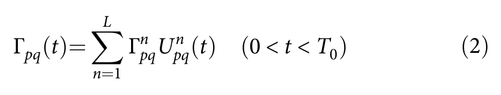

**中文说明：** 式 (2) 把一个调制周期内的反射系数写成 L 个移位脉冲函数 Uₚqⁿ(t) 的线性叠加，每一项权重为 Γₚqⁿ（即该时间片内的反射系数）。这相当于把“连续的时间调制”离散化为 L 个时间片的编码。

**Original:** where Unpq(t) is a periodic pulse function with modulation period T0. In each period, we have

**中文:** 其中 Uₚqⁿ(t) 是调制周期为 T₀ 的周期脉冲函数。在每个周期内，有

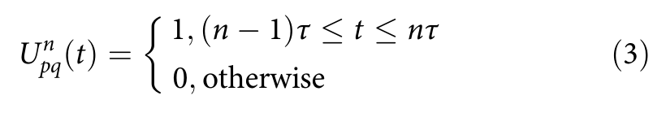

**中文说明：** 式 (3) 定义第 n 个时间片的脉冲形状：(n−1)τ ≤ t ≤ nτ 时取 1，其余取 0。

**Original:** where τ = T0/L is the pulse width of Unpq(t), L is a positive integer representing the length of the time-coding sequence, and Γnpq = Anpqexp(jφnpq) is the reflection coefficient of the (p, q)th coding element during the interval (n − 1)τ ≤ t ≤ nτ at the central frequency, with Anpq and φnpq denoting the amplitude and phase, respectively.

**中文:** 其中 τ = T₀/L 是 Uₚqⁿ(t) 的脉冲宽度，L 为正整数，表示时间编码序列的长度；Γₚqⁿ = Aₚqⁿ·exp(jφₚqⁿ) 为第 (p, q) 个编码单元在区间 (n − 1)τ ≤ t ≤ nτ 内、于中心频率处的反射系数，Aₚqⁿ 与 φₚqⁿ 分别表示其幅度与相位。

**Original:** Next, we decompose Unpq(t) into a Fourier series

**中文:** 接下来，我们把 Uₚqⁿ(t) 展开为傅里叶级数

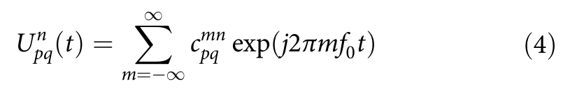

**中文说明：** 式 (4) 是脉冲函数的傅里叶级数：以 f₀ = 1/T₀ 为基频，各次谐波由傅里叶系数 cₚq^mn 加权。注意下标 n 表示时间片编号、上标 m 表示谐波阶数，二者不可混淆。

**Original:** where f0 = 1/T0, and the Fourier coefficients cmnpq are given by

**中文:** 其中 f₀ = 1/T₀，傅里叶系数 cₚq^mn 由下式给出

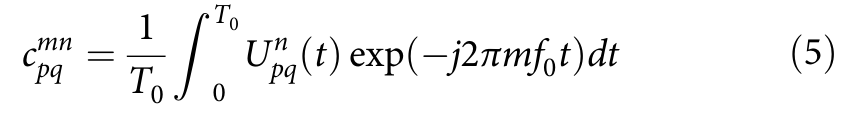

**中文说明：** 式 (5) 是傅里叶系数的定义式：在第 n 个时间片区间内对脉冲函数做积分，积分限从 (n−1)τ 到 nτ。

**Original:** Thus, the Fourier series coefficients ampq of the periodic function Γpq(t) can be represented as (see Supplementary Note 1 for detailed derivations)

**中文:** 因此，周期函数 Γₚq(t) 的傅里叶级数系数 aₚq^m 可表示为（详细推导见补充注记 1）

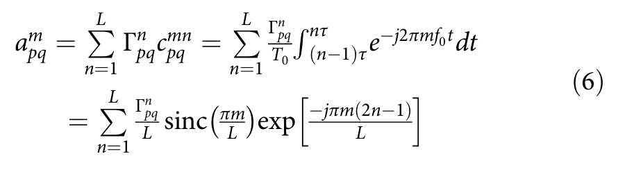

**中文说明：** 式 (6) 是全文最关键的解析式：aₚq^m = Σₙ Γₚqⁿ·(1/L)·sinc(πm/L)·exp[−jπm(2n−1)/L]。它说明第 m 次谐波的等效激励是各时间片反射系数 Γₚqⁿ 的加权求和，权重由 sinc 项与一个随时间片序号线性增长的相位项构成——这正是“用时间编码合成等效幅度与相位”的数学依据。

**Original:** Finally, the far-field scattering pattern of the space-time-coding digital metasurface at the mth harmonic frequency fc + mf0 is written as

**中文:** 最后，时空编码数字超表面在第 m 次谐波频率 fc + mf₀ 处的远场散射方向图写作

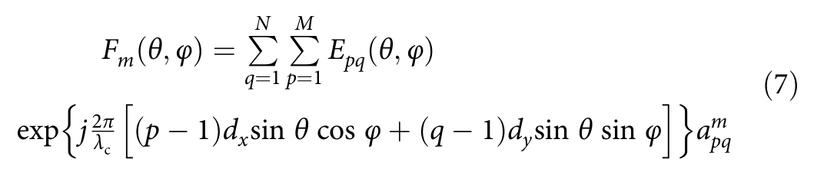

**中文说明：** 式 (7) 给出谐波远场 Fᵐ(θ, φ)：把式 (6) 得到的等效激励 aₚq^m 代回式 (1) 的空间求和，即得任意谐波频率处的散射方向图。这正是后文所有谐波波束设计（图 2、图 3）与 RCS 缩减（图 5）的计算基础。

**Original:** In the approximate modeling, the mutual coupling between coding elements is ignored. Hence, for an arbitrary 3D space-time-coding sequence (see Supplementary Note 2 for details), we can calculate the scattering pattern of the coding metasurface at any harmonic frequencies via Eq. (7). Throughout the paper, for simplicity, we assume isotropic coding elements (Epq = 1). By controlling the time-coding sequences of the individual elements, a set of complex reflection coefficients ampq is synthesized to control their scattering properties. More specifically, via Eq. (6), we can synthesize the equivalent amplitude and phase excitations of all elements at a specific harmonic frequency, as shown in Supplementary Figure 1.

**中文:** 在该近似建模中，编码单元之间的互耦被忽略。因此，对任意的三维时空编码序列（详见补充注记 2），我们都可以通过式 (7) 计算编码超表面在任意谐波频率处的散射方向图。为简单起见，全文假定编码单元各向同性（Eₚq = 1）。通过控制各个单元的时间编码序列，可以合成出一组复反射系数 aₚq^m，用以调控其散射特性；更具体地说，借助式 (6)，我们能够在特定谐波频率处合成所有单元的等效幅度与相位激励，如补充图 1 所示。

**Original:** In this study, we assume that the reflection amplitude Anpq of each element is uniform, whereas the phase φnpq is a periodic function of time, whose values are either 0° or 180°, according to the digits "0" and "1" in the coding sequence. Henceforth, we shall refer to this scheme as "phase modulation" (PM). The coding sequence in the space-time-coding digital metasurface can be arbitrary, and is represented by a 3D matrix with dimensions (M, N, L). For instance, Supplementary Figure 1a displays a random 3D space-time-coding matrix with dimensions (8, 8, 8), representing a coding metasurface composed of 8 × 8 elements, with an 8-interval periodic time modulation (see also Supplementary Figure 1f). All coding elements are periodically switched according to the 3D matrix shown in Supplementary Figure 1a. Each element has its own independent time-coding sequence, which results in different equivalent amplitudes and phases at the various harmonic frequencies. For instance, with reference to the +2nd harmonic frequency, the equivalent amplitude and phase distributions are shown in Supplementary Figures 1b, c, respectively. The corresponding 3D and 2D scattering patterns in the uv-plane (u = sin θ cosφ, v = sin θ sin φ) are shown in Supplementary Figures 1d, e, respectively. The reader is referred to Supplementary Figures 2 and 3 for additional results.

**中文:** 在本研究中，我们假定每个单元的反射幅度 Aₚqⁿ 是均匀的，而相位 φₚqⁿ 是时间的周期函数，其取值根据编码序列中的数字“0”“1”在 0° 或 180° 之间切换。以下我们称该方案为“相位调制”（PM）。时空编码数字超表面的编码序列可以是任意的，用一个维度为 (M, N, L) 的三维矩阵表示。例如补充图 1a 展示了一个维度为 (8, 8, 8) 的随机三维时空编码矩阵，对应由 8 × 8 个单元构成、含 8 个时间间隔周期调制的编码超表面（另见补充图 1f）。所有编码单元都按补充图 1a 中的三维矩阵周期性切换。每个单元都有各自独立的时间编码序列，因此在各谐波频率处得到不同的等效幅度与相位。例如，就 +2 次谐波而言，其等效幅度与相位分布分别见补充图 1b、1c；在 uv 平面（u = sin θ cosφ，v = sin θ sin φ）中对应的三维与二维散射方向图分别见补充图 1d、1e。更多结果请参阅补充图 2 与补充图 3。

**Original:** As a key aspect of the proposed approach, we highlight that, although the physical coding elements exhibit only binary reflection phases (0° or 180°), the equivalent excitation [via Eq. (6)] can attain almost 360° phase coverage by suitably designing the time-coding sequences, as shown in Supplementary Figures 1c. In this way, a single 1-bit (or 2-bit) programmable metasurface periodically time-switched can be used to effectively synthesize multi-bit programmable metasurfaces (see Supplementary Note 3), which can open up a plethora of interesting applications.

**中文:** 作为该方法的一个关键之处，我们要强调：尽管物理编码单元只具有二值反射相位（0° 或 180°），但通过合理设计时间编码序列，其等效激励［由式 (6) 给出］可以达到接近 360° 的相位覆盖，如补充图 1c 所示。这样一来，仅用一块周期性时间切换的 1 比特（或 2 比特）可编程超表面，就能有效等效出多比特可编程超表面（见补充注记 3），从而开启大量有趣的应用。

### 2.2 谐波波束扫描（Harmonic beam steering）

**Original:** With the aid of the above theoretical analysis, we can successfully attain precise control of the scattering patterns at any harmonic frequencies. As a first illustrative example, we address the design of a space-time-coding matrix for harmonic beam steering in one plane. Traditional time-switched arrays considered in previous studies can realize harmonic beam steering by using time-gradient sequences, as illustrated in Fig. 2a, b. However, these methods are based on AM, in which only one element of the array scatters at a given time, thereby resulting in significant gain reductions. Conversely, if we use the same time sequences, but considering the proposed PM scheme instead, the scattered powers can be significantly enhanced. The equivalent amplitudes and phases of the coding elements under AM and PM are shown in Fig. 2c, d, respectively. We clearly observe that the equivalent amplitudes pertaining to AM are almost constant, and significantly smaller than the PM ones, which confirms our intuition above. Moreover, it can also be observed that some equivalent phase gradients emerge at positive and negative harmonic frequencies (see white arrows), which are instrumental to steer the harmonic beams. The harmonic beam steering can be better understood by introducing a time shift in the Fourier transform. The time-coding sequences of the Y-elements from 1st to 8th in Fig. 2b can be considered as the periodic function Γpq(t) with a time shift tq, whence Γpq(t − tq) →FS ampq exp(−j2πmf0tq). Accordingly, the time shift brings an additional space phase shift −2πmf0tq with unchanged amplitudes at the mth harmonic frequency, which clearly explains the phase gradients in Fig. 2c, d (see Supplementary Note 4 for more details). Figure 2e shows the normalized scattering patterns pertaining to AM at different harmonic frequencies, while Fig. 2f shows the PM ones (normalized with respect to those in Fig. 2e). The scattering peaks pertaining to PM are 15.56, 5.78, 5.11, and 3.90 dB higher than the AM ones at fc, fc ± f0, fc ± 2f0, and fc ± 3f0, respectively. However, the power levels in the PM case are markedly unbalanced, as the power at the central frequency is much larger than those at other harmonic frequencies.

**中文:** 借助上述理论分析，我们可以在任意谐波频率处成功实现对散射方向图的精确控制。作为第一个示例，我们设计用于单平面谐波波束扫描的时空编码矩阵。以往研究中考虑的传统时间切换阵列可以用时间梯度序列实现谐波波束扫描，如图 2a、2b 所示。但这些方法基于幅度调制（AM）：在任一时刻阵列中只有一个单元在散射，因而带来明显的增益下降。相反，如果我们使用同样的时间序列、但改用本文提出的相位调制（PM）方案，散射功率就能显著增强。AM 与 PM 下编码单元的等效幅度与相位分别见图 2c、2d。可以清楚看到：AM 的等效幅度几乎恒定，且显著小于 PM 的等效幅度，这印证了上述直觉；同时还能观察到正、负谐波频率处出现了等效相位梯度（见白色箭头），这正是驱动谐波波束偏折的关键。引入傅里叶变换中的时间移位，可以更好地理解谐波波束扫描：图 2b 中第 1 至第 8 个 Y 向单元的时间编码序列可视为带时间移位 tq 的周期函数 Γpq(t)，于是 Γpq(t − tq) 的傅里叶级数对应 ampq·exp(−j2πmf0tq)。因此，时间移位在第 m 次谐波频率处引入了附加的空间相移 −2πmf0tq，而幅度保持不变——这清楚解释了图 2c、2d 中的相位梯度（详见补充注记 4）。图 2e 给出 AM 在不同谐波频率处的归一化散射方向图，图 2f 给出 PM 的结果（以图 2e 为参考归一化）。在 fc、fc ± f0、fc ± 2f0 与 fc ± 3f0 处，PM 的散射峰值分别比 AM 高 15.56、5.78、5.11 与 3.90 dB。不过 PM 情形下的功率水平明显不均衡：中心频率处的功率远高于其他谐波频率。

### 图 2 谐波波束扫描

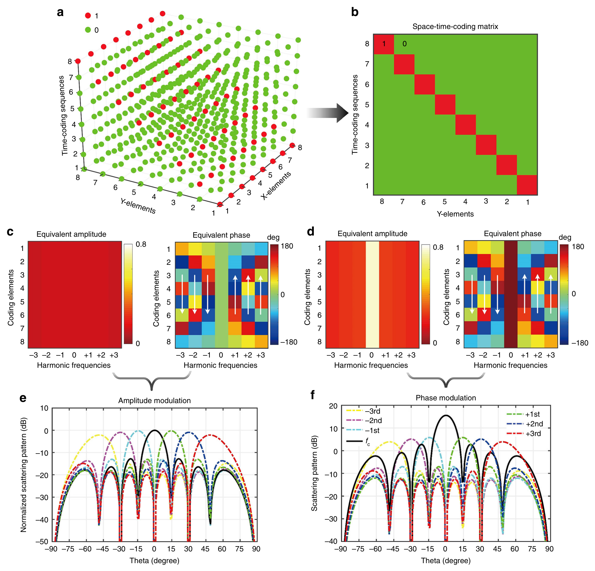

**Original caption:** Fig. 2 Harmonic beam steering. a, b 3D space-time-coding matrix and corresponding 2D coding matrix, respectively. The red and green dots represent "1" and "0" digits, respectively. c, d Equivalent amplitude and phase distributions pertaining to AM and PM schemes, respectively. The white arrows indicate the phase gradients that emerge at the various harmonic frequencies. e, f Corresponding 1D scattering pattern cuts (at φ = 90°) at different harmonic frequencies pertaining to AM and PM schemes, respectively

**中文图注:** 图 2：谐波波束扫描。a、b 分别为三维时空编码矩阵与对应的二维编码矩阵，红点与绿点分别代表数字“1”与“0”。c、d 分别为 AM 与 PM 方案下的等效幅度与等效相位分布，白色箭头标出各谐波频率处出现的相位梯度。e、f 分别为 AM 与 PM 方案在不同谐波频率处的一维散射方向图切面（φ = 90°）。

**Reading note:** 这组图的核心对比是 c 与 d：AM 的等效幅度（c 上排）几乎不随谐波变化且数值很小，而 PM（d 上排）在 ±1、±2、±3 次谐波处都保持较高幅度，因此 e 与 f 的散射峰值相差十几分贝。读图时先看 d 中白色箭头指示的“相位梯度随谐波阶数反号”，它对应 e/f 中正负谐波主瓣向相反方向偏折；再看 f 中中心频率 fc 的主瓣明显高于其他谐波，这正是后文要用 BPSO 做功率均衡的原因。

**Original:** For better equalization of the power levels, we exploit a BPSO algorithm to optimize the time-coding sequence of each coding element (see Supplementary Note 5 for more details). As a result, we obtain an optimized 2D space-time coding matrix, as shown in Fig. 3a. The equivalent amplitude and phase of this coding matrix are shown in Supplementary Figures 5a and 5b, respectively (see Supplementary Note 6 for details). The corresponding harmonic scattering patterns are shown in Fig. 3b, from which we observe that the power levels at different harmonic frequencies are now uniform and about 7.6 dB higher than those pertaining to AM (cf. Fig. 2e). The 2D and 3D scattering patterns are displayed in Fig. 3c, d, respectively. It can be observed that the main beams at different harmonic frequencies point to different directions, thereby realizing the desired harmonic beam steering.

**中文:** 为了更好地均衡功率水平，我们利用二进制粒子群优化（BPSO）算法优化每个编码单元的时间编码序列（详见补充注记 5）。由此得到一个优化后的二维时空编码矩阵，如图 3a 所示；该编码矩阵的等效幅度与相位分别见补充图 5a、5b（详见补充注记 6）。相应的谐波散射方向图见图 3b，可以看到各谐波频率处的功率水平已变得均匀，且比 AM 情形（对比图 2e）高约 7.6 dB。二维与三维散射方向图分别见图 3c、3d：不同谐波频率的主波束指向不同方向，从而实现了期望的谐波波束扫描。

**Original:** It is worth pointing out that the harmonic scattering patterns can also be calculated via the inverse fast Fourier transform (IFFT) technique, which can greatly reduce the computational complexity of the optimization, especially for electrically large metasurfaces.

**中文:** 值得指出的是，谐波散射方向图也可以通过逆快速傅里叶变换（IFFT）技术计算，从而大幅降低优化过程的计算复杂度，对于电大尺寸超表面尤为有利。

### 图 3 BPSO 优化的谐波波束扫描

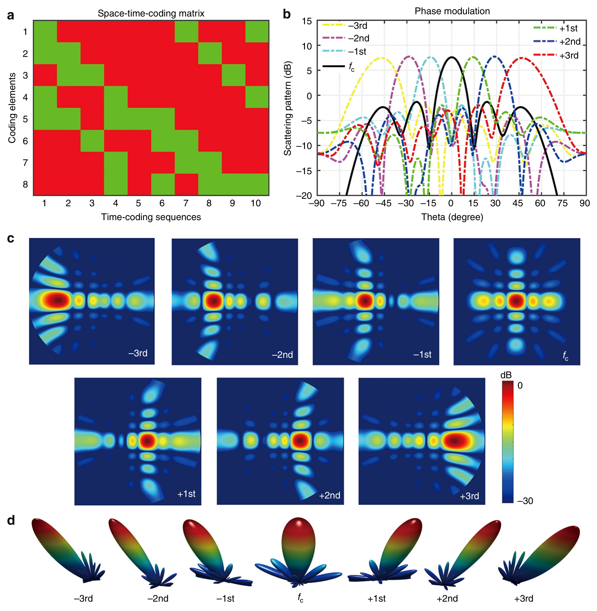

**Original caption:** Fig. 3 BPSO-optimized harmonic beam steering. a Optimized 2D space-time-coding matrix. b, c, d Corresponding 1D scattering-pattern cuts at φ = 90°, 2D, and 3D scattering patterns, respectively, at different harmonic frequencies

**中文图注:** 图 3：BPSO 优化的谐波波束扫描。a 优化后的二维时空编码矩阵。b、c、d 分别为不同谐波频率处对应的一维散射方向图切面（φ = 90°）、二维与三维散射方向图。

**Reading note:** 与图 2 对照着看：图 3a 的编码矩阵不再是简单的线性时间梯度，而是 BPSO 搜索出的“非规则”序列。效果体现在 b——±1、±2、±3 次谐波的峰值被拉平，且整体比 AM 高约 7.6 dB。c、d 说明这一均衡并未破坏波束指向：各谐波主瓣仍指向互不相同的方向。这份矩阵随后被直接烧写进 FPGA，用于图 6 的实测。

### 2.3 中心频率的波束扫描与整形（Beam steering and shaping at the central frequency）

**Original:** In the above designed 1-bit space-time-coding metasurface, only the beams at harmonic frequencies are steered towards other directions, whereas the beam at the central frequency always points at broadside. This limitation essentially stems from the equivalent phase at the central frequency (see Fig. 2c, d and Supplementary Figure 4a). As anticipated, we could use physical coding elements with 2-bit phase responses to obtain 3-bit equivalent space coding at the central frequency. The space-time-coding strategy provides a new way of designing multi-bit programmable metasurface (even with arbitrary phases), which does not require a complicated layout and control system, and enables a more precise control of EM waves in space and frequency domains.

**中文:** 在上述设计的 1 比特时空编码超表面中，只有谐波频率处的波束被引向其他方向，中心频率处的波束始终指向正前方（broadside）。这一限制本质上源自中心频率处的等效相位（见图 2c、2d 与补充图 4a）。正如预期，我们可以改用具有 2 比特相位响应的物理编码单元，在中心频率处获得 3 比特的等效空间编码。时空编码策略为设计多比特可编程超表面（甚至任意相位）提供了新途径：它不需要复杂的版图与控制系统，并能在空间域与频率域更精确地操控电磁波。

**Original:** More specifically, we consider a coding metasurface with 8 × 8 elements and time-coding sequences with a length of 8. First, we address the beam-steering design in one plane at the central frequency. Hence, we only need to study time-coding sequences of eight elements, and each column of elements has the same digital code. Figure 4a, b shows the 2-bit space-time-coding matrix, in which the red, yellow, green, and blue dots represent "0", "1", "2", and "3" digits, representing 0°, 90°, 180°, and 270° phase responses, respectively (the criterion for selecting those eight sets of time-coding sequences is detailed in Supplementary Note 7). The equivalent amplitudes and phases of those eight coding elements at different harmonic frequencies are shown in Fig. 4c, d, respectively. We can clearly observe that the designed space-time-coding matrix effectively results in equivalent 3-bit responses, "0′" (−135°), "1′" (−90°), "2′" (−45°), "3′" (0°), "4′" (45°), "5′" (90°), "6′" (135°), and "7′" (180°), and an equivalent phase gradient at the central frequency. According to the generalized Snell's law, this phase discontinuity will steer a normally incident wave by an angle of 14.5°. The corresponding 2D scattering pattern at the central frequency and the scattering patterns at different harmonic frequencies are displayed in Fig. 4e, f. It can be seen that the main beam at the central frequency points at θ = −14.5°, and the scattered powers at the harmonic frequencies are much smaller, which provides good sideband suppression.

**中文:** 更具体地说，我们考虑一个含 8 × 8 个单元、时间编码序列长度为 8 的编码超表面。首先处理中心频率处单平面的波束扫描设计，因此只需研究 8 个单元的时间编码序列，且每一列单元共享同一数字编码。图 4a、4b 给出 2 比特时空编码矩阵，其中红、黄、绿、蓝点分别代表数字“0”“1”“2”“3”，对应 0°、90°、180°、270° 的相位响应（这 8 组时间编码序列的选取准则详见补充注记 7）。这 8 个编码单元在不同谐波频率处的等效幅度与相位分别见图 4c、4d。可以清楚看到，所设计的时空编码矩阵在中心频率处有效形成了 3 比特等效响应：“0′”（−135°）、“1′”（−90°）、“2′”（−45°）、“3′”（0°）、“4′”（45°）、“5′”（90°）、“6′”（135°）、“7′”（180°），并形成等效相位梯度。根据广义斯涅尔定律，该相位不连续会把正入射波偏折 14.5°。中心频率处的二维散射方向图与不同谐波频率处的散射方向图分别见图 4e、4f：中心频率主波束指向 θ = −14.5°，而谐波频率处的散射功率小得多，因而具有良好的边带抑制。

**Original:** Moreover, we compare the beam-steering performance of the original 2-bit coding "0-0-1-1-2-2-3-3" with the equivalent 3-bit coding "0′-1′-2′-3′-4′-5′-6′-7′", as shown in Fig. 4g. It is observed that the former scheme could realize a steering angle of 14.5°, but accompanied by high sidelobes, while the latter scheme attains the steering with much lower sidelobes and only a little gain reduction attributable to the sideband power losses. Similar examples of equivalent 3-bit coding for large-angle beam steering are illustrated in Supplementary Figures 6c and 6d.

**中文:** 此外，我们比较了原始 2 比特编码“0-0-1-1-2-2-3-3”与等效 3 比特编码“0′-1′-2′-3′-4′-5′-6′-7′”的波束扫描性能，如图 4g 所示。可以看到，前者虽然也能实现 14.5° 的偏折，但旁瓣很高；后者则能以低得多的旁瓣完成同样的偏折，仅因边带功率损耗带来很小的增益下降。大角度波束扫描下等效 3 比特编码的类似示例见补充图 6c 与 6d。

**Original:** As a further illustrative example, we exploit the eight sets of time-coding sequences in Fig. 4b to generate a vortex beam carrying orbital-angular-momentum (OAM) at the central frequency. The coding metasurface is spatially divided into eight sectors with rotated distribution of time-coding sequences, and each sector has the same time-coding sequence. The final space-time-coding configuration is displayed in Supplementary Figure 7a, while the corresponding equivalent amplitudes and phases at the central frequency are shown in Fig. 4h, i, respectively. The equivalent 3-bit space-coding in Fig. 4i exhibits a spiral-like phase profile, and can generate a vortex beam with OAM mode l = 1. The corresponding 2D and 3D scattering patterns at the central frequency are shown in Fig. 4j, k. Consistently with the characteristics of the desired vortex beam, a typical intensity profile with a hollow center can been clearly observed.

**中文:** 作为又一个示例，我们利用图 4b 中的 8 组时间编码序列，在中心频率处产生携带轨道角动量（OAM）的涡旋波束。编码超表面在空间上被划分为 8 个扇区，各扇区的时间编码序列呈旋转分布，每个扇区内使用同一时间编码序列。最终的时空编码构型见补充图 7a，中心频率处对应的等效幅度与相位分别见图 4h、4i。图 4i 中的等效 3 比特空间编码呈现螺旋状相位分布，可产生 OAM 模式 l = 1 的涡旋波束。中心频率处对应的二维与三维散射方向图见图 4j、4k，可以清楚观察到涡旋波束典型的中心中空强度分布。

**Original:** It is worth highlighting that the above examples, dealing with radiation scenarios of practical interest for high-performance antennas and wireless communication systems, could not be readily addressed via the simpler strategies (phase-switched screens or time-modulated arrays).

**中文:** 值得强调的是，上述示例涉及高性能天线与无线通信系统所关心的辐射场景，而仅靠更简单的策略（相位切换屏或时间调制阵列）难以直接实现。

### 图 4 中心频率处的波束扫描与整形

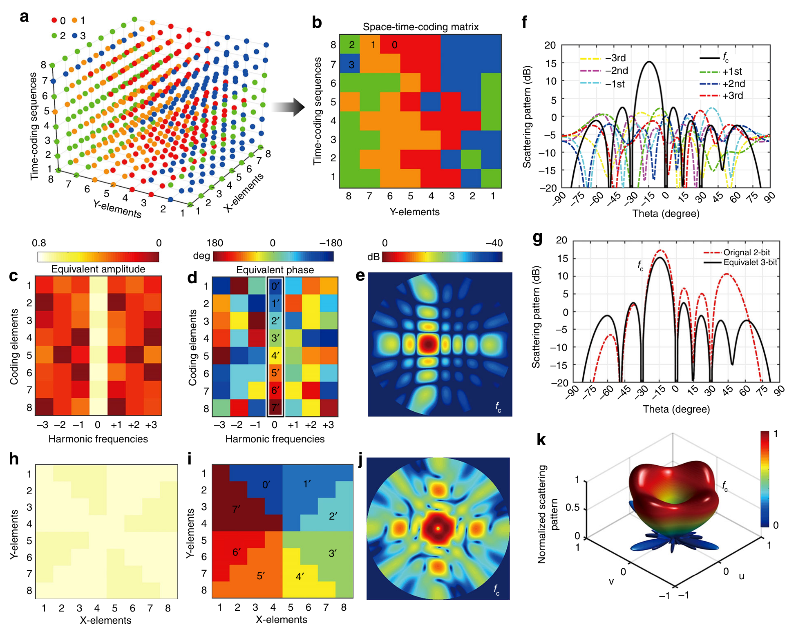

**Original caption:** Fig. 4 Beam steering and shaping at the central frequency. a, b 3D space-time-coding matrix and corresponding 2D coding matrix for beam steering, respectively, in which the red, yellow, green, and blue dots represent "0", "1", "2", and "3" digits, respectively. c, d Equivalent amplitude and phase distributions at different harmonic frequencies, respectively. This space-time-coding matrix results in equivalent 3-bit coding responses "0", "1′", "2′", "3′", "4′", "5′", "6′", and "7′" at the central frequency. e Corresponding 2D scattering pattern at the central frequency for beam steering. f Corresponding 1D scattering pattern cuts (at φ = 90°) at different harmonic frequencies. g Comparison of scattering patterns pertaining to the original 2-bit coding and equivalent 3-bit coding for realizing the beam steering at the central frequency. h, i Equivalent amplitude and phase distributions for vortex-beam generation at the central frequency, which exhibit an equivalent 3-bit coding spiral phase profile (OAM mode l = 1). j, k Corresponding 2D and 3D scattering patterns at the central frequency for beam shaping, respectively

**中文图注:** 图 4：中心频率处的波束扫描与整形。a、b 分别为用于波束扫描的三维时空编码矩阵与对应的二维编码矩阵，其中红、黄、绿、蓝点分别代表数字“0”“1”“2”“3”。c、d 分别为不同谐波频率处的等效幅度与相位分布；该时空编码矩阵在中心频率处形成“0′”“1′”“2′”“3′”“4′”“5′”“6′”“7′”的 3 比特等效编码响应。e 波束扫描在中心频率处对应的二维散射方向图。f 不同谐波频率处对应的一维散射方向图切面（φ = 90°）。g 为实现中心频率波束扫描，原始 2 比特编码与等效 3 比特编码的散射方向图对比。h、i 中心频率处涡旋波束产生所用的等效幅度与相位分布，呈现等效 3 比特编码的螺旋相位剖面（OAM 模式 l = 1）。j、k 波束整形在中心频率处对应的二维与三维散射方向图。

**Reading note:** 这张图信息量最大，建议按 a–g 与 h–k 两组看。a–g 是“用时间换比特”的直接证据：物理上仍是 2 比特（0/1/2/3），但 d 显示中心频率处等效出 8 个相位台阶（−135° 到 180°），g 中 3 比特等效编码的旁瓣比原 2 比特编码低得多。h–k 是同一思想的复用：把 8 组序列按扇区旋转排布，i 的相位沿方位角螺旋上升，k 的三维图中主瓣中心出现凹陷，即涡旋波束的特征。注意 g 图例中的 “Orignal / Equivalet” 是原文拼写，应为 Original / Equivalent。

### 2.4 用于雷达散射截面缩减的散射控制（Scattering control for radar-cross-section reduction）

**Original:** In radar and stealth technologies, reducing the scattering from a target, i.e., reducing its radar cross section (RCS), represents a pivotal issue. Conventional radar absorbing materials can absorb the incident EM power, whereas low-scattering metasurfaces based on the principle of phase cancellation can redirect the incident wave to other directions. The phase-switched screen proposed in ref. 34 exploits temporal-coding (via a simple time-switching sequence "01") for redistributing the scattered power to odd harmonics. Against this background, our proposed space-time-coding digital metasurfaces can redistribute the scattered power in both space and frequency domains, leading to a mechanism for RCS reductions that completely differs from the conventional strategies.

**中文:** 在雷达与隐身技术中，降低目标的散射、即降低其雷达散射截面（RCS），是一个关键问题。传统雷达吸波材料能够吸收入射电磁能量，而基于相位对消原理的低散射超表面则可以把入射波重定向到其他方向。文献 34 提出的相位切换屏利用时间编码（通过简单的时间切换序列“01”）把散射功率重新分配到奇次谐波。在此背景下，我们提出的时空编码数字超表面可以在空间域与频率域同时重新分配散射功率，从而形成一种与传统策略完全不同的 RCS 缩减机制。

**Original:** For example, Fig. 5a illustrates a metasurface featuring a uniform reflection-phase distribution, which essentially behaves like a metallic plate. By assuming normally incident plane-wave illumination, from the normalized 2D scattering pattern shown in Fig. 5f, we observe a scattered power peaked at broadside. By changing the uniform phase distribution to a chessboard-like pattern as shown in Fig. 5b, the backscattered power is strongly reduced, but there are still strong scattering peaks at other directions, as it can be observed in Fig. 5g. We now apply to the chessboard-like pattern a space-coding matrix varying with the time sequence "10" in a modulation period, as illustrated in Fig. 5c. In this case, the incident power is redistributed in both space and frequency domains. The scattering patterns pertaining to the center frequency and the first five positive harmonic frequencies are displayed in Fig. 5h. Note that this time-coding results in the generation of odd harmonics only, as shown in Supplementary Figure 8a. We clearly observe that the beam shapes are the same as those in Fig. 5g, but the backscattered powers spread to odd sidebands only. This active coding metasurface modulated by the space-time-coding matrix in Fig. 5c could yield zero backscattered power at the central frequency. Moreover, the maximum of backscattered powers at different harmonic frequencies is also reduced by ~9.55 dB by comparison with Fig. 5f, and by ~3.92 dB by comparison with the chessboard-like space coding in Fig. 5g.

**中文:** 例如，图 5a 展示了一个反射相位均匀分布的超表面，其行为本质上类似金属板。假定平面波正入射，从图 5f 的归一化二维散射方向图可以看到散射功率集中在正前方。把均匀相位分布改为图 5b 所示的棋盘形图案后，回波功率被大幅削弱，但在其他方向仍存在较强的散射峰（见图 5g）。现在我们给棋盘形图案施加一个在一个调制周期内按时间序列“10”变化的时空编码矩阵，如图 5c 所示。此时入射功率在空间域与频率域同时被重新分配。中心频率与前 5 个正次谐波频率对应的散射方向图见图 5h。注意这种时间编码只产生奇次谐波，如补充图 8a 所示。可以清楚看到：波束形状与图 5g 相同，但回波功率只扩散到奇次边带。由图 5c 的时空编码矩阵调制的这种有源编码超表面，在中心频率处可以实现零回波功率；此外，各谐波频率处的最大回波功率相比图 5f 降低约 9.55 dB，相比图 5g 的棋盘形空间编码降低约 3.92 dB。

**Original:** If we now consider the BPSO-optimized space-coding shown in Fig. 5d, the backscattered power would be distributed uniformly in all possible directions, as it can be observed in Fig. 5i. This optimized space-coding results in a more uniform scattering pattern, and decreases the maximum of backscattered power of 7.07 dB by comparison with the chessboard-like space-coding. On this basis, we apply a random time-coding sequence "10011010" to the optimized space-coding, as displayed in Fig. 5e. In this case, the incident power is redistributed in both space and frequency domains more uniformly. The scattering patterns pertaining to the first five positive harmonic frequencies are displayed in Fig. 5j. The beam shapes are also the same as those in Fig. 5i, but the backscattered powers are now significantly reduced in the whole upper space, and spread to almost all sidebands (see Supplementary Figure 8b). This space-time-coding matrix could also yield zero backscattered power at the central frequency. Moreover, the maximum of backscattered energies at different harmonic frequencies are reduced by ~21.52 dB by comparison with Fig. 5f, and by ~8.82 dB by comparison with Fig. 5i. Generally, the backscattered powers can be perfectly suppressed in both space and frequency domains, by introducing proper time modulation on space-coding metasurfaces, which ensures the effective and robust RCS reduction.

**中文:** 若改用图 5d 中经 BPSO 优化的空间编码，回波功率会在所有可能方向上均匀分布，如图 5i 所示。这种优化后的空间编码带来更均匀的散射方向图，相比棋盘形空间编码把最大回波功率又降低了 7.07 dB。在此基础上，我们对优化空间编码施加随机的间编码序列“10011010”，如图 5e 所示。此时入射功率在空间域与频率域中被更均匀地重新分配，前 5 个正次谐波频率对应的散射方向图见图 5j：波束形状仍与图 5i 相同，但回波功率在整个上半空间都被显著削弱，并扩散到几乎所有边带（见补充图 8b）。该时空编码矩阵同样可在中心频率处实现零回波功率；此外，各谐波频率处的最大回波能量相比图 5f 降低约 21.52 dB，相比图 5i 降低约 8.82 dB。总的来说，通过对空间编码超表面引入恰当的时间调制，可以在空间域与频率域同时完美压制回波功率，从而实现有效且鲁棒的 RCS 缩减。

### 图 5 基于时空编码超表面的 RCS 缩减

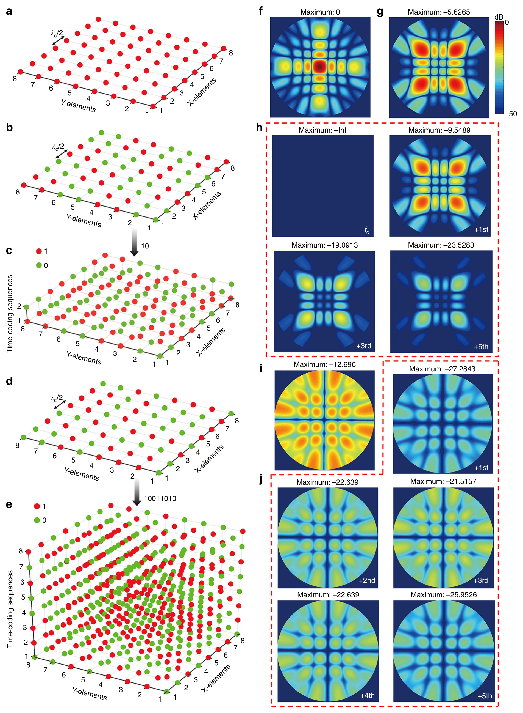

**Original caption:** Fig. 5 RCS reductions via space-time-coding metasurfaces. a, b Metasurfaces with uniform and chessboard-like space-coding distributions, respectively. c 3D space-time-coding matrix obtained by applying the time-coding sequence "10" to the chessboard-like space coding. d Metasurface with an optimized space-coding distribution. e 3D space-time-coding matrix obtained by applying the random time-coding sequence "10011010" to the space coding in panel (d). f, g 2D scattering patterns pertaining to the metasurfaces in panels (a, b), respectively. h 2D scattering patterns pertaining to the space-time-coding digital metasurface in panel (c) at different harmonic frequencies. Note that this time-coding results in the generation of odd harmonics only. i 2D scattering patterns of the metasurface in panel (d). j 2D scattering patterns pertaining to the space-time-coding digital metasurface in panel (e) at different harmonic frequencies

**中文图注:** 图 5：基于时空编码超表面的 RCS 缩减。a、b 分别为空间编码均匀分布与棋盘形分布的超表面。c 把时间编码序列“10”施加到棋盘形空间编码上得到的三维时空编码矩阵。d 具有优化空间编码分布的超表面。e 把随机时间编码序列“10011010”施加到 (d) 中空间编码上得到的三维时空编码矩阵。f、g 分别为 (a)、(b) 中超表面对应的二维散射方向图。h (c) 中时空编码数字超表面在不同谐波频率处的二维散射方向图；注意这种时间编码只产生奇次谐波。i (d) 中超表面的二维散射方向图。j (e) 中时空编码数字超表面在不同谐波频率处的二维散射方向图。

**Reading note:** 这张图的读法是“横向对比 a–b、d 三种空间编码，纵向对比 f–i–j 三种结果”。关键在每幅散射图旁标出的 Maximum 值：f 为 0 dB（等价于金属板），g 降到 −5.63 dB（棋盘编码打散后向）；对棋盘编码再叠加时间序列“10”后（h），中心频率处的最大回波降为 −Inf（完全抵消），各谐波最大值进一步降至 −9.55 dB；若改用 BPSO 优化空间编码（i），最大值可压到 −12.70 dB，再叠加随机时间序列“10011010”（j）后进一步降到 −21.52 dB。也就是说，空间编码负责把能量摊平到各个方向，时间编码负责把能量摊到各个谐波，两者叠加才实现空间与频谱的双重抑制。

### 2.5 实验验证（Experimental verification）

**Original:** To validate the above-illustrated concepts and designs, we realize a coding metasurface composed of 8 × 8 elements pertaining to the harmonic-beam-steering example (see Fig. 3). As shown in Fig. 6a, each column (composed of eight coding elements) is connected by biasing lines with a width of 0.2 mm and shares a common control voltage. Each coding element consists of a rectangular metal patch printed on a grounded F4B substrate with dielectric constant of 2.65, loss tangent of 0.001, and thickness of 2 mm. A PIN-diode (M/A-COM MADP-000907–14020x) is employed to connect the patch with ground through a metal stub and via, as shown in Fig. 6b. The size of the coding element is 15 mm × 15 mm, which corresponds to half wavelength at the central frequency of 10 GHz. The dimensions of the stub and patch are determined to attain a 180° reflection-phase change when the PIN diode switches between "ON" and "OFF" states (see Supplementary Figure 9 for more details). As the diode is "ON" (or "OFF") with a biasing voltage of 1.33 V (or 0 V), the corresponding coding state is "1" (or "0"). The equivalent circuit model of the PIN diode is illustrated in Fig. 6c, with R = 7.8 Ω, C = 28 pF, and L = 30 pH for full-wave analysis around 10 GHz.

**中文:** 为验证上述概念与设计，我们针对谐波波束扫描示例（见图 3）制作了一个由 8 × 8 个单元构成的编码超表面。如图 6a 所示，每一列（含 8 个编码单元）通过宽度 0.2 mm 的偏置线相连，并共享同一控制电压。每个编码单元由印刷在接地 F4B 基板上的矩形金属贴片构成，基板介电常数为 2.65、损耗角正切为 0.001、厚度为 2 mm。如图 6b 所示，使用一只 PIN 二极管（M/A-COM MADP-000907-14020x）通过金属短截线和过孔把贴片与地连接。编码单元尺寸为 15 mm × 15 mm，对应中心频率 10 GHz 处的半波长。短截线与贴片的尺寸经过设计，使 PIN 二极管在“ON”与“OFF”状态间切换时产生 180° 的反射相位变化（详见补充图 9）。当二极管在 1.33 V（或 0 V）偏置下处于“ON”（或“OFF”）时，对应编码状态为“1”（或“0”）。PIN 二极管的等效电路模型见图 6c，用于 10 GHz 附近全波分析的参数为 R = 7.8 Ω、C = 28 pF、L = 30 pH。

**Original:** Full-wave simulation results are obtained by using the commercial software package, CST Microwave Studio 2014. In the simulations of the coding elements, periodic boundaries are applied to the x and y directions, and two Floquet ports are used along the ±z directions. A linearly polarized plane-wave illumination (with x-directed electric field) is assumed to calculate the reflection coefficient pertaining to the coding elements. The phase and amplitude of the reflection coefficient pertaining to the "ON" and "OFF" states of the PIN diode are shown in Fig. 6f, g, respectively. We observe that the phase difference is 180° around the frequency of 10 GHz, and the corresponding amplitude is nearly unit (above 0.95).

**中文:** 全波仿真结果由商业软件 CST Microwave Studio 2014 得到。在编码单元仿真中，x、y 方向施加周期边界，±z 方向使用两个 Floquet 端口；并假定线极化平面波照射（电场沿 x 方向）来计算编码单元的反射系数。PIN 二极管“ON”与“OFF”状态下反射系数的相位与幅度分别见图 6f、6g。可以看到，在 10 GHz 附近相位差为 180°，且对应幅度接近 1（高于 0.95）。

**Original:** Based on this design, we fabricate a prototype of the proposed coding metasurface, as shown in Fig. 6e. The structure consists of eight columns with eight connected elements, and has an overall size of 120 mm × 120 mm (4λc × 4λc). The experiments are carried out in a standard microwave anechoic chamber, with the measurement setup illustrated in Fig. 6d. A linearly polarized horn antenna working from 8 to 12 GHz serves as the excitation source and is connected to a microwave signal generator (Keysight E8267D), which provides the excitation signal at a fixed frequency. Both the space-time-coding digital metasurface and feeding antenna are mounted on a turntable, which can automatically rotate by 360° in the horizontal plane. Another horn antenna is used to receive the harmonic scattered signals via a spectrum analyzer (Keysight E4447A). An FPGA hardware control board (ALTERA Cyclone IV) is exploited to provide dynamic biasing voltages for the coding metasurface, in which each column shares a control voltage. The adopted FPGA is a low-cost system with a clock speed of 50 MHz, in which a code is preloaded to generate eight control voltages according to the time-coding sequences in Fig. 3a. The modulation period T0 of the time-coding sequences is 2 μs and the pulse width τ is 0.2 μs, which correspond to a system modulation frequency f0 = 0.5 MHz, and diode switching speed of 5 MHz, respectively. It is worth pointing out that the relatively fast switching speed is attributable to the parallelized design of PIN-diodes in each column in Fig. 6a, e.

**中文:** 基于该设计，我们制作了所提编码超表面的样机，如图 6e 所示。该结构由 8 列、每列 8 个相连单元组成，整体尺寸为 120 mm × 120 mm（4λc × 4λc）。实验在标准微波暗室中进行，测量装置如图 6d 所示。工作于 8 至 12 GHz 的线极化喇叭天线作为激励源，连接到微波信号发生器（Keysight E8267D）以提供固定频率的激励信号。时空编码数字超表面与馈电天线均安装在一个转台上，可在水平面内自动旋转 360°。另一只喇叭天线通过频谱分析仪（Keysight E4447A）接收谐波散射信号。一块 FPGA 硬件控制板（ALTERA Cyclone IV）为编码超表面提供动态偏置电压，其中每一列共享一个控制电压。所用 FPGA 是低成本系统，时钟频率 50 MHz，预先载入的代码可按照图 3a 中的时间编码序列生成 8 路控制电压。时间编码序列的调制周期 T0 为 2 μs，脉冲宽度 τ 为 0.2 μs，对应系统调制频率 f0 = 0.5 MHz、二极管切换速度 5 MHz。值得指出的是，相对较快的切换速度得益于图 6a、6e 中每列 PIN 二极管的并联设计。

**Original:** Figure 6h, i shows the measured 2D scattering patterns pertaining to the first three positive and negative harmonics, assuming center frequencies of 9.8 and 10.0 GHz, respectively. Due to the blockage effect of the illuminating horn antenna, the scattering patterns at the center frequencies are not shown. The scattering patterns are normalized with respect to the scattered peak power measured from a copper plate with the same size as the metasurface. We clearly observe that the harmonic beam steering is obtained, as an effect of the space-time-coding metasurface. The steering angles of the harmonic beams are in good agreement with the theoretical predictions (see Supplementary Table 1 for more details), thereby validating the effectiveness of the proposed approach. We also observe that the results at the central frequency of 10.0 GHz are moderately worse than those at 9.8 GHz, which is likely attributable to a shift of the 180° phase-difference condition due to fabrication tolerances as well as the various approximations and parameter uncertainties in our modeling. Nevertheless, the measured results at 10.0 GHz still exhibit the general hallmarks of the harmonic beam steering, as shown in Fig. 6i.

**中文:** 图 6h、6i 给出了中心频率分别为 9.8 GHz 与 10.0 GHz 时，前三个正、负谐波的实测二维散射方向图。由于照射喇叭天线的遮挡效应，中心频率处的散射方向图未予给出。散射方向图以与超表面同尺寸的铜板所测散射峰值功率为参考进行归一化。可以清楚看到，得益于时空编码超表面，谐波波束扫描得以实现；各谐波波束的偏折角与理论预测吻合良好（详见补充表 1），从而验证了该方法的有效性。我们还观察到，10.0 GHz 中心频率下的结果比 9.8 GHz 时略差，这很可能是由于加工公差以及建模中的各种近似与参数不确定性导致 180° 相位差条件发生偏移。尽管如此，10.0 GHz 下的实测结果仍表现出谐波波束扫描的总体特征，如图 6i 所示。

**Original:** The proposed space-time-coding metasurface can in principle operate as a broadband system, provided that the design of the coding elements is likewise broadband, which is promising for multi-input and multi-output (MIMO) wireless communications. For instance, at different directions, the scattered power spectra are different for the various harmonic frequencies, and can be precisely controlled. Therefore, we can envision the possibility to encode information in the frequency spectra for multi-point communications, which can find intriguing applications in MIMO scenarios.

**中文:** 只要编码单元的设计同样具备宽带特性，所提出的时空编码超表面原则上可以作为宽带系统工作，这对多输入多输出（MIMO）无线通信具有吸引力。例如，在不同方向上，各谐波频率的散射功率谱互不相同且可被精确控制。因此，可以设想把信息编码到频谱中用于多点通信，这在 MIMO 场景中具有有趣的应用前景。

### 图 6 样机设计、建模与表征

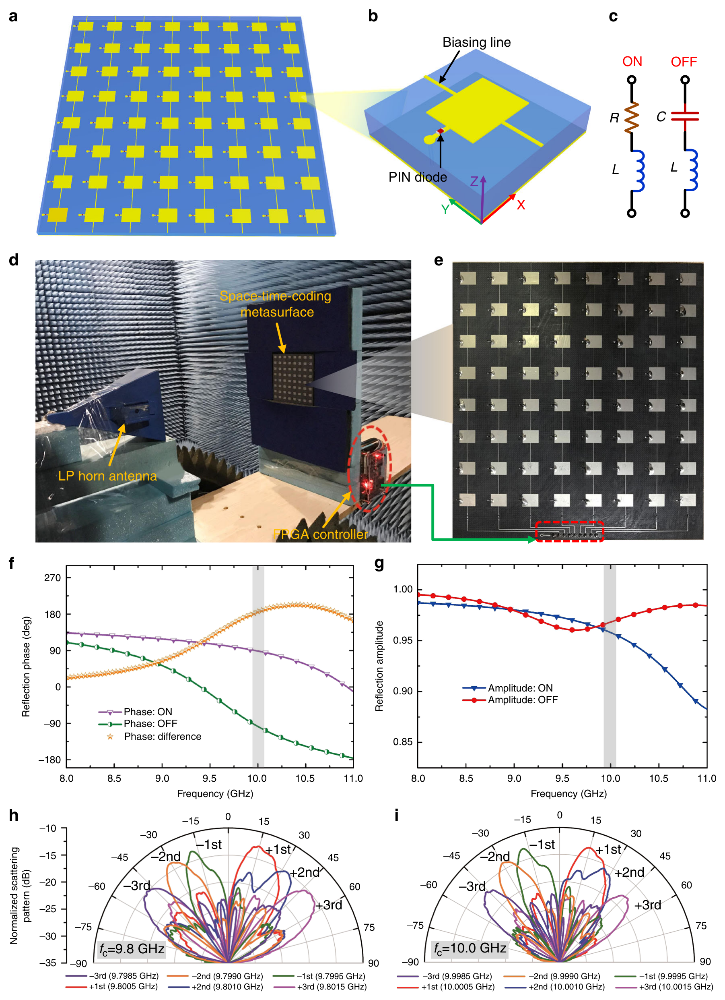

**Original caption:** Fig. 6 Prototype design, modeling, and characterization. a Schematic of the realized space-time-coding metasurface prototype. b Geometry of the coding element with the biasing line. c Equivalent circuit models of the PIN diode biased at the "ON" and "OFF" states. d Measurement setup in an anechoic chamber. e Photo of the fabricated prototype. f, g Numerically computed reflection phase and amplitude of the coding element, respectively, for both diode states as a function of frequency. The grey-shaded areas indicate a neighborhood of the operational frequency (10 GHz). h, i Measured scattering patterns at different harmonic frequencies, for excitation frequencies of 9.8 and 10 GHz, respectively

**中文图注:** 图 6：样机设计、建模与表征。a 所实现时空编码超表面样机的示意。b 含偏置线的编码单元几何结构。c PIN 二极管在“ON”与“OFF”偏置状态下的等效电路模型。d 暗室中的测量装置。e 加工样机的照片。f、g 两种二极管状态下编码单元反射相位与反射幅度随频率变化的数值计算结果，灰色阴影区表示工作频率（10 GHz）附近区域。h、i 激励频率分别为 9.8 GHz 与 10 GHz 时、不同谐波频率处的实测散射方向图。

**Reading note:** 读图顺序建议 f/g → d/e → h/i。f 与 g 是“单元是否合格”的证据：在 10 GHz 附近两态相位差恰为 180°，且幅度均高于 0.95，所以 1 比特相位调制成立。d 与 e 说明实验链路：喇叭天线 + 转台 + 频谱分析仪，超表面与馈源同轴旋转，中心频率方向图因遮挡而缺失。h 与 i 是最终结论：±1、±2、±3 次谐波主瓣分别指向约 ∓15°、∓30°、∓47°（见补充表 1），与理论一致；i 比 h 略差，可用相位差条件偏移解释。

## 3 讨论 DISCUSSION

**Original:** In summary, we have proposed a strategy based on time-modulation to design space-time-coding digital metasurfaces, in which each coding element has a set of time-coding sequences switched cyclically in a modulation period. Together with spatial modulation, the proposed time modulation on digital coding can control both spatial (propagation direction) and spectral (frequency distribution) characteristics of the scattered EM power. As a proof of principle, by means of a BPSO-based design of time-coding sequence, we demonstrated beam-scanning patterns at different harmonic frequencies. An FPGA-controlled prototype was fabricated and experimental characterized to validate the proposed method, indicating good agreement with the theoretical predictions. We also proposed other intriguing application scenarios to beam shaping and reduction of the scattered power, via proper design of the 3D space-time-coding matrix.

**中文:** 总而言之，我们提出了一种基于时间调制的策略来设计时空编码数字超表面：其中每个编码单元都拥有一组时间编码序列，并在一个调制周期内循环切换。与空间调制相结合，这种对数字编码施加的时间调制可以同时控制散射电磁功率的空间特性（传播方向）与频谱特性（频率分布）。作为原理验证，我们通过基于 BPSO 的时间编码序列设计，演示了不同谐波频率处的波束扫描方向图；并制作了 FPGA 控制的样机并进行实验表征，结果与理论预测吻合良好。我们还通过合理设计三维时空编码矩阵，提出了波束整形与降低散射功率等其他有趣的应用场景。

**Original:** By comparison with the "phase-switched screens", our approach is considerably more general and flexible, owing to the judicious combination between the wave-manipulation capabilities enabled by metasurfaces and suitable temporal modulation. This enables more precise and effective control of the scattering and radiation, for both even/odd harmonics and central frequency.

**中文:** 与“相位切换屏”相比，我们的方法要通用、灵活得多，原因在于它巧妙结合了超表面所赋能的波调控能力与恰当的时间调制。这使其能够对偶次/奇次谐波以及中心频率的散射与辐射实现更精确、更有效的控制。

**Original:** In general, our proposed theory and design of space-time-coding digital metasurfaces substantially expand the application scope of digital metamaterials, and may find important applications to wireless communications, cognitive radars, MIMO systems, OAM beam generation, adaptive beamforming, and holographic imaging. The proposed concept can be extended to the terahertz and optical ranges, as well as to acoustic waves, and can be further generalized to control the transmitted waves by suitably modulating the phase or amplitude of the transmission coefficient. Planned future investigations also include the exploration of space-time coding to engineer nonreciprocal effects.

**中文:** 总体而言，我们提出的时空编码数字超表面理论与设计显著拓展了数字超材料的应用范围，并可能在无线通信、认知雷达、MIMO 系统、OAM 波束产生、自适应波束赋形与全息成像等领域得到重要应用。该概念可推广到太赫兹与光学波段以及声波，并可通过恰当调制透射系数的相位或幅度进一步推广到对透射波的控制。计划中的未来研究还包括探索利用时空编码来构造非互易效应。

## 代码与数据可用性（Code and Data Availability）

**Original:** Code availability. The custom computer codes utilized during the current study are available from the corresponding authors on reasonable request.

**中文:** 代码可用性：本研究使用的自编计算机代码可向通讯作者合理索取。

**Original:** Data availability. The datasets generated during and/or analyzed during the current study are available from the corresponding authors on reasonable request.

**中文:** 数据可用性：本研究生成和/或分析的数据集可向通讯作者合理索取。

## 附录：补充材料（Supplementary Information）

### A.1 傅里叶级数系数的推导（Supplementary Note 1）

**Original:** Supplementary Note 1: Derivation of Fourier-series coefficients ampq. The Fourier-series coefficients ampq of the periodic function Γpq(t) are derived in detail as follows:

**中文:** 补充注记 1：傅里叶级数系数 aₚq^m 的推导。周期函数 Γₚq(t) 的傅里叶级数系数 aₚq^m 的详细推导如下：

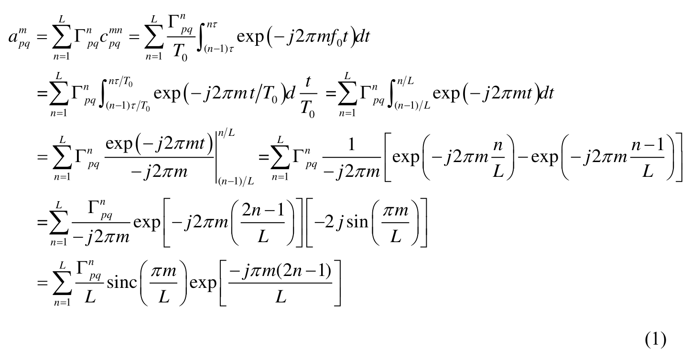

**中文说明：** 补充式 (1) 把主文式 (5) 的积分代入式 (6) 的求和，逐项积分后化简，最终把 aₚq^m 写成各时间片反射系数 Γₚqⁿ 与一个仅依赖 (m, n) 的复权重之积的和。该式是补充注记 2 中全部数值计算的出发点。

**Original:** The equivalent amplitude Amp q and phase φmpq excitations of each coding element at different harmonic frequencies can be written as

**中文:** 每个编码单元在不同谐波频率处的等效幅度 Aₚq^m 与等效相位 φₚq^m 激励可写作

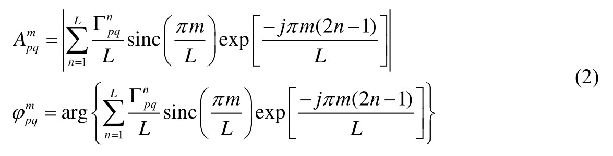

**中文说明：** 补充式 (2) 分别给出等效幅度 Aₚq^m = |Σₙ Γₚqⁿ·sinc(πm/L)·exp[−jπm(2n−1)/L]| 与等效相位 φₚq^m = arg{·}（并对 L 归一化）。它把“时间编码序列”与“谐波频率处的等效激励”直接对应起来，是全文的核心工具式。

**Original:** Via Supplementary Equation (2), we can calculate the equivalent amplitude and phase of each coding element for any time-coding sequences, which can help controlling the scattered power at various harmonic frequencies.

**中文:** 借由补充式 (2)，我们可以对任意时间编码序列计算每个编码单元的等效幅度与相位，从而帮助控制各谐波频率处的散射功率。

### A.2 随机时空编码矩阵的详细分析（Supplementary Note 2）

**Original:** Supplementary Note 2: Detailed analysis of the random space-time-coding matrix. The three-dimensional (3D) space-time-coding matrix in Supplementary Figure 1a can be displayed in another form, as shown in Supplementary Figure 1f. Each coding element has its own time-coding sequences, which can be independently designed.

**中文:** 补充注记 2：随机时空编码矩阵的详细分析。补充图 1a 中的三维时空编码矩阵可以用另一种形式表示，如补充图 1f 所示。每个编码单元都拥有各自的时间编码序列，可以独立设计。

#### 图 S1 时空编码矩阵及其对应的散射方向图

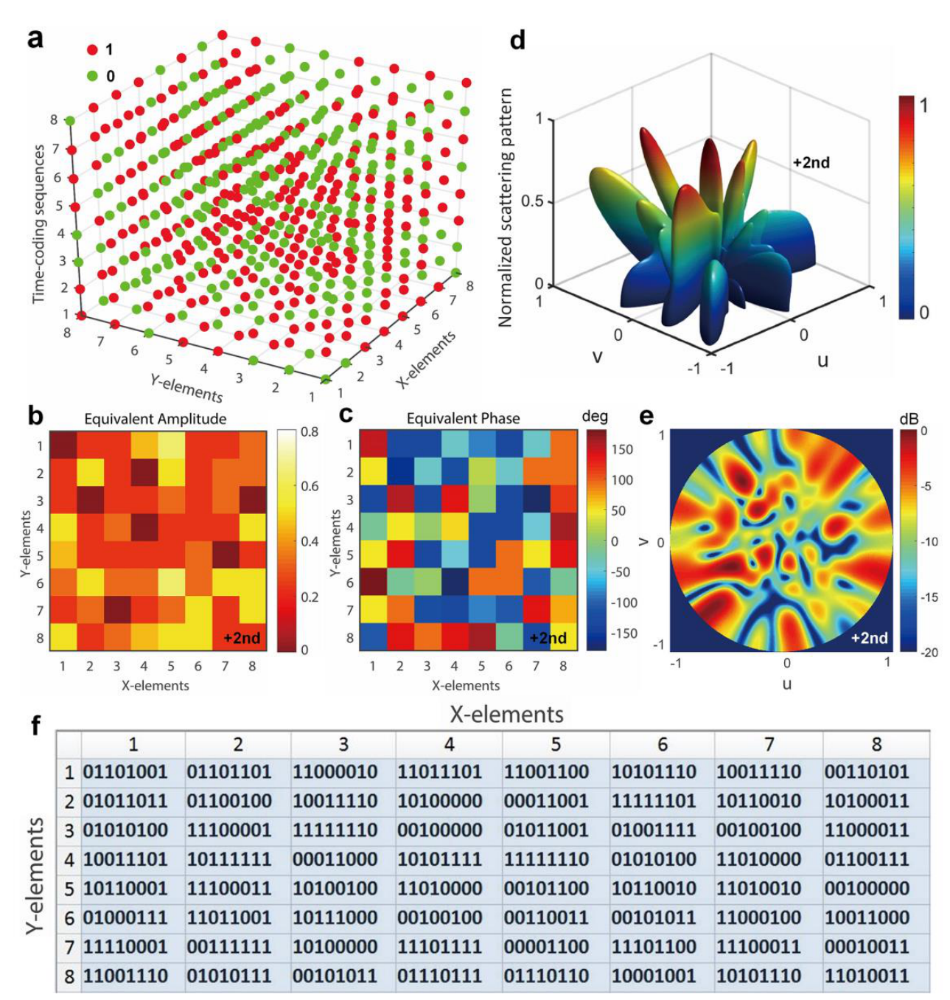

**Original caption:** Supplementary Figure 1 | Space-time-coding matrix and corresponding scattering patterns. a, Random 3D space-time-coding matrix with dimension (8, 8, 8). The red and green dots represent "1" and "0" digits, respectively. b,c, Equivalent amplitudes and phases, respectively, of all coding elements at the +2nd harmonic frequency. d,e, Corresponding 3D and 2D scattering patterns, respectively, at the +2nd harmonic frequency. f, Time-coding sequences of each coding element in panel a.

**中文图注:** 补充图 1：时空编码矩阵及其对应的散射方向图。a 维度为 (8, 8, 8) 的随机三维时空编码矩阵，红点与绿点分别代表数字“1”与“0”。b、c 分别为 +2 次谐波频率处所有编码单元的等效幅度与等效相位。d、e 分别为 +2 次谐波频率处对应的三维与二维散射方向图。f a 中各编码单元的时间编码序列。

**Reading note:** a 与 f 是同一矩阵的两种“视图”：a 把 (x, y, t) 三个维度一次性画成三维点云，f 则把每个单元的时间序列摊平成一维行。b、c 说明随机的时空编码能让各单元在 +2 次谐波处获得互不相同的等效激励，d、e 则是这种激励的散射后果——整体呈漫散射状，没有明显主瓣。

**Original:** By using Supplementary Equation (2), the equivalent amplitude and phase at any harmonic frequencies are calculated. Supplementary Figures 2a and 2b show the equivalent amplitude and phase patterns from the -3rd to +4th harmonic frequencies based on the space-time-coding matrix in Supplementary Figure 1a. It can be observed that each harmonic frequency has independent distributions of amplitude and phase. However, the phase at the central frequency is only 0 or 180°, which is inherently limited by the 1-bit design of the coding element. Supplementary Note 3 illustrates how to circumvent this limitation. Further results pertaining to scattering patterns at different harmonic frequencies are shown in Supplementary Figure 3. The scattering patterns at any harmonic frequencies can be obtained via Eq. (7). Due to the different equivalent amplitude and phase distributions at different harmonic frequencies, the resulting scattering patterns are also different.

**中文:** 利用补充式 (2) 可以计算任意谐波频率处的等效幅度与相位。补充图 2a、2b 给出基于补充图 1a 中时空编码矩阵、从 −3 次到 +4 次谐波频率的等效幅度与相位分布。可以看到，每个谐波频率都有各自独立的幅度与相位分布；但中心频率处的相位只能是 0° 或 180°，这是 1 比特编码单元设计固有的限制。补充注记 3 说明了如何规避这一限制。不同谐波频率处散射方向图的更多结果见补充图 3；任意谐波频率的散射方向图都可通过主文式 (7) 求得。由于各谐波频率处的等效幅度与相位分布不同，得到的散射方向图也彼此不同。

#### 图 S2 任意谐波频率处的等效幅度与相位

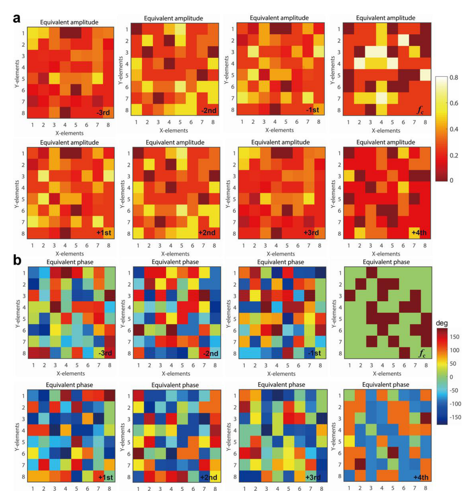

**Original caption:** Supplementary Figure 2 | Equivalent amplitudes and phases at any harmonic frequencies. a,b, Equivalent amplitude and phase distributions, respectively, pertaining to the -3rd to +4th harmonic frequencies, based on the space-time-coding matrix in Supplementary Figure 1a.

**中文图注:** 补充图 2：任意谐波频率处的等效幅度与相位。a、b 分别给出基于补充图 1a 中时空编码矩阵、−3 次至 +4 次谐波频率的等效幅度分布与等效相位分布。

**Reading note:** 这张图是“一个矩阵、七个谐波”的展开：横轴为单元编号、纵轴为谐波阶数，每个格子给出该单元在该谐波处的等效幅度（a）或相位（b）。注意中心频率 m = 0 那一行在相位图中只有两种取值，而 ±1、±2、±3、±4 行的相位则连续铺满 360°——这正是“时间编码可以补足相位比特”的直观证据。

#### 图 S3 不同谐波频率处的散射方向图

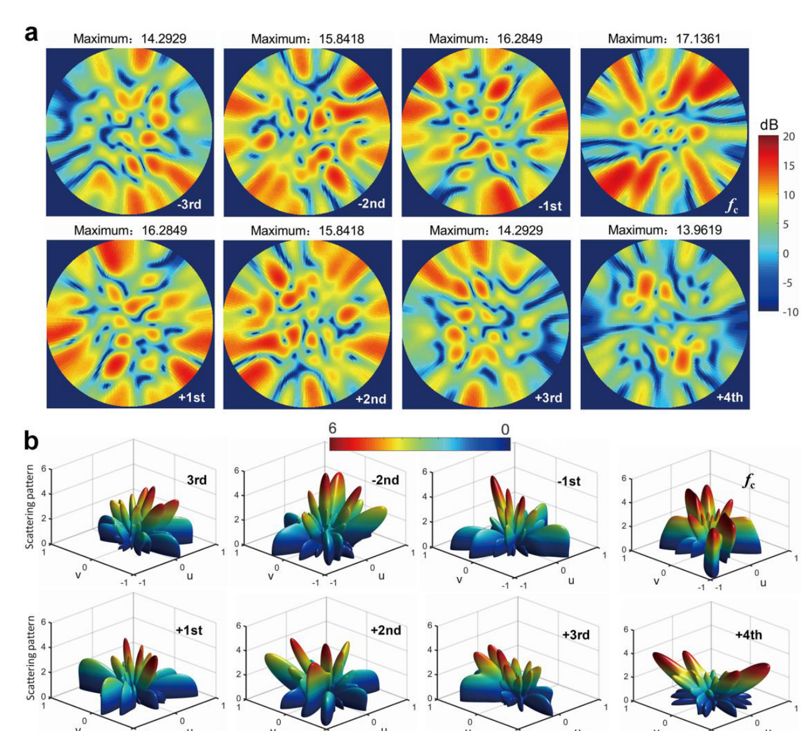

**Original caption:** Supplementary Figure 3 | Scattering patterns at different harmonic frequencies. a,b, 2D and 3D scattering patterns, respectively, pertaining to the -3rd to +4th harmonic frequencies based on the space-time-coding matrix in Supplementary Figure 1a.

**中文图注:** 补充图 3：不同谐波频率处的散射方向图。a、b 分别为基于补充图 1a 中时空编码矩阵、−3 次至 +4 次谐波频率的二维与三维散射方向图。

**Reading note:** 与补充图 2 对照阅读：各谐波的等效激励分布不同，因此散射方向图也不一样，整体呈“方向与频谱都摊平”的漫散射形态。这一点在补充注记 8 中会被再次用到——它是抑制时域高强度脉冲的一种手段。

### A.3 不同谐波频率处的等效相位覆盖（Supplementary Note 3）

**Original:** Supplementary Note 3: Equivalent phase coverages at different harmonic frequencies. As previously mentioned, the equivalent phases φmpq of each coding element at any harmonic frequencies can be independently designed via suitable choice of the corresponding time-coding sequence. Here, we theoretically study the phase coverage at different harmonic frequencies. In the 1-bit case, the coding elements only exhibit 0 or 180° phase responses, and the equivalent phase coverages are demonstrated in Supplementary Figure 4a. We can observe that the phase coverage can reach 360° at any harmonic frequencies, with the exception of the central frequency. This can be explained by recalling that the equivalent phase φ0pq at the central frequency is given by

**中文:** 补充注记 3：不同谐波频率处的等效相位覆盖。如前所述，每个编码单元在任意谐波频率处的等效相位 φₚq^m 都可以通过恰当选择相应的时间编码序列来独立设计。这里我们从理论上研究不同谐波频率处的相位覆盖。在 1 比特情形下，编码单元只呈现 0° 或 180° 的相位响应，其等效相位覆盖见补充图 4a。可以看到，除中心频率外，任意谐波频率处的相位覆盖都可以达到 360°。这可以通过回顾中心频率处的等效相位 φₚq⁰ 的表达式来解释：

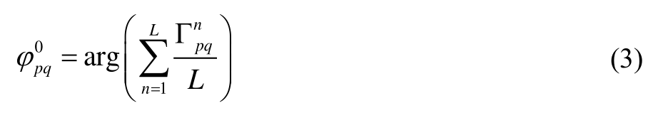

**中文说明：** 补充式 (3) 给出中心频率（m = 0）的等效相位 φₚq⁰ = arg(Σₙ Γₚqⁿ)。当 sinc 项退化为 m = 0 的特殊形式时，各项权重变为实数且同号，因此求和结果的辐角只能取 0° 或 180°——这正是中心频率无法获得连续相位覆盖的代数原因。

**Original:** which clearly indicates that the value of φ0pq is either 0 or 180°. To relax this restriction, we further study the phase coverages of 2-bit digital coding elements, which have four phase states as 0, 90°, 180°, and 270°. As shown in Supplementary Figure 4b, the equivalent phase coverages at the central frequency can also reach almost 360°, provided that the time-coding sequences of each coding elements are sufficiently long.

**中文:** 该式清楚表明 φₚq⁰ 的取值只能是 0° 或 180°。为放宽这一限制，我们进一步研究 2 比特数字编码单元的相位覆盖——它们有 0°、90°、180°、270° 四个相位状态。如补充图 4b 所示，只要各编码单元的时间编码序列足够长，中心频率处的等效相位覆盖同样可以接近 360°。

#### 图 S4 1 比特与 2 比特数字编码单元的等效相位覆盖

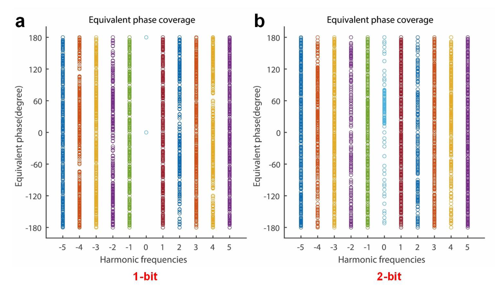

**Original caption:** Supplementary Figure 4 | a,b, Equivalent phase coverages of 1-bit and 2-bit digital coding elements, respectively, at different harmonic frequencies.

**中文图注:** 补充图 4：a、b 分别为 1 比特与 2 比特数字编码单元在不同谐波频率处的等效相位覆盖。

**Reading note:** 读图时把横轴当作谐波阶数、纵轴当作可达相位范围。a 中 m ≠ 0 的行都能铺满整个圆，唯独 m = 0 一行只落在 0°/180° 两个点上；b 用 2 比特单元把这最后的缺口也几乎补满。这张图是“用时间编码等效更高比特数”这一主张的核心支撑。

**Original:** On the other hand, the control system and biasing circuit of conventional (n>2)-bit programmable metasurfaces are very complicated. In order to design non-modulated elements with higher-bit coding, such as 3-bit, additional diodes need to be embedded into the elements. The layout would be very complicate and the control system would also be a challenge. However, the proposed space-time-coding metasurfaces provide a simple strategy to obtain almost 360° phase coverage at any harmonic frequencies and central frequency. Therefore, high-bit programmable metasurfaces can be easily realized by suitably designing the time-coding sequences, which does not need a complicate layout and control system.

**中文:** 另一方面，传统 (n>2) 比特可编程超表面的控制系统与偏置电路非常复杂。若要设计 3 比特等更高比特的非调制单元，就必须在单元中嵌入更多二极管，版图会变得非常复杂，控制系统也会成为难题。而所提出的时空编码超表面提供了一种简单策略，可在任意谐波频率以及中心频率处获得接近 360° 的相位覆盖。因此，只需合理设计时间编码序列即可轻松实现高比特可编程超表面，而无需复杂的版图与控制系统。

### A.4 图 2 中谐波波束扫描的另一种解释（Supplementary Note 4）

**Original:** Supplementary Note 4: Alternative explanation of the harmonic beam steering in Figure 2. For a better understanding of our work, we provide an alternative explanation of the harmonic beam steering, by introducing the time shift in the Fourier transform. As shown in Figures 2a and 2b, the time-coding sequences of the Y-elements from 1st to 8th can be considered as the periodic function Γpq(t) with a time shift tq,

**中文:** 补充注记 4：图 2 中谐波波束扫描的另一种解释。为了更好地理解本文工作，我们通过在傅里叶变换中引入时间移位，给出谐波波束扫描的另一种解释。如图 2a、2b 所示，第 1 至第 8 个 Y 向单元的时间编码序列可视为带时间移位 tq 的周期函数 Γₚq(t)，

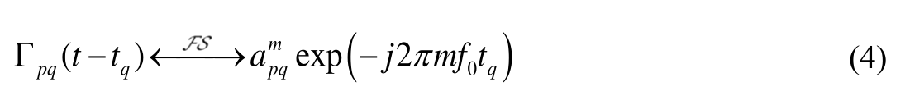

**中文说明：** 补充式 (4) 用时移定理刻画相邻单元的关系：Γₚq(t − tq) 的傅里叶级数系数等于 aₚq^m·exp(−j2πmf₀tq)。也就是说，时间上平移 tq 只给第 m 次谐波带来一个 −2πmf₀tq 的相位因子，幅度完全不变——这就是“时间梯度”如何转化为“空间相位梯度”的关键一步。与之配套的是 tq = (q−1)τ = (q−1)T₀/8（8 个 Y 单元、L = 8 时 τ = T₀/8）。

**Original:** where tq = (q − 1)τ = (q − 1)T0/8, and the Fourier series coefficients ampq of the periodic function Γpq(t) are given in Eq. (6). When the time shift tq is applied to the periodic function Γpq(t), there will be an additional space phase shift −2πmf0tq with unchanged amplitude at the mth harmonic frequency, which clearly explains the phase gradients in Figures 2c and 2d. Therefore, the phase difference ψm between adjacent (p, q)th and (p, q+1)th elements at the mth harmonic frequency can be written as

**中文:** 其中 tq = (q − 1)τ = (q − 1)T₀/8，而周期函数 Γₚq(t) 的傅里叶级数系数 aₚq^m 已由式 (6) 给出。当把时间移位 tq 施加到周期函数 Γₚq(t) 上时，在第 m 次谐波频率处会引入附加的空间相移 −2πmf₀tq，而幅度保持不变——这清楚地解释了图 2c、2d 中的相位梯度。因此，相邻的第 (p, q) 与第 (p, q+1) 个单元在第 m 次谐波频率处的相位差 ψm 可写作

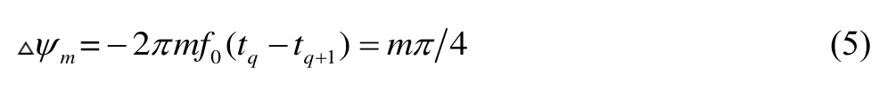

**中文说明：** 补充式 (5) 给出 ψm = 2πmf₀(tq₊₁ − tq) = mπ/4。由于相邻单元的时间移位恰好是 τ = T₀/8，所以每提高一阶谐波，相邻单元间的空间相位差就线性增加 π/4，这正是谐波级次越高、波束偏折越大的原因。

**Original:** Under normal incidence, the generalized Snell's law can be simply expressed as

**中文:** 在正入射条件下，广义斯涅尔定律可简单表示为

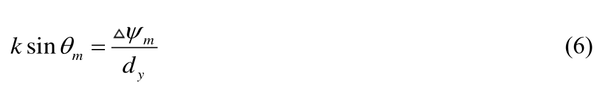

**中文说明：** 补充式 (6) 即 sin θm = ψm/(kc·dy)。其中 kc = 2π/λc 为反射波的波数，dy = λc/2 为沿 y 方向的单元周期，θm 为第 m 次谐波（频率 fc + mf₀）处的波束指向角。

**Original:** where θm is the beam steering angle at the mth harmonic frequency fc + mf0, kc = 2π/λc is the wavenumber of the reflected waves, and dy = λc/2 is the element period along the y direction. Therefore, the beam steering angle θm can be written as:

**中文:** 其中 θm 是第 m 次谐波频率 fc + mf₀ 处的波束指向角，kc = 2π/λc 是反射波的波数，dy = λc/2 是沿 y 方向的单元周期。因此，波束指向角 θm 可写作：

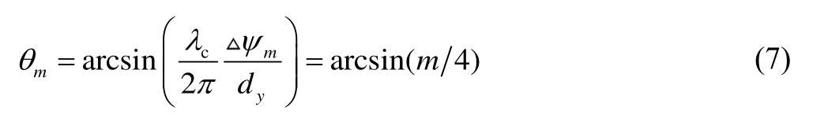

**中文说明：** 补充式 (7) 即 θm = arcsin(ψm/(kc·dy))。把 ψm = mπ/4 与 kc·dy = π 代入，得 sin θm = m/4，于是 θ₀ = 0°、θ±1 = ±14.48°、θ±2 = ±30°、θ±3 = ±48.59°，与图 2e、2f 的仿真结果一致。

**Original:** Finally, we calculate the steering angles at different harmonic frequencies, θ0=0, θ±1=±14.48°, θ±2=±30° and θ±3=±48.59°, which are all in good agreement with the theoretical results in Figures 2e and 2f.

**中文:** 最后，我们计算了不同谐波频率处的指向角：θ₀ = 0°，θ±1 = ±14.48°，θ±2 = ±30°，θ±3 = ±48.59°，均与图 2e、2f 中的理论结果吻合良好。

### A.5 基于 BPSO 的谐波波束扫描设计细节（Supplementary Note 5）

**Original:** Supplementary Note 5: Details on the BPSO-based design for harmonic beam steering. As discussed in the main text, we design a coding metasurface with 8×8 elements and a time-modulation period with 10 intervals. For simplicity, each column of eight coding elements shares the same control voltage, which corresponds to the same digital code. In this case, the 3D space-time coding matrix is simplified to a 2D matrix (similar to the process that associates Figure 2a to Figure 2b). In the PSO algorithm, a potential solution is regarded as a particle. Every particle is represented as an n-dimensional vector, and every element of the vector is described by the digits '0' or '1', corresponding to a bit of the space-time coding matrix. The moving velocity of the particle indicates the probability of position change, and is given by

**中文:** 补充注记 5：基于 BPSO 的谐波波束扫描设计细节。如正文所述，我们设计了一个含 8×8 个单元、时间调制周期含 10 个间隔的编码超表面。为简单起见，每列 8 个编码单元共享同一控制电压，即共享同一数字编码。此时三维时空编码矩阵被简化为二维矩阵（与图 2a 到图 2b 的化简过程类似）。在粒子群算法中，一个潜在解被视为一个粒子；每个粒子表示为一个 n 维向量，向量的每个元素取数字“0”或“1”，对应时空编码矩阵的一位。粒子的移动速度表示位置改变的概率，由下式给出：

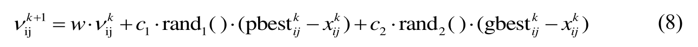

**中文说明：** 补充式 (8) 是标准的粒子速度更新：vᵢⱼ^(k+1) = w·vᵢⱼ^k + c₁·rand()·(pbestᵢⱼ^k − xᵢⱼ^k) + c₂·rand()·(gbestᵢⱼ^k − xᵢⱼ^k)。即惯性项、个体最优吸引项与全局最优吸引项三者之和；w 为惯性系数，c₁、c₂ 为加速常数。

**Original:** where rand1 and rand2 are random numbers between 0 and 1, c1 and c2 are the acceleration constants, w is the inertia coefficient, pbestkij is the individual optimal position, and gbestkij is the global optimal position. Consistently with the probabilistic interpretation, the velocity vij is constrained within the interval [0, 1], by means of a sigmoid-function mapping:

**中文:** 其中 rand₁ 与 rand₂ 是 0 到 1 之间的随机数，c₁ 与 c₂ 为加速常数，w 为惯性系数，pbestᵢⱼ^k 为个体最优位置，gbestᵢⱼ^k 为全局最优位置。与“速度表示概率”的解释一致，速度 vᵢⱼ 通过 sigmoid 函数映射被约束在区间 [0, 1] 内：

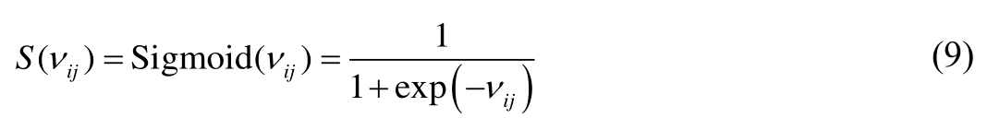

**中文说明：** 补充式 (9) 是 sigmoid 映射：Sᵢⱼ = Sigmoid(vᵢⱼ) = 1/(1 + exp(−vᵢⱼ))。它把连续速度转换成 0 到 1 之间的取 1 概率，从而把连续型 PSO 改造成适用于 0/1 编码的二进制 PSO。

**Original:** Accordingly, the position xk+1ij is updated via

**中文:** 相应地，位置 xᵢⱼ^(k+1) 按下式更新：

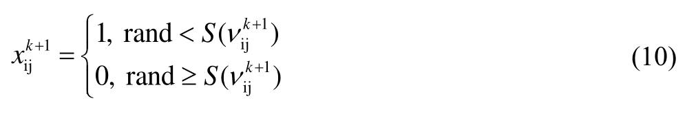

**中文说明：** 补充式 (10) 给出二进制位置更新规则：若 rand() < S(xᵢⱼ^k) 则取 1，否则取 0。式 (8)–(10) 构成 BPSO 的一次完整迭代。

**Original:** The targets to be optimized are then evaluated by the function fitness(x), looking for the best space-time-coding matrix. In order to achieve the beam steering of the desired angles at the various harmonic frequencies, the fitness function is defined as

**中文:** 随后用适应度函数 fitness(x) 评估待优化目标，以寻找最佳的时空编码矩阵。为在各谐波频率处实现期望角度的波束扫描，适应度函数定义为

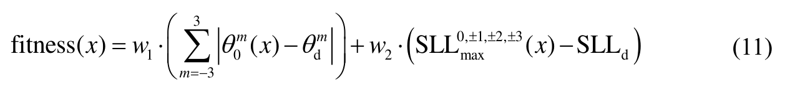

**中文说明：** 补充式 (11) 由两项加权组成：第一项对 m = 0, 1, 2, 3 各次谐波的指向角误差求和，第二项惩罚最大旁瓣电平之差。二者按权重相加，从而在“指向正确”与“旁瓣低”之间取得折中。

**Original:** where θ0m and θdm denote the simulated and desired steering angles, SLLmax0 and SLLd represent the maximum values of the simulated and desired sidelobe levels, and w1 and w2 are the corresponding weighting factors of each term, which are set as 5 and 1 in our examples.

**中文:** 其中 θₘ⁰ 与 θₘ^d 分别表示仿真得到的与期望的指向角，SLLₘₐₓ⁰ 与 SLL^d 表示仿真得到的与期望的最大旁瓣电平，w₁ 与 w₂ 是各项对应的权重因子，在本文示例中分别取 5 与 1。

### A.6 图 3a 时空编码矩阵的等效幅度与相位（Supplementary Note 6）

**Original:** Supplementary Note 6: Equivalent amplitudes and phases for the space-time-coding matrix in Figure 3a. We have realized harmonic beam steering based on the phase modulation with the BPSO-based design of the coding matrix shown in Figure 3a. Here, we illustrate the equivalent amplitudes and phases of the coding elements at different harmonic frequencies, as shown in Supplementary Figure 5. At the central frequency, the phase of the 5th coding element is 180°, and different from other elements, but its amplitude is zero. Therefore, the main beam still points at broadside, which is consistent with the results shown in Figures 3b and 3d. Furthermore, the equivalent phases at positive and negative harmonic frequencies also exhibit different phase gradients.

**中文:** 补充注记 6：图 3a 中时空编码矩阵的等效幅度与相位。我们基于相位调制、利用图 3a 中 BPSO 设计的编码矩阵实现了谐波波束扫描。这里展示各编码单元在不同谐波频率处的等效幅度与相位，如补充图 5 所示。在中心频率处，第 5 个编码单元的相位为 180°，与其他单元不同，但其幅度为零；因此主波束仍指向正前方，这与图 3b、3d 的结果一致。此外，正、负谐波频率处的等效相位也呈现出不同的相位梯度。

#### 图 S5 BPSO 设计的等效幅度与相位分布

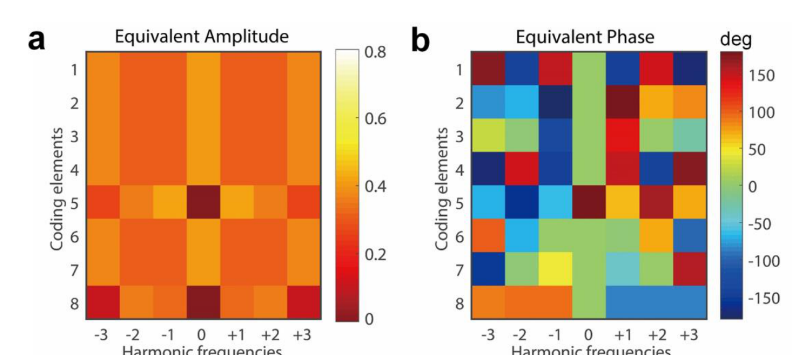

**Original caption:** Supplementary Figure 5 | a,b, Equivalent amplitude and phase distributions, respectively, for the BPSO-based design of the space-time coding matrix in Figure 3a.

**中文图注:** 补充图 5：a、b 分别为图 3a 中时空编码矩阵在 BPSO 设计下的等效幅度分布与等效相位分布。

**Reading note:** 读图时要抓住“幅度为零即不参与”这一细节：中心频率行（m = 0）中第 5 个单元相位为 180° 但幅度为零，因此它对主波束没有贡献，等效地使中心频率波束保持正前方，只有谐波波束被偏折。a、b 两幅图配合起来，说明 BPSO 是通过“调制各单元的等效幅度与相位”来均衡各谐波功率的。

### A.7 选取时间编码序列以获得 3 比特等效编码响应的准则（Supplementary Note 7）

**Original:** Supplementary Note 7: Criterion for selecting the time-coding sequences for obtaining 3-bit equivalent coding responses. In some practical applications, sideband signals are not desirable and should be suppressed to improve the scattered/radiated power at the central frequency. As an application for the beam steering shown in Figures 4e-4g, the criterion for selecting time-coding sequences of the eight elements is to make the equivalent amplitudes small enough at all harmonic frequencies, while making the equivalent phases at the central frequency to exhibit 3-bit coding responses with high amplitude (as shown in Figures 4c and 4d). Hence, an in-house MATLAB code based on Supplementary Equation (2) is utilized to search for the eligible time-coding sequences (as shown in Figure 4b).

**中文:** 补充注记 7：为获得 3 比特等效编码响应而选取时间编码序列的准则。在某些实际应用中，边带信号并不受欢迎，应当加以抑制以提升中心频率处的散射/辐射功率。以图 4e–4g 所示的波束扫描为例，选取 8 个单元时间编码序列的准则是：让所有谐波频率处的等效幅度都足够小，同时让中心频率处的等效相位呈现出高幅度的 3 比特编码响应（如图 4c、4d 所示）。因此，我们利用一个基于补充式 (2) 自编的 MATLAB 程序来搜索符合条件的间编码序列（如图 4b 所示）。

**Original:** As a result, the 2D scattering patterns pertaining to the -3rd to +3th harmonic frequencies based on the space-time-coding matrix in Figure 4a are shown in Supplementary Figure 6a. The corresponding 1D scattering patterns at the first five negative and positive harmonic frequencies are also shown in Supplementary Figure 6b. We observe that the maximum sideband level is about -12.95dB, which is much lower than the pattern level at the central frequency (cf. Figure 5f).

**中文:** 由此，基于图 4a 中时空编码矩阵、−3 次至 +3 次谐波频率对应的二维散射方向图见补充图 6a；前五个正、负谐波频率对应的一维散射方向图见补充图 6b。可以看到，最大边带电平约为 −12.95 dB，远低于中心频率处的方向图电平（对比图 5f）。

#### 图 S6 中心频率 3 比特等效编码的散射方向图

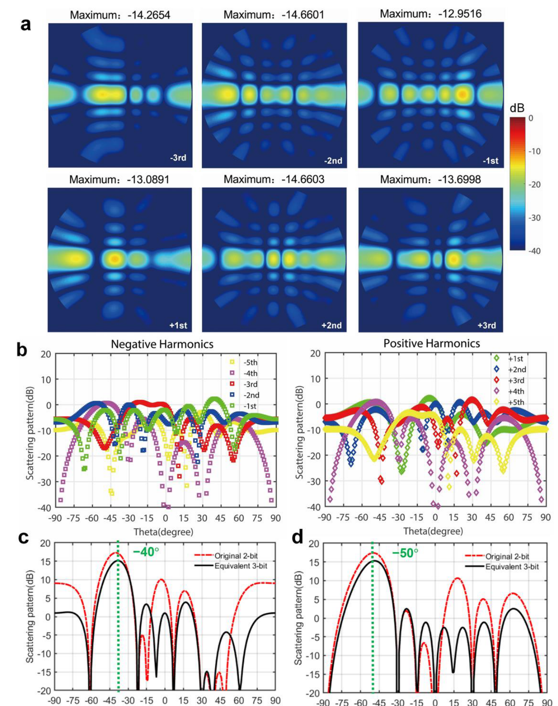

**Original caption:** Supplementary Figure 6 | a, 2D scattering patterns pertaining to the -3rd to +3th harmonic frequencies, based on the space-time-coding matrix in Figure 5a. b, Corresponding 1D scattering pattern cuts (at φ = 90°) at different harmonic sidebands. c,d, Comparison of scattering patterns pertaining to the original 2-bit coding and equivalent 3-bit coding for realizing larger steering angles at the central frequency. (Note: 原文图注中的 "Figure 5a" 与 "3th" 系笔误，应为 "Figure 4a" 与 "+3rd".)

**中文图注:** 补充图 6：a 基于图 4a 中时空编码矩阵、−3 次至 +3 次谐波频率对应的二维散射方向图。b 不同谐波边带处对应的一维散射方向图切面（φ = 90°）。c、d 为实现中心频率处更大偏折角时，原始 2 比特编码与等效 3 比特编码的散射方向图对比。（注：原图注中 “Figure 5a” 与 “3th” 应为 “Figure 4a” 与 “+3rd”。）

**Reading note:** b 中的电平标尺是这张图的重点：最大边带电平约 −12.95 dB，比中心频率主瓣低一个多数量级，因此“边带抑制”这条设计准则确实被满足。c、d 把同样的思路推广到大偏折角：原文给出的两组对比是“3-0-2-3-0-1-3-0”对“7′-1′-4′-6′-1′-3′-6′-0′”（偏折 40°）与“2-0-1-3-0-2-3-1”对“5′-0′-3′-6′-1′-4′-7′-2′”（偏折 50°），后者均以更低旁瓣实现同样的偏折。

**Original:** Moreover, we can also utilize [the eight sets of time-coding sequences in Fig. 4b] to generate a vortex-beam at the central frequency. A similar example is shown in Supplementary Figure 6d, in which the original 2-bit coding is "2-0-1-3-0-2-3-1", and the equivalent 3-bit coding is "5′-0′-3′-6′-1′-4′-7′-2′" for a steering angle of 50°... Furthermore, the eight sets of time-coding sequences with rotated distribution (see Supplementary Figure 7a) can be used to generate a vortex-beam at the central frequency, and the scattered powers at the harmonic frequencies (see Supplementary Figure 7b) are also much smaller than that in Figure 4j. Finally, we can also utilize optimization algorithms to reduce power losses in harmonic sidebands, so as to further improve the efficiency of the coding metasurface.

**中文:** 此外，我们还可以利用（图 4b 中的 8 组时间编码序列）在中心频率处产生涡旋波束。类似示例见补充图 6d：原始 2 比特编码为“2-0-1-3-0-2-3-1”，等效 3 比特编码为“5′-0′-3′-6′-1′-4′-7′-2′”，偏折角为 50°。进一步地，把这 8 组时间编码序列按旋转方式分布（见补充图 7a），即可在中心频率处产生涡旋波束，且其谐波频率处的散射功率（见补充图 7b）也远小于图 4j 中的结果。最后，我们还可以利用优化算法降低谐波边带的功率损耗，从而进一步提高编码超表面的效率。

#### 图 S7 涡旋波束产生所用的时空编码构型

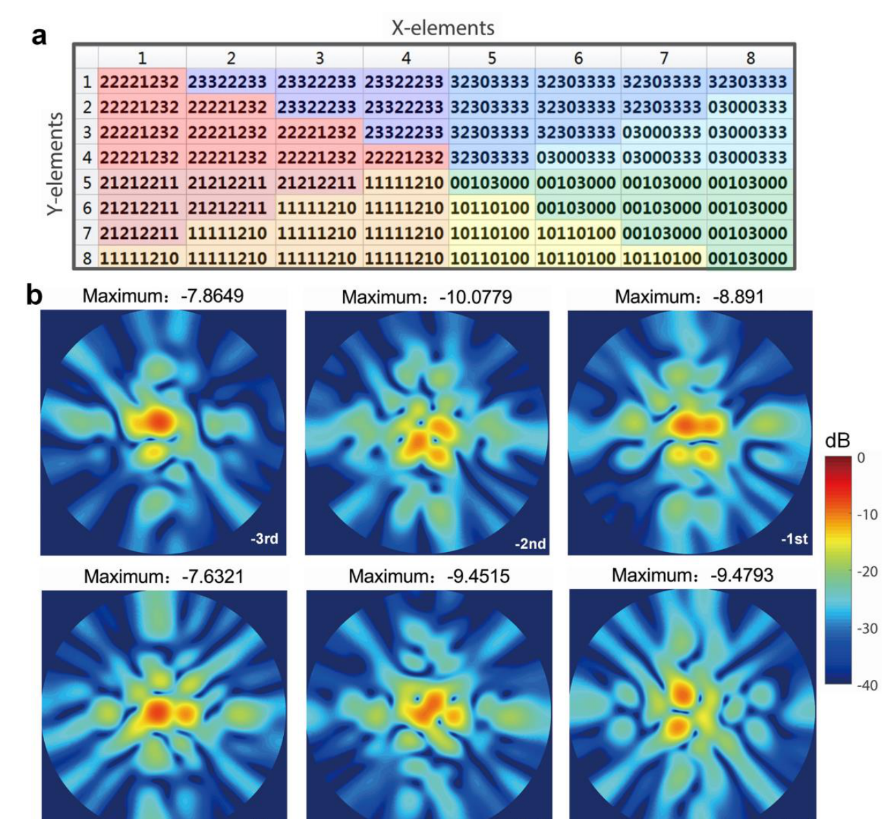

**Original caption:** Supplementary Figure 7 | Space-time-coding configuration for vortex-beam generation and corresponding 2D scattering patterns at harmonic frequencies. a, The coding metasurface is divided into eight sectors, each characterized by a 2-bit time-coding sequence. b, Corresponding 2D scattering patterns pertaining to the -3rd to +3th harmonic frequencies.

**中文图注:** 补充图 7：用于产生涡旋波束的时空编码构型及其在谐波频率处对应的二维散射方向图。a 编码超表面被划分为 8 个扇区，每个扇区由一个 2 比特时间编码序列表征。b −3 次至 +3 次谐波频率处对应的二维散射方向图。

**Reading note:** a 是图 4h、4i 的“配置视图”：8 个扇区各用一种时间编码序列，扇区之间按方位角依次旋转，于是等效出的 3 比特相位沿周向螺旋上升。b 则确认这种配置同时满足两个要求——中心频率生成涡旋波束，而各谐波频率的散射功率远低于图 4j 的结果。

### A.8 谐波最大强度的频谱分析（Supplementary Note 8）

**Original:** Supplementary Note 8: Spectral analysis of the maximum intensity of harmonics. Figures 5h and 5j show the spatial scattering patterns at different harmonic frequencies. Here, we investigate the spectral distribution of the maximum intensity of the harmonics. Supplementary Figure 8a and 8b show the maxima of scattering patterns from -50th to +50th harmonic frequencies, corresponding to the coding matrices in Figure 5c and 5e, respectively. It can be observed that the maximum intensity gradually decreases with the increase of the harmonic order, and drops significantly with respect to the first few harmonics.

**中文:** 补充注记 8：谐波最大强度的频谱分析。图 5h 与 5j 给出了不同谐波频率处的空间散射方向图。这里我们考察谐波最大强度的频谱分布。补充图 8a 与 8b 分别给出对应图 5c 与图 5e 中编码矩阵、从 −50 次到 +50 次谐波频率的散射方向图最大值。可以看到，最大强度随谐波阶数升高而逐渐减小，且相对前几次谐波出现显著下降。

#### 图 S8 −50 次至 +50 次谐波的最大散射强度

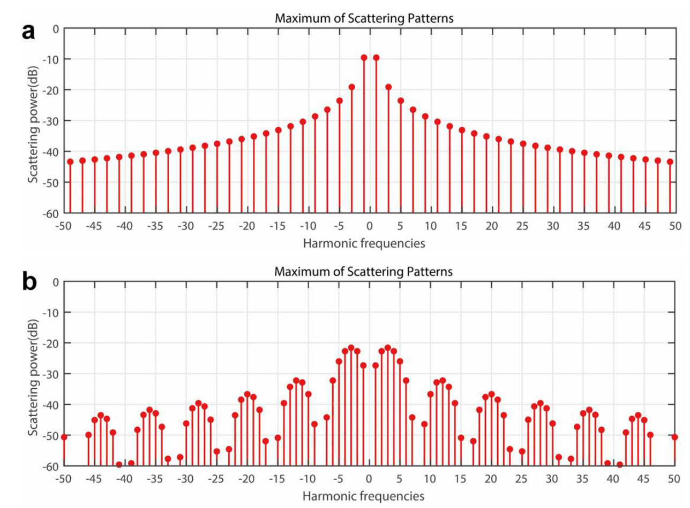

**Original caption:** Supplementary Figure 8 | a,b, Maxima of the scattering patterns from -50th to +50th harmonic frequencies, corresponding to the coding matrices in Figures 5c and 5e, respectively.

**中文图注:** 补充图 8：a、b 分别为对应图 5c 与图 5e 中编码矩阵、从 −50 次到 +50 次谐波频率的散射方向图最大值。

**Reading note:** 这张图回答了“时间编码会不会把能量搬到很远的边带”这一担心：最大强度随谐波阶数单调下降，高阶谐波的能量可以忽略。a（对应图 5c 的“10”序列，只有奇次谐波）与 b（对应图 5e 的“10011010”序列，奇偶谐波都有但整体更低）对比，正是图 5 中 21.52 dB 与 8.82 dB 两组抑制量的频谱侧证据。

**Original:** As we previously mentioned, the space-time-coding in Figure 5e yields better RCS reduction performance than that in Figure 5c. This mainly depends on the judiciously designed coding sequences in both space- and time-domain, which can redistribute the scattered power more uniformly not only in space but also in spectrum, as demonstrated in Supplementary Figure 8. In connection with the time-domain response of the proposed space-time-coding metasurface, we observe that, by assuming the modulation time much larger than the period at the central wavelength, and neglecting the transients, during each time intervals one effectively experiences a time-harmonic response associated with a specific spatial coding. Especially for the case of RCS reduction in Figure 5e, the time-domain response of this 3D space-time-coding matrix during any modulation interval can be represented by the scattering pattern in Figure 5i. In this case, the scattered power at any direction remains at low levels due to the optimized space-coding in Figure 5d for redistributing the power in the space-domain uniformly.

**中文:** 如前所述，图 5e 的时空编码比图 5c 具有更好的 RCS 缩减性能。这主要取决于在空间域与时间域上精心设计的编码序列：如补充图 8 所证明的，它不仅能更均匀地在空间上、也能更均匀地在频谱上重新分配散射功率。结合所提时空编码超表面的时域响应可以看到：在假定调制时间远大于中心波长处的周期并忽略瞬态的前提下，每个时间间隔内系统实际上经历的是与某一特定空间编码相对应的单频（时间谐波）响应。特别地，对于图 5e 的 RCS 缩减情形，该三维时空编码矩阵在任一调制间隔内的时域响应都可用图 5i 的散射方向图来代表；此时由于图 5d 中优化空间编码已把功率在空间域均匀摊平，任何方向上的散射功率都维持在低水平。

**Original:** As also indicated in the main text, the scattering patterns in Figure 5h and 5j are similar in terms of beam shapes, only differing in the maximum value. The scattering patterns at different harmonic frequencies overlap in the space-domain and therefore the temporal interference of different harmonics may add up to a ultrashort high-intensity pulse in the time-domain. Here, we provide two solutions to limit the maximum intensity over time.

**中文:** 正如正文所指出的，图 5h 与 5j 的散射方向图在波束形状上相似，只是最大值不同。不同谐波频率的散射方向图在空间域上相互重叠，因此在时域中不同谐波的干涉可能会叠加成一个超短的高强度脉冲。为此，我们给出两种限制时间上最大强度的方案。

**Original:** (1) We could utilize the random 3D space-time-coding matrix in Supplementary Figure 1a to randomly redistribute scattering patterns in space. In this case, scattering patterns at different harmonic frequencies would have different beam shapes and would not exactly overlap in space, as shown in Supplementary Figure 3. Therefore, the chances for temporal interference of different spectral harmonics adding up to a short, high-intensity pulse would be further minimized.

**中文:** （1）可以利用补充图 1a 中的随机三维时空编码矩阵，把散射方向图在空间上随机重分布。此时不同谐波频率的散射方向图具有不同的波束形状，不会在空间上完全重叠（如补充图 3 所示）。因此，不同频谱谐波的时域干涉叠加成短时高强度脉冲的概率将被进一步最小化。

**Original:** (2) On the other hand, we could significantly increase the modulation frequency f0 to obtain a very short period T0, which mainly depends on the switching speed of the PIN diodes and the control systems. The PIN diodes we used can reach a 2~3 ns switching speed. By decreasing the switching time to a nanosecond scale, it would be difficult for a radar detector to harvest energy from many harmonics. This also represents a possible solution to avoid accumulating a high-intensity pulse.

**中文:** （2）另一方面，可以显著提高调制频率 f₀ 以获得很短的周期 T₀，这主要取决于 PIN 二极管与控制系统的切换速度。我们所用的 PIN 二极管切换速度可达 2~3 ns。把切换时间降到纳秒量级后，雷达探测器将难以从众多谐波中收集能量。这也是避免高强度脉冲累积的一种可行方案。

### A.9 所提 1 比特编码单元与实验结果（Supplementary Note 9）

**Original:** Supplementary Note 9: Detailed analysis of the proposed 1-bit coding element and experimental results.

**中文:** 补充注记 9：所提 1 比特编码单元与实验结果的详细分析。

#### 图 S9 1 比特编码单元与电场分布

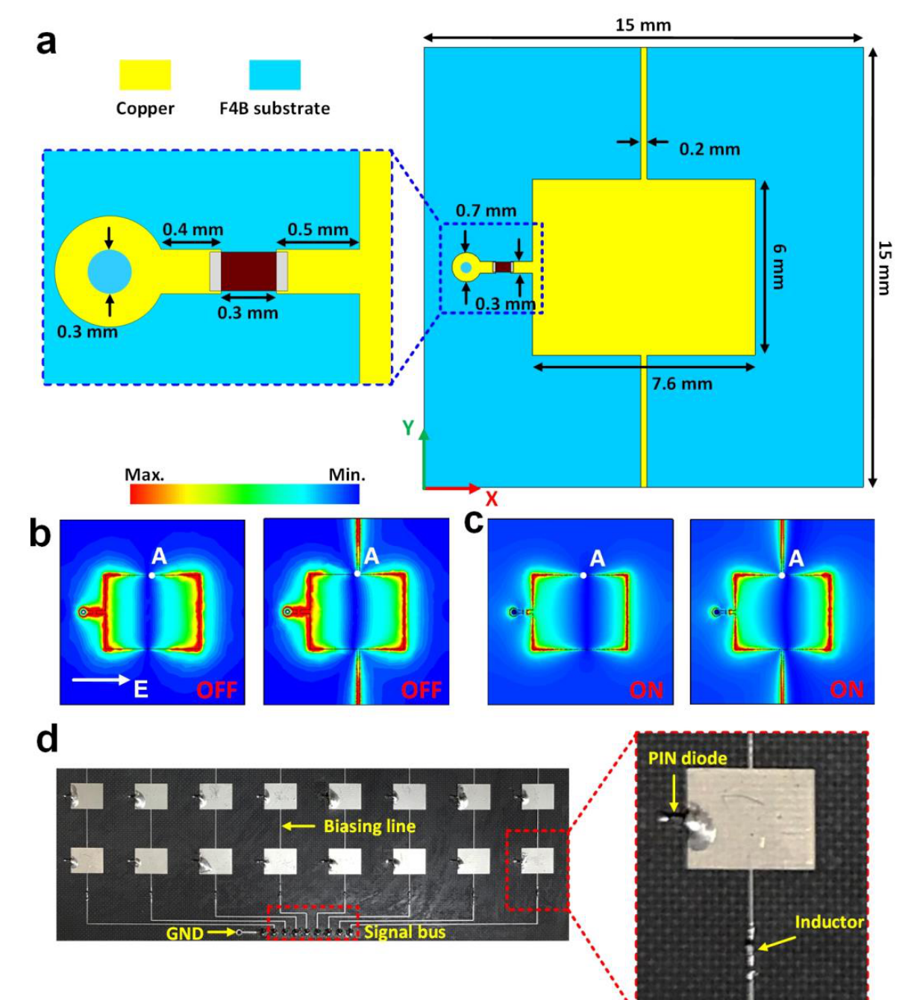

**Original caption:** Supplementary Figure 9. a, Top view of the 1-bit coding element with detailed geometrical parameters. b,c, Electric-field distributions of the coding element with the PIN diode 'OFF' and 'ON', respectively. d, Magnified view of the fabricated prototype in Figure 6b.

**中文图注:** 补充图 9。a 含详细几何参数的 1 比特编码单元俯视图。b、c 分别为 PIN 二极管处于“OFF”与“ON”状态时编码单元的电场分布。d 图 6b 中加工样机的放大视图。

**Reading note:** 这张图要回答的是“加了偏置线会不会破坏单元性能”。a 给出全部几何参数；b、c 对比无偏置线与有偏置线（在 A 点接入）时的电场分布，可见 A 点处电场很弱，故偏置线的引入不改变贴片在 “ON/OFF” 两态下的场分布；d 则显示偏置线上串联了 2 nH 电感作为射频扼流。

**Original:** The detailed parameters of the coding element considered in our fabricated prototype are shown in Supplementary Figure 9a. The corresponding electric-field distributions (at the operational frequency of 10 GHz) with and without biasing lines are shown in Supplementary Figures 9b and 9c. When the biasing line is added at point A, it does not affect the field distribution of the rectangular patch at both "ON" and "OFF" states, because the electric field at point A is very weak. Therefore, the introduction of the biasing line does not sensibly affect the performance of the space-time-coding metasurface. Moreover, inductors with inductance of 2nH are also introduced in the biasing lines to provide an RF choke, as illustrated in Supplementary Figure 9d.

**中文:** 我们加工样机中所用编码单元的详细参数见补充图 9a；在工作频率 10 GHz 处、有偏置线与无偏置线的对应电场分布分别见补充图 9b、9c。当在 A 点接入偏置线时，由于 A 点处电场非常弱，它不会影响矩形贴片在“ON”与“OFF”两种状态下的场分布。因此，偏置线的引入不会明显影响时空编码超表面的性能。此外，偏置线中还引入了电感值为 2 nH 的电感以提供射频扼流，如补充图 9d 所示。

**Original:** Finally, Supplementary Table 1 quantitatively illustrates the comparison between theoretically calculated and measured beam-steering angles at different harmonic frequencies, from which a generally good agreement is observed.

**中文:** 最后，补充表 1 定量给出了不同谐波频率处理论计算与实测波束指向角的对比，可以看到二者总体吻合良好。

#### 表 S1 理论计算与实测结果的对比

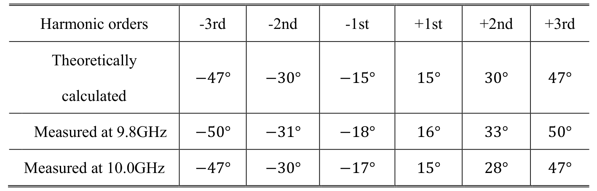

**Original caption:** Supplementary Table 1. The comparison of theoretical and measured results.

**中文图注:** 补充表 1：理论计算与实测结果的对比。

| 谐波阶数 | −3rd | −2nd | −1st | +1st | +2nd | +3rd |
|---|---|---|---|---|---|---|
| 理论计算 | −47° | −30° | −15° | 15° | 30° | 47° |
| 9.8 GHz 实测 | −50° | −31° | −18° | 16° | 33° | 50° |
| 10.0 GHz 实测 | −47° | −30° | −17° | 15° | 28° | 47° |

**Reading note:** 这是全文最直接的“理论—实验”对齐证据。10.0 GHz 下的实测值与理论几乎逐项吻合（±3° 以内），9.8 GHz 下的偏差略大（最大约 3°–5°），与正文“10.0 GHz 反而略差”的表述方向相反——说明两组数据的偏差量级相当，都主要来自转台标定与加工公差。

### A.10 补充参考文献（Supplementary References）

**Original:** 1. Zhang, Q. et al. Shaping electromagnetic waves using software-automatically-designed metasurfaces. Sci. Rep. 7, 3588 (2017). 2. Nezamabadi-Pour, H., Rostami-Shahrbabaki, M. & Maghfoori-Farsangi, M. Binary particle swarm optimization: challenges and new solutions. CSI J. Comput. Sci. Eng. 6, 21-32 (2008).

**中文:** 1. Zhang, Q. 等，利用软件自动设计的超表面整形电磁波，Sci. Rep. 7, 3588 (2017)。2. Nezamabadi-Pour, H., Rostami-Shahrbabaki, M. & Maghfoori-Farsangi, M.，二进制粒子群优化：挑战与新解，CSI J. Comput. Sci. Eng. 6, 21–32 (2008)。

## 阅读提示 / Critical Reading Notes

### 论文解决的问题与核心主张

本文解决的是“数字编码超表面只能空间编码、时间维度未被利用”这一问题。核心主张可以概括为三点：

- (1) 把每个编码单元的反射系数视为周期性时间调制的复函数，用傅里叶级数把“时间编码序列”映射为各次谐波处的**等效幅度与等效相位**，从而在同一个物理口径上同时控制空间（传播方向）与频谱（谐波功率分布）；
- (2) 1 比特物理单元经恰当的时间编码后可以等效出接近 360° 的相位覆盖，即用“时间”换取“相位比特”，从而用低比特硬件合成多比特可编程超表面；
- (3) 该框架可同时用于谐波波束扫描、中心频率波束扫描与整形（含 OAM 涡旋波束），以及通过在空间域与频谱域同时摊平能量来实现 RCS 缩减。

### 证据链与结论边界

- 证据链由四层构成：解析理论（式 1–7 与补充式 1–3：由时延定理推出相邻单元相位差 ψm = mπ/4，进而 θm = arcsin(m/4)）→ 全波/数值仿真（图 2 的 AM 与 PM 对比、图 3 的 BPSO 优化、图 4 的等效 3 比特编码与涡旋波束、图 5 的四组 RCS 场景）→ 单元与样机表征（图 6f、6g 证明 10 GHz 附近两态相位差为 180°、幅度 > 0.95）→ 暗室实测（图 6h、6i 与补充表 1 的指向角对比）。
- 结论边界比较清晰：所有设计都建立在“互耦忽略”的物理光学近似与“调制速度远小于电磁波频率”的准静态假设之上；能量只在整数谐波频率 fc + mf₀ 处出现，谐波间隔由调制周期 T₀ 决定；实测验证是在 10 GHz 附近、单一 8 × 8 样机上完成的。

### 值得注意的局限与风险

- (1) 近似模型的适用性：互耦被忽略、用逐单元远场 Eₚq 叠加（并假设各向同性 Eₚq = 1），当单元间距变小或单元间耦合增强时误差会增大。
- (2) 时间编码与切换速度直接绑定：可获得的最大谐波阶数与调制频率 f₀、PIN 二极管切换速度（本文 5 MHz 量级）有关，更高阶谐波被 sinc 项迅速压小。
- (3) 功率均衡与效率的折中：PM 相比 AM 虽可提升十几分贝，但功率集中在中心频率；BPSO 优化可均衡各谐波，却也说明“均衡”不是免费的，需要全局搜索。
- (4) 时间编码序列的选取是全局组合优化问题：图 4b 中的 8 组序列需要专门的筛选准则（补充注记 7），随单元数与时间片长度增长会迅速变难。
- (5) 时域峰值风险：不同谐波在空间上重叠时可能叠加出超短高强度脉冲，补充注记 8 给出的两种缓解方案都带有额外代价（随机化会改变方向图、提高 f₀ 受器件限制）。
- (6) 实验层面的不确定性：10 GHz 附近的实测指向角偏差主要归因于加工公差与转台标定，且中心频率方向图因馈源遮挡未能测量。

### 与领域的关系

- 本文是“数字编码超表面”走向“时空编码超表面”的关键一步：它把 Code/Programmable Metasurface 的离散相位描述与天线领域的时间调制阵列（time-modulated array）、相位切换屏（phase-switched screen）理论统一在同一个傅里叶级数框架下，并给出了 8 × 8 的 FPGA 样机验证。
- 与后续工作相比，本文建立的是“理论 + 原理样机”的基础层：它所定义的 aₚq^m、等效幅度/相位、时间梯度→空间相位梯度等概念，后来被广泛用于谐波波束赋形、频谱复用通信、非互易传输与时空超表面的信息调制研究。
- 与同一课题组的后续工作（如时间编码直接信息传输、空频复用超表面通信）相比，本文尚未涉及信息映射效率与信息论层面的优化，这一点正是后续文献的主要推进方向。

### 延伸阅读建议

可对照阅读：
- (1) 编码/数字/可编程超表面的原始论文（Light Sci. Appl. 2014，Cui 等），理解“0/1 编码单元”的出发点；
- (2) 时空梯度超表面与时间反演对称性破缺（Phys. Rev. B 2015，Hadad 等；Opt. Mater. Express 2015，Shaltout 等），理解本文所回应的时间调制背景；
- (3) 时间调制阵列与相位切换屏（文献 34、35），理解谐波控制的经典理论；
- (4) 本文后续的“空间-时间编码数字超表面：原理与应用”（2021，Zhang & Cui），获取更完整的综述与工程视角；
- (5) 若关注由此发展出的通信方向，可延伸阅读直接数字消息传输与空频复用超表面通信等工作。
